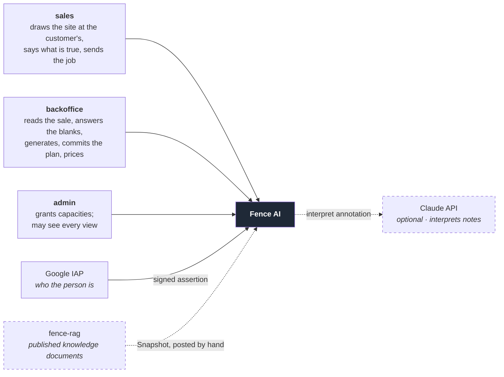
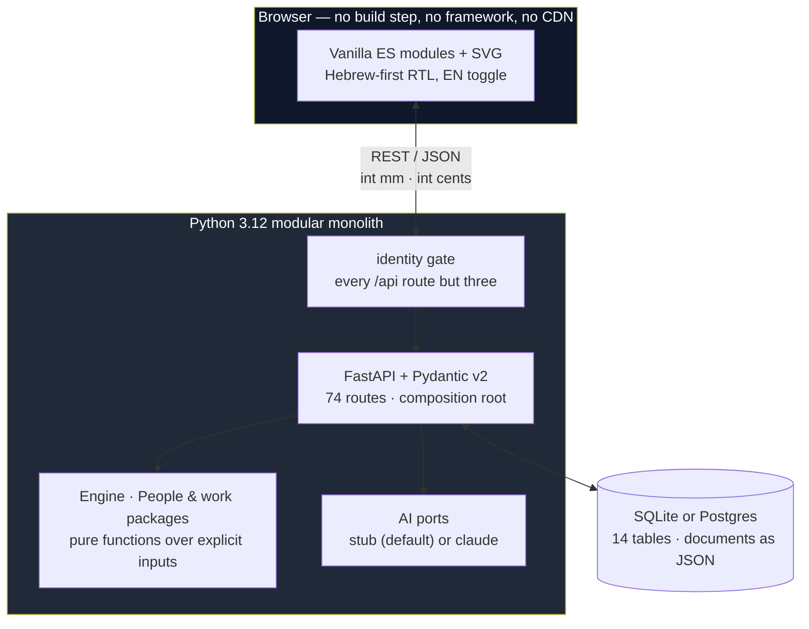
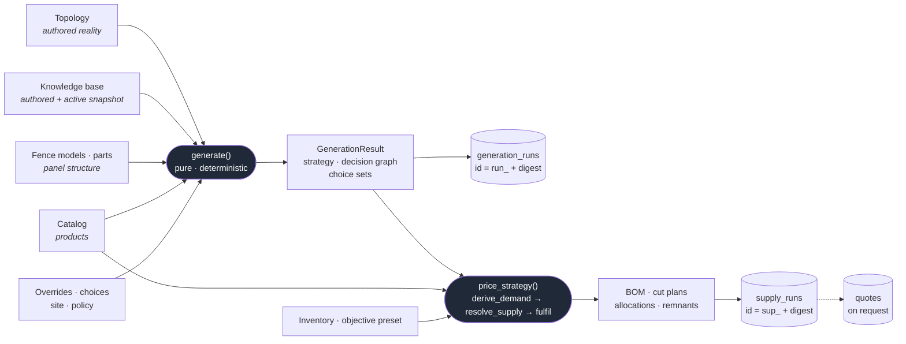
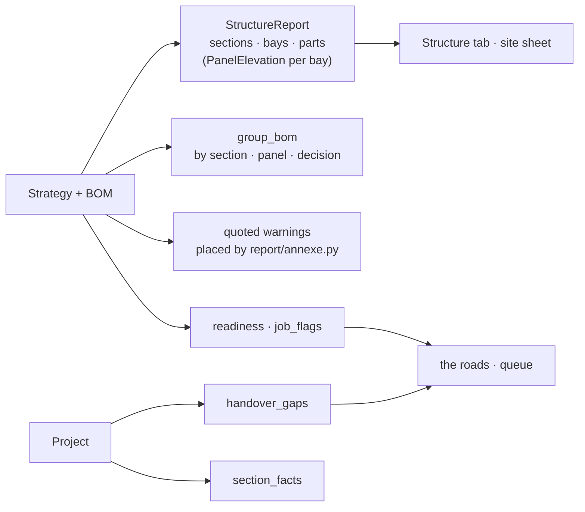

# 00 — Overview

Fence AI turns a **drawing of a site** into a **priced bill of materials**, and can
explain every number in it. Between those two ends sit a construction topology, a
typed knowledge base, a product-structure model, a deterministic generator, and a
persisted decision graph.

The unusual property is not the optimisation. It is that **the whole chain is
reproducible and explainable**: the same inputs always produce the same fence, and
every element, requirement and BOM line can be walked back to the rule and the fact
that caused it.

---

## Three planes

Everything in this repository belongs to one of three planes, and every document
here says which. The planes are a way of reading the system, not three deployables:
one process serves all of them, through one API and one store.

```mermaid
flowchart LR
    subgraph PEOPLE["PEOPLE & WORK<br/>who is asking · where the job is"]
        direction TB
        P1["identity · capacity · view"]
        P2["job lifecycle · desk commands"]
        P3["queue · roads · audit"]
    end
    subgraph ENGINE["ENGINE<br/>what the fence is · what it costs"]
        direction TB
        E1["topology · catalog · parts<br/>fence models · knowledge"]
        E2["generate() · decision graph"]
        E3["demand → supply → BOM · quotes<br/>read models"]
    end
    subgraph AI["AI & LEARNING<br/>what a model suggests · what experts teach"]
        direction TB
        A1["ports · stub · Claude adapter"]
        A2["interpretations · critique<br/>agent advice"]
        A3["corrections → candidates → review"]
    end

    PEOPLE -->|"drawing, site, choices · Generate<br/>commit_plan re-checks a run"| ENGINE
    ENGINE -->|"handover · readiness · flags"| PEOPLE
    PEOPLE -->|"verbatim notes · corrections"| AI
    AI -->|"proposals, inert until<br/>a person confirms"| PEOPLE
    ENGINE -->|"a run, read-only"| AI
```

| Plane | Answers | Packages | Deep-dive |
|---|---|---|---|
| **Engine** | What is this fence, why, and what does it cost? | `core` `topology` `catalog` `parts` `fencemodel` `knowledge` `decisions` `strategy` `demand` `fulfillment` `report` | [`knowledge-system.md`](knowledge-system.md) · [`decision-model.md`](decision-model.md) · [`material-optimization.md`](material-optimization.md) · [`published-part-inspection.md`](published-part-inspection.md) |
| **People & work** | Who is this, what may they do, and whose desk is the job on? | `identity` `project` `commands` | [`people-and-work.md`](people-and-work.md) |
| **AI & learning** | What does a model suggest, and how does an expert's correction become a rule? | `ai` `agent` `learning` | [`ai-layer.md`](ai-layer.md) |
| *shared edges* | How does any of it reach a person or a disk? | `api` `store` `web` | [`04-backend.md`](04-backend.md) · [`05-frontend.md`](05-frontend.md) |

**The one rule between them: AI output changes no engine computation until a
person confirms it.** An interpretation becomes a topology event only when somebody
confirms it; a proposed rule is stored beside the knowledge but evaluated only after
a reviewer approves it; the agent's advice and the critic's notes are shown and never
applied. Three qualifications keep the rule honest:

* **"A person" is any active account today** — no AI or learning route asks for a
  capacity ([`people-and-work.md`](people-and-work.md)).
* **A candidate is inert because of what the proposer wrote**, not because the route
  checked: `propose-knowledge` stores whatever the proposer returns, and the two
  guards in the evaluator read its `status` and `type`.
* **The learning loop does call the engine** — the impact preview regenerates and
  re-prices every project — but read-only, and it stores nothing.

The code side is held by tests: no engine package may import an AI port, adapter or
the agent (`tests/architecture/test_fitness.py`), and the command door refuses the
agent's one action kind to every capacity. [`01-domains.md`](01-domains.md) lists
every import that crosses a plane.

---

## Who uses it

Three capacities, held as a row per person; identity itself is Google's (ADR-0013).

A capacity is what the server checks; a **view** (`sales` · `backoffice` · `all`) is
only what the screen shows, derived from the capacity. The server asks for a
capacity at the command door and at user administration, and nowhere else yet —
[`people-and-work.md`](people-and-work.md) has the whole list.

The Claude link is dashed because it is **optional by construction**, and narrow:
only the annotation interpreter has a Claude adapter, chosen by `FENCEAI_AI=claude`.
The proposer, the critic and the agent run their deterministic stubs, which is also
what keeps the whole system working offline (ADR-0009). fence-rag is the other
team's knowledge platform; what crosses from it is a `Snapshot` document under the
frozen boundary contract, and nothing goes back.

---

## Containers

74 routes in production; 76 under `FENCEAI_IDENTITY=dev`, which adds the
impersonation switch (`POST`/`DELETE /api/dev/identity`). The database is chosen by
`FENCEAI_DB`'s URL scheme, with the same SQL translated by `store/dialect.py`
(ADR-0012). Deliberate absences, each with a reason in [`06-choices.md`](06-choices.md):
no build step, no framework, no CDN, no ORM, no message queue, no cache tier.

---

## The spine — the engine plane

Every stage is a **pure function over explicit inputs**. Persistence happens between
stages, in the route, never inside them.

**Two identities, two questions.** A `GenerationRun` is the DESIGN: its id is a
content hash over everything that decided the fence — the project, the whole
topology, the knowledge snapshot set, the overrides, the policy (less the objective
preset), the fence-model, part and catalog identities it drew on, the site facts,
any answered choices, and the planning and digest versions. Generating twice from the
same inputs writes nothing new. A `SupplyRun` is what that design costs from one yard
at one moment — run, inventory, catalog and preset — and is legitimately different
tomorrow. A `Quote` is a supply run somebody decided to stand behind (ADR-0011).

**A read refuses rather than recomputing silently.** Pricing re-runs on every read
against today's catalog and stock, and a moved catalog is a 409 (`catalog_changed`,
`catalog_schema_changed`). Views that lay a run over the drawing — the structure
sheet, section decisions, agent advice, `commit_plan` — also refuse a moved drawing
(`topology_changed`), and all but the advice a moved site (`site_conditions_changed`). The BOM itself does not:
it describes the run, not the drawing.

Read models hang off the side of the spine and are **derived, never stored**:

`StructureReport`'s governing property is **Σ(parts) ≡ BOM** — it inverts existing
pegs and is forbidden from recomputing a quantity. `handover_gaps` and
`section_facts` are derived from the project rather than a run, because they must
answer before anything is generated.

---

## A job, end to end

| # | Step | Who | Plane | Where it lives |
|---|---|---|---|---|
| 1 | Create the job, name the customer, draw the site — runs, corners, ground heights | sales | people → engine input | `project`, `topology`, `js/editor.js`, `js/job.js` |
| 2 | Say what is true of it — heights, gates, bases, the property, free-text notes | sales | engine input · AI input | `topology` events, `project` context and annotations |
| 3 | Choose what it is built from — a fence model, per project or per stretch | sales | engine input | `fencemodel`, `js/panel.js` |
| 4 | Send it to the office (`submit_job`) | sales | people | `commands/desk.py`, `js/my-jobs.js` |
| 5 | Take it, read the sale, answer the blanks — or send it back with a question | backoffice | people | `js/queue.js`, `js/desk-actions.js`, `report/handover.py` |
| 6 | **Generate** — explicitly, never automatically | backoffice | engine | `strategy/generator.py` |
| 7 | Inspect why — click any element, read its decision trail; read the advice | backoffice | engine · AI | `decisions`, `js/inspector.js`, `js/agent-advice.js` |
| 8 | Commit the plan (`commit_plan`), then price it — BOM, cut plans, stock netting, a quote | backoffice | people · engine | `report`, `demand`, `fulfillment` |

Steps 2 and 7 feed the AI & learning plane: a note can be interpreted into a
proposed event, and a correction can become a knowledge **candidate**, inert until
reviewed — with a preview of *"this would affect N of your projects"* available
before anything is approved.

---

## What the system refuses to do

These are load-bearing and recur in every document here.

* **No AI inside deterministic computation.** AI interprets text, proposes rules,
  critiques results and ranks alternatives. It never selects a product, places a
  post, or changes anything without a person confirming it.
* **No number invented to fill a gap.** An undeclared post face draws as a flagged
  nominal; an unresolvable cut length is an error, not a plausible integer.
* **No silently ignored field.** A fence-model field the resolver does not honour is
  named by `validate_model` (`_unsupported_features` in `fencemodel/model.py`); a
  draft may be saved with it, and publishing or generating from it is refused.
* **No auto-generation.** Generation stays behind an explicit button.
