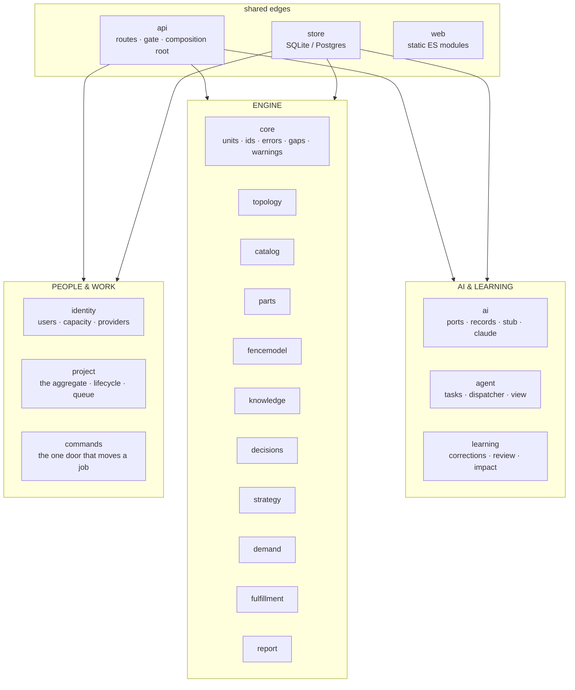
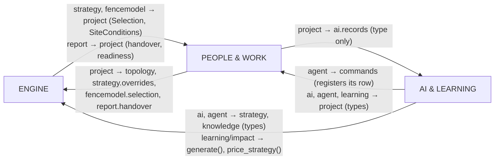
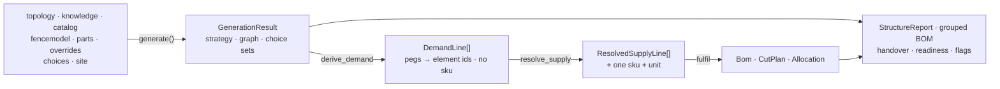

# 01 — Domains

Nineteen Python packages under `src/fenceai/` plus the static `web/` bundle, sorted
into the three planes of [`00-overview.md`](00-overview.md#three-planes) and a set
of shared edges. The grouping is conceptual; the **dependency rules below are
mechanical**, and the ones a test enforces are the ones to preserve.

---

## Packages by plane

| Plane | Package | Owns | Never |
|---|---|---|---|
| **Engine** | `core` | Integer millimetres and cents, the **two** named tolerances, ids, the refusal types (`ReadRefused`, `RequestRefused`, `GenerationFailure`), `Gap`, `DocumentWarning` | Knows nothing about fences |
| | `topology` | Nodes, runs, gate spans, station events (gates, bases, heights, top lines, tilt, obstacles), proportional re-anchoring | Mutated by generation |
| | `catalog` | Products as **consumption behaviour**, not SKU rows: indivisible, divisible-linear, packaged, coverage-based, assembly kits. Flat and per-metre pricing | Decides what a fence needs |
| | `fencemodel` | Panel **structure** — frame slots, infill patterns, fixings, option axes, variants, joints, the `Eligibility` a resolved slot freezes. Immutable versions, `validate_model`, the 1-D pattern fit, panel previews | Owns numbers that can conflict (max span, rail count) — those are knowledge; authors eligibility directly — that is `parts` now, except the two slots a `SpecField` cannot express (`docs/superpowers/specs/2026-08-18-part-library-design.md` §5) |
| | `parts` | What a piece **is**, named once and shared: a `Part`'s declared spec (`SpecField`, compiled to the owned AST), a `PartType` filing vocabulary, resolving a slot's `part_id` to `latest_active` and freezing what a run drew on | Owns *where* a piece goes in a panel (placement, joint, engagement) — that stays `fencemodel` |
| | `knowledge` | Typed, versioned rules; a closed condition AST and an owned evaluator; authority → explicit override → specificity precedence; the published `Snapshot`, its expansion and source policy | Exists only in a prompt (ADR-0005) |
| | `decisions` | The append-only graph, acyclic by ordinal; read-time supply nodes; per-language explanation templates | Reconstructed after the fact — it is built *during* generation |
| | `strategy` | `generate()`: post placement, closed-form span layout, vertical mode, heights, safety checks, warnings, choice sets. Overrides as first-class patches | Impure or non-deterministic (ADR-0004) |
| | `demand` | `DemandLine`s pegged to the strategy elements that caused them — no SKU, no unit | Knows about purchasing, stock or price |
| | `fulfillment` | The declared pipeline: supply resolution to one SKU + unit, FFD cut planning with kerf and remnants, package rounding, coverage, kits, inventory netting; `SupplyRun` and immutable `Quote` | Recomputes structure |
| | `report` | Read models **derived, never stored**: structure sheet, elevations, grouped BOM, section facts and decisions, quoted-warning placement — and the people plane's handover, readiness and flags | Recomputes a quantity; it inverts pegs |
| **People & work** | `identity` | `User`, `Capacity`, `default_view`, the last-admin rule, the `IdentityProvider` port with `iap` and `dev` adapters, subject binding. Imports nothing outside itself | Holds a password or a session |
| | `project` | The `Project` aggregate (engine inputs, job fields, verbatim notes), the job lifecycle, the queue and my-jobs read models, `confirm_intent`, `SiteConditions` | Interprets text itself — that is `ai` |
| | `commands` | One typed, capacity-checked row per change that moves a job; `perform` asks capacity → performable → state → payload → precondition | Field edits — typing an address is not a command |
| **AI & learning** | `ai` | Four ports, the record types a project stores (`ai/records.py`), the stub and Claude adapters | Called from inside a computation |
| | `agent` | One task (`RANK_CHOICE_SET`), the dispatcher's three checks, the read-only `AgentView`, its action row in the command table | Reaches the store or the generator |
| | `learning` | `Correction`, the review rules, the portfolio impact preview (shared with the engine's model and rule previews) | Activates a rule without a review |
| *shared* | `api` | 74 routes (76 under `dev`), the identity gate, the composition root — the only place that wires everything | Holds domain logic |
| | `store` | Fourteen tables, documents as JSON, one serialized connection, two SQL dialects | Holds domain logic |
| | `web` | Static ES modules and SVG. Server JSON in, pixels out | Decides anything the server would refuse |

---

## The rules, and which are enforced

`tests/architecture/test_fitness.py` treats every package except `api`, `store`,
`web`, `agent` and `ai` as **domain** — fifteen of them, across all three planes. It runs only in the full suite
(`uv run pytest -q`), not in the scenario gate.

| Rule | Plane it protects | Test |
|---|---|---|
| The domain imports neither `api` nor `web` | all | `test_the_domain_does_not_import_the_delivery_mechanism` |
| No domain module imports the store — persistence is the caller's business | all | `test_no_domain_module_imports_the_store` |
| The domain may name `ai.records` and nothing else in `ai` | engine ⟂ AI | `test_no_ai_inside_deterministic_computation`, `test_only_the_api_layer_imports_the_agent` |
| No domain package imports `agent` (`api` and `ai` do); `ai.records` may not import it either | engine ⟂ AI | `test_only_the_api_layer_imports_the_agent` |
| `agent` never imports `api`, `store` or `strategy.generator` | engine ⟂ AI | `test_the_agent_never_reaches_the_store_or_the_generator` |
| `report` never imports `api`, `store` or `ai` | engine | `test_a_read_model_never_reaches_for_the_things_that_decide` |
| Every AI port has a conforming stub | AI | `test_every_ai_port_has_a_stub` |
| Every `/api` route carries the identity gate; the exempt list is exactly three paths | people | `test_every_api_route_actually_carries_the_gate` and three siblings |
| Only the store writes an audit row privately | people | `test_nothing_outside_the_store_writes_an_audit_row_privately` |

**What is NOT enforced: a one-way layering inside the domain.** At file level the
module-level import graph is acyclic — counting the imports deferred into function
bodies, two cycles appear, both held apart by hand (below). At package level it is
not: 14 of the 19 packages
(`agent`, `ai`, `commands`, `decisions`, `demand`, `fencemodel`, `fulfillment`,
`knowledge`, `learning`, `parts`, `project`, `report`, `strategy`, `topology`) form
one strongly connected component. A smallest set of package edges whose removal
would break every cycle has eleven — the set is not unique; this is one of them, and
all of its edges are narrow:

| Edge | Import | Why it exists |
|---|---|---|
| `parts → fencemodel` | `parts/resolve.py`, `parts/validate.py` | resolving a part reference walks the panel document that names it |
| `parts → strategy` | `parts/resolve.py` → `PartUse` | reference data reaching into generation for a type |
| `fencemodel → strategy · fulfillment · report` | `fencemodel/preview.py` (and `vocabulary.py` → `fulfillment.presets`) | the panel preview prices and draws, so it calls the pipeline and the read models; the editor's vocabulary lists the objective presets |
| `fencemodel → project` | `fencemodel/model.py`, `preview.py` → `project.site` | `SiteConditions` lives in `project` |
| `strategy → project` | `strategy/generator.py` → `project.model` | `Selection` and `SiteConditions` live in `project` |
| `knowledge → strategy` | `knowledge/parameters.py` → `strategy.choices` | published paired tables land as choice points |
| `decisions → fulfillment` | `decisions/supply.py` → `fulfillment.supply` | read-time supply nodes |
| `project → report` | `project/queue.py` → `report.handover` | the queue counts open questions per row |
| `project → ai` | `project/model.py` → `ai.records` | an annotation stores its interpretations |

`parts` ↔ `fencemodel` is the main cycle held apart by hand (it runs
`fencemodel.model ⇢ parts.resolve → strategy.model → fencemodel.resolve →
fencemodel.model`; a second, inside `fencemodel`, runs through the deferred import in
`lengths.py`): `fencemodel/model.py` imports `parts.model` at module level, takes
`PartLibrary` only under `TYPE_CHECKING`, and defers every import of
`parts.resolve` / `parts.validate` into function bodies. **That deferral is
load-bearing** — do not "tidy" it without breaking the cycle some other way.

---

## Where the planes touch

Every import that crosses a plane, by direction. Edges into `core` are omitted.

**There is no arrow from the engine into the AI plane.** The fitness tests keep the
AI ports, the adapters and the agent out of the engine; they do not yet stop an
engine package importing `learning`, which is itself classed as domain, and they
allow `ai.records` by design. The engine's arrows into people & work are the ones worth knowing, because each
is a type that lives in the wrong package rather than a dependency anyone wanted:

* `SiteConditions` (`project/site.py`) and `Selection` (`project/model.py`) are
  `generate()` inputs — the `site.*` namespace, the answered choice sets — that sit
  in `project` because the project stores them. (`Override` is the healthy
  counter-example: `strategy/overrides.py` defines it and `project` imports it.)
* `report/handover.py`, `report/readiness.py` and `report/flags.py` answer the
  people plane's questions but live with the other read models because they are pure
  functions. `handover` and `readiness` import `project.model`; `project/queue.py`
  imports `report.handover` back.

Neither is a correctness defect: every one of these is inert data or a pure function,
and the only `project` behaviour `generate()` calls is the pure
`SiteConditions.facts()`. Moving the two input types to the engine and the three job read models to the people plane would leave the engine
importing nothing from either other plane — recorded here as the seam, not as work
in flight.

---

## The contracts that cross boundaries

These are the interfaces worth knowing; everything else is internal.

**The demand line is the narrowest waist in the system.** Demand emits *what the
fence needs* with no SKU and no unit; `resolve_supply` writes both in one statement
from the product it chose, into a different type (`ResolvedSupplyLine`), because the
parts ledger balances per `(sku, unit)` and a guessed unit made the same item read as
unassigned **and** from-stock at once. A line nothing can supply stays a
`DemandLine` and is reported as `unresolved`.

Across planes, the contracts are smaller still: a person reaches the engine through
ordinary writes and `commit_plan`; the engine answers the people plane only through
read models. AI output changes engine state through `confirm_intent` (a people-plane
function in `project/intents.py`) and `apply_review`, both on a person's request; it
also lands as `proposed` rows in `knowledge_versions`, which nothing evaluates; and
the impact preview calls `generate()` and `price_strategy()` read-only.

---

## Where a new concept goes

| If it is… | It belongs in… | Plane |
|---|---|---|
| something a human draws about the fence | `topology` | engine |
| a fact about the site that changes what is built | `project/site.py` today (see the seam above) | engine input |
| a fact about a product you buy | `catalog` | engine |
| what a piece IS, named once and shared across models | `parts` | engine |
| the structure of a panel — where a piece goes | `fencemodel` | engine |
| a number that two rules could disagree about | `knowledge` | engine |
| a consequence of geometry | `strategy` | engine |
| a way of buying or cutting | `fulfillment` | engine |
| a way of presenting what already exists | `report` | engine |
| who somebody is, or what their account may do | `identity` | people |
| a field about the job that changes no quantity | `project` (job fields, never `Topology`) | people |
| a change that moves a job between desks | a row in `commands` | people |
| something a model reads or suggests | a port in `ai`, a task in `agent` | AI |
| how a human correction turns into a rule | `learning` | AI |

If a concept seems to need two of these, it is usually two concepts. The rail
**count** is knowledge; where the rails **sit** is the model; what a rail **is** is
the part it names — a slot that once authored its own inline requirement now names a
shared `Part`, and fixing that part once reaches every model that names it. Not
always a full collapse: `RAIL-3000` at a declared 40 mm face and `RAIL-3000` with no
declared face are still two different facts, so they stayed two parts rather than
being merged into one that would have quietly asserted a number a slot never stated.
