# 02 — Entities

UML class diagrams per plane, drawn from the models: Pydantic models almost
everywhere, and a handful of dataclasses where a row is code rather than a
document (`CommandSpec`, `ActionSpec`, `TaskSpec`, `FitResult`, the evaluator's
`Firing` / `Conflict` / `Resolution`, the pricing pipeline's `PipelineState` /
`Phase`). Each section names the file(s) it was drawn from — check one in a single
command before trusting a diagram:

```bash
uv run python -c "from fenceai.strategy.model import GenerationRun; print(list(GenerationRun.model_fields))"
```

Conventions: `Mm` is integer millimetres, `Cents` integer cents (ADR-0002). `X?` is
`X | None`. A discriminated union is drawn as inheritance from an abstract base; the
discriminator is a `kind` literal, except the condition AST (`Expr`), which
discriminates on `op`. `Literal` in a box is a closed set of strings, spelled out in
the prose beside the diagram. Properties are drawn as fields, methods with `()`.
Every box is complete unless it says *abridged*.

The three planes — **Engine**, **People & work**, **AI & learning** — are defined in
[`00-overview.md`](00-overview.md). Part I draws the engine, Part II people and
work, Part III AI and learning; the section before them is the one document all
three write.

**What is stored.** Every table holds a whole document as JSON in a `doc` column
(`store/db.py: _SCHEMA`). Anything not named here is derived and persisted nowhere.

| Table | Document | Keyed by |
|---|---|---|
| `projects` | `Project` | `id` |
| `knowledge_versions` | `KnowledgeVersion` | `(object_id, version)`, plus a `status` column |
| `fence_models` | `FenceModel` | `(model_id, version)`, plus `status` |
| `parts` | `parts.model.Part` | `(part_id, version)`, plus `status` |
| `generation_runs` | the whole `GenerationResult` | `id`, plus `project_id`, `created_at` |
| `supply_runs` | `SupplyRun` | `id`, plus `design_id`, `created_at` |
| `quotes` | `Quote` | `id`, plus `project_id`, `status`, `created_at` |
| `corrections` | `Correction` | `id`, plus `project_id` |
| `inventories` | `Inventory` | `project_id` |
| `catalogs` | `Catalog` | the single row `default` |
| `knowledge_snapshots` | `Snapshot` | `snapshot_id`, plus `loaded_at` |
| `active_snapshot` | — | one row (`only_row = 1`) naming a `snapshot_id` |
| `users` | `User` | `id`; `email` is UNIQUE |
| `audit_log` | no document: columns `seq, at, actor, action, ref` | `seq` |

---

## Where the planes meet — the Project aggregate

`src/fenceai/project/model.py`

The fields are drawn grouped by plane — the Project's own identity, the engine's
inputs, the shared note list, then the job — not in declaration order. Each type the
project holds carries the stereotype of the plane that owns it.

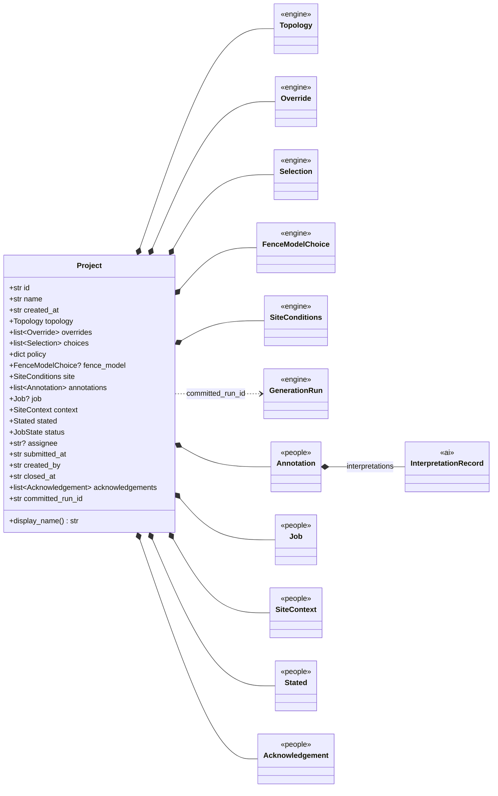

| Field | Plane | Why it is there |
|---|---|---|
| `id`, `name`, `created_at` | people | the job's identity; `display_name()` shows `job.label()` once a job is set, so no surface has to ask |
| `topology` | engine input | what `generate()` consumes; hashed whole into the run id |
| `overrides` | engine input | patches to the generated layout, anchored to the drawing; hashed |
| `choices` | engine input | answers to choice sets — an *input* to generation anchored to a scope, which is why they sit beside `overrides` rather than among them; hashed as `choice_digest` when non-empty |
| `policy` | engine input | design parameters such as `default_height_mm`, plus `objective_preset`, which is a supply choice and is stripped before hashing |
| `fence_model` | engine input | the model a stretch is built to unless a `fence_model` interval event says otherwise; `None` keeps the M-LEGACY path |
| `site` | engine input | whole-site facts, the `site.*` evaluation namespace; its facts are hashed, its `revision` is bookkeeping |
| `annotations` | people, with an AI field | the verbatim notes are the salesperson's; `interpretations` on each is the AI plane's |
| `job`, `context`, `stated` | people | who bought the fence, what else is on the property, what the job does *not* have |
| `status`, `assignee`, `submitted_at`, `created_by`, `closed_at` | people | where the job is and whose desk it is on (`project/lifecycle.py`) |
| `acknowledgements` | people | what somebody said they read, anchored to what they read |
| `committed_run_id` | people, naming an engine record | which `GenerationRun` is the real one |

**The Project document is the one place all three planes write fields of one
document.** Elsewhere a plane writes whole rows into another's table — the proposer
inserts `proposed` `KnowledgeVersion`s into the engine's `knowledge_versions` — or
moves a status on another's document, as accepting a `Quote` does. Here the salesperson's
drawing, the office's job state and an interpreter's proposals are separate fields of
one JSON document, saved whole by `Store.save_project`.

**Topology, site, overrides and choices are engine inputs.** `generate()` takes them
as arguments — never the project — and the run id hashes the whole topology, the
overrides, the policy less its objective preset, the site facts and any answered
choices (see *Strategy and decisions*). `SiteConditions` and `Selection` live in
`project/` because they are facts about this job, but they are generation inputs and
are drawn under Part I.

**Job fields never touch `Topology`, so moving a job never stales a run.** `job`,
`context`, `stated`, `status`, `assignee` and the timestamps are on the project, not
in the drawing, and the comments on them make one argument: a change to any of them
changes no quantity, so it must not bump `topology.revision` and 409 every derived
view. `committed_run_id` is deliberately not a digest input either — "or committing a
plan would change the id of the run it commits".

**`Annotation` is shared.** People own the note: `id`, `target_ref`, `text`,
`author`, `created_at` — the text drives the handover, `sale_anchor` and
`is_office_note`. The AI plane owns `interpretations`, the `InterpretationRecord`s
proposed over that text. `generate()` never reads annotations; a proposal reaches the
drawing only through `confirm_intent` (Part III).

### References that cross a plane

| From | To | Through | Where |
|---|---|---|---|
| `Project` (people) | `GenerationRun` (engine) | `committed_run_id`, written by `commit_plan` after re-checking drawing, site and catalog | `project/model.py: Project`, `commands/desk.py: CommitPlan` |
| `GenerationRun` (engine) | `Project` (people) | `project_id`, bound as a scope dimension and hashed | `strategy/model.py: GenerationRun`, `strategy/generator.py: bind_scope` |
| `Quote`, `SupplyRun` (engine) | `Project`, `GenerationRun` | `Quote.project_id / run_id / supply_id`; `SupplyRun.design_id` | `fulfillment/quote.py`, `fulfillment/supply_run.py` |
| `Inventory` (engine) | `Project` | the `inventories` table is keyed by `project_id` | `store/db.py: save_inventory` |
| `Acknowledgement` (people) | `GenerationRun` | `anchor` is a run id for `warnings_reviewed` | `commands/desk.py: AcknowledgeWarnings` |
| `readiness`, `job_flags` (people) | run, strategy, choice sets, supply, quotes | arguments the caller already holds | `report/readiness.py: readiness`, `report/flags.py: job_flags` |
| an actor string | engine records | `KnowledgeVersion.attributed_to` and `audit_log.actor` from the session; `Override.author` and `Selection.author` as the client sent them | `strategy/overrides.py`, `project/model.py`, `knowledge/model.py`, `store/db.py: _audit` |
| `Annotation` (people) | `InterpretationRecord` (AI) | `interpretations`; `annotation_id` points back | `project/model.py: Annotation`, `ai/records.py` |
| `CandidateIntent` (AI) | topology event or `Override` (engine) | `confirm_intent` writes `IntervalEvent(source = record id)` or a `PinPost` override | `project/intents.py: confirm_intent` |
| `Correction` (AI) | `GenerationRun`, a `DecisionNode`, an element | `generation_run_id`, `decision_ref`, `element_ref` | `learning/model.py: Correction` |
| `KnowledgeProposer` (AI) | `KnowledgeVersion` (engine) | a `type="candidate"`, `status="proposed"` version whose `derived_from` names correction ids and `run#decision` | `ai/stub.py: StubProposer` |
| `ReviewAction` (AI) | `KnowledgeVersion` | `apply_review` retires the candidate and mints `v+1` | `learning/review.py: apply_review` |
| `Proposal` (AI) | `GenerationRun` | `saw: ViewDigest(run_id, topology_revision, knowledge_hash)` | `agent/view.py: AgentView.digest` |
| `ActionSpec` (AI) | `CommandSpec` (people) | a subclass, registered into the desk's one command table | `agent/registry.py` |

Engine packages import from `project/` in three places, which is why those types are
drawn as engine inputs: `fencemodel/model.py` and `fencemodel/preview.py` import
`project.site`, and `strategy/generator.py` imports `Selection` and `SiteConditions`
from `project.model`. `report/handover.py` and `report/readiness.py` import
`project.model` too, but they are the people plane's read models that happen to live
in `report/`. [`01-domains.md`](01-domains.md) lists every import that crosses a
plane.

---

# Part I — Engine

## Topology — authored reality

`src/fenceai/topology/model.py`, `topology/station.py`

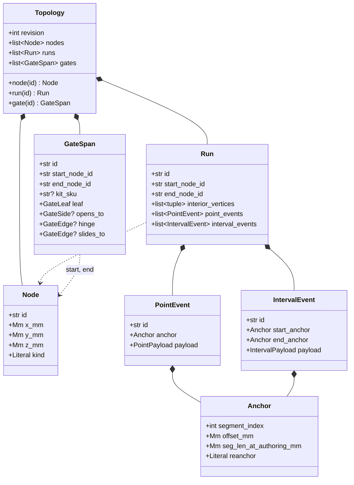

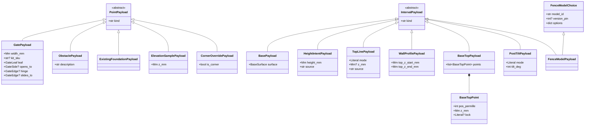

**Point payloads:** `gate`, `obstacle`, `existing_foundation`, `elevation_sample`,
`corner_override`. **Interval payloads:** `base`, `height_intent`, `top_line`,
`wall_profile`, `base_top`, `post_tilt`, `fence_model`. `FenceModelPayload` *is* a
`FenceModelChoice` with a `kind`, so a stretch says which model it is built to in the
same words a project does.

| Field | Values |
|---|---|
| `Node.kind` | `terminal` (default) · `junction` |
| `Anchor.reanchor` | `proportional` (default) · `rigid` |
| `GateLeaf` | `single` (default) · `double` · `sliding` |
| `GateSide` (`opens_to`) | `left` · `right`, relative to the run's (or the gate span's) own direction |
| `GateEdge` (`hinge`, `slides_to`) | `start` · `end` |
| `BaseSurface` | `soil` · `concrete` · `masonry_wall` |
| `TopLinePayload.mode` | `follow` · `level` · `stepped` |
| `PostTiltPayload.mode` | `plumb` (default) · `perpendicular` · `custom`; `tilt_deg` is −45…45 |
| `BaseTopPoint.lock` | `level` · `step` · `None` (free) |
| `HeightIntentPayload.source`, `TopLinePayload.source` | `"user"`, or the id of the interpretation record that materialised it |

**Why anchors and not stations.** A station is derived. An event stores
`(segment_index, offset_mm, seg_len_at_authoring_mm)` so it follows its originating
segment when the geometry is edited — drag a vertex and the gate stays where the
user meant it (ADR-0003). How it follows is the anchor's own `reanchor` policy:
`proportional`, the default and ADR-0003's rule, rescales the offset with the
segment, so an elevation sample a third of the way along a wall stays a third of the
way along; `rigid` keeps the offset a person measured and clamps it to the
segment's length if the segment shrank. `topology/station.py: anchor_station` is
**the only anchor resolver** — overrides resolve through it too
(`strategy/overrides.py: override_station` is a thin wrapper), because a second
resolver once drew the same pinned post 800 mm apart in the canvas and the
generator. Frontend and backend implement the same two functions: `anchorFor` /
`make_anchor` and `stationOfAnchor` / `anchor_station`. Reading `anchor.offset_mm`
as a station is a bug in both languages.

**Duplicate ids are refused at the model boundary**, so a bad PUT is a 422 rather
than geometry that silently merges two objects downstream. `Topology._integrity`
refuses duplicate node, run, event and gate ids; a gate id equal to a run id (both
become elements downstream, so they are checked together); a run or a gate naming a
node that does not exist; and a gate whose two ends are the same node.

**A gate is either a hole in a run or an element of its own.** A `GatePayload` is a
point event that punches an opening into a run. A `GateSpan` stands *beside* the
runs, joining two nodes — the way a salesperson actually places a gate between two
stretches drawn unconnected. **A `GateSpan` has no `width_mm`, and its absence is
the point**: the opening is the distance between its nodes, read by
`topology/station.py: gate_opening_mm`, so dragging a node cannot leave a stored
width disagreeing with the drawing. Both carry the same four swing facts, validated
by one function (`check_swing_coherence`): a sliding gate has no `opens_to` or
`hinge`, a swing gate has no `slides_to`, a double gate has no `hinge`. `None`
everywhere means *nobody has said* and stays valid, because a swing drawn from a
default is a confident wrong drawing.

**Stationing is derived, never stored.** A run's stations are the cumulative plan
(chord) length over `[start_node, *interior_vertices, end_node]`. A vertex is a
structural **corner** when its turn angle exceeds `CORNER_ANGLE_DEG = 15.0`
(`topology/station.py:16`), which a `corner_override` point event can flip either way.
Segments are straight only — ADR-0003 reserves `segment_kind` for arcs.

**Ground is interpolated, the fence top-line is derived.** `ground_z(topo, run, s)`
is piecewise-linear over `ground_samples`: the two node elevations anchor the ends of
the run — a corner shared by two runs has one `z_mm`, so the ground is continuous
fence-wide by construction — plus the run's interior `elevation_sample` events. An
event within `NUMERIC_TOLERANCE_MM` of an end replaces that node's value. With no
events the ground is linear between the two node elevations. At a vertical step the
right-hand side wins. The top of the fence is never stored (ADR-0003) — it falls out
of the height intents, the top-line mode and the ground.

**`base_top` is the general top profile of a BUILT base** (a wall, a concrete plinth);
`wall_profile` is the two-point linear special case that predates it. Two consecutive
points at the same `pos_permille` are a vertical **step**, and the right-hand side wins
at the boundary.

`lock` is an **authoring** constraint on the segment that *starts* at its point:
`level` holds that segment at one absolute elevation, with `z_mm` compensating for the
ground underneath, and `step` holds it vertical. The editor re-imposes locks after
every edit, so *"make this stretch horizontal"* survives later dragging until the user
frees it. The generator and `base_top_at()` read the resulting **geometry** and never
the lock itself — the lock is how the shape was authored, not a fact about the built
base.

**A model change is a structural boundary.** The generator adds the stations where
the model changes along a run (`topology/station.py: fence_model_transition_stations`)
to the fixed set, so no bay ever straddles the place where the fence visibly changes
model.

---

## Catalog — products as consumption behaviour

`src/fenceai/catalog/model.py`

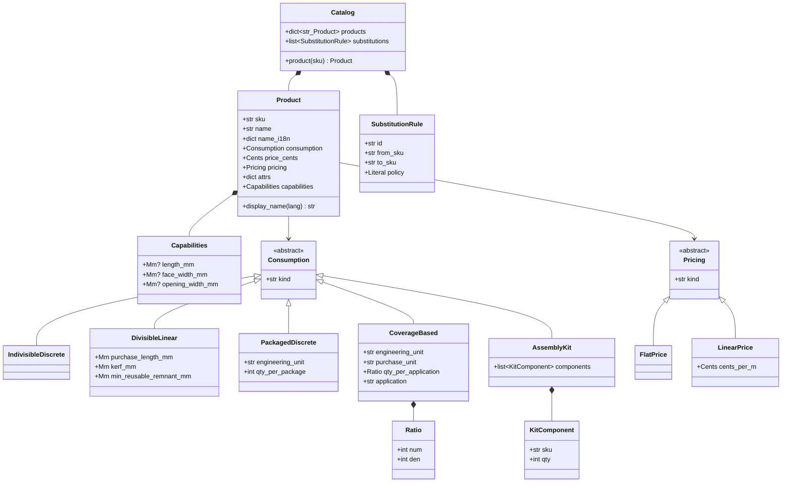

`attrs` is `dict[str, str | int | bool | list[int] | list[str]]`.
`SubstitutionRule.policy` is `auto` · `suggest_only` (default); the demo catalog
seeds one rule and nothing reads `substitutions` yet.

**A product is not a row, it is a behaviour.** The five consumption kinds are what
make the same pipeline buy a post, cut a bar, round up a box of screws, pour a
footing and explode a gate kit. `purchase_price_cents(product)` is the single read
and the one rounding point; a rate-priced product may not also carry a flat price,
because two fields that can each claim to be the price is a lie waiting to happen —
and a rate needs a purchase length, so `LinearPrice` is refused on anything that is
not `DivisibleLinear` (`Product._one_price`).

**Two places to put a product fact, and the split is the point.**
`Capabilities` is what **deterministic code** may read: `length_mm` (what
`_check_post_lengths` measures against), `face_width_mm` (the post's extent as seen,
which the clear opening is measured to) and `opening_width_mm` (the gate opening a
kit fits). Typed, optional, versioned. `attrs` is the open bag for everything read by
a *predicate* or a *person* — `material`, `finish`, `colour`, a routed post's hole
heights as a list.

The rule, in `catalog/model.py: Capabilities`: **a magic string key in Python is the
defect.** `attrs.get("length_mm")` compiles whether or not anything ever sets it, a
typo is a silent `None`, and by the time it matters the number is on a cut list. Data
read by code gets a field; data read by data stays in the bag, because an eligibility
predicate names the keys it reads and a company stocking a new kind of thing should
add a product and a rule, not a release.

One bag key is checked at load: **`attrs.colour` must be `#rrggbb`**
(`Product._colour_is_a_swatch`). It reaches the client as a CSS fill, where escaping
does nothing, so an arbitrary value would be a style the catalog author writes into
the page.

`None` on a capability means **not declared**, and each reader answers that in its own
honest way — the elevation draws a flagged nominal, `clear_opening_mm` narrows by
nothing, the length check measures against no stock. A gate event with no `kit_sku`
takes the kit whose `opening_width_mm` equals the opening; if no product declares a
fit the strategy says `no_gate_kit` rather than inventing a SKU. **A SKU is an opaque
id — never parse a dimension out of it**, or the system only works for one catalog's
naming convention.

`Capabilities` is deliberately a flat record and not a union of capability kinds:
three facts is not a taxonomy.

**The catalog's shape is stamped on every run.** `CATALOG_SCHEMA_VERSION`
(`"capabilities-v1"`) is written to `GenerationRun.catalog_schema_version`, and a read
of a run stamped under an older shape answers 409 `catalog_schema_changed` *before*
the content hash is compared — otherwise a schema change would be reported as
`catalog_changed`, and a reader would go looking for a price edit that never
happened. `catalog_hash(catalog, skus)` hashes only the products a run named
(`GenerationRun.catalog_skus`, kits expanded transitively), so one unrelated price
edit does not make every stored run refuse; an empty list means a run stamped before
the narrowing, compared against the whole-catalog hash.

---

## Fence model — panel structure

`src/fenceai/fencemodel/model.py`, `selection.py`, `resolve.py`, `fit.py`, `library.py`

The authored document:

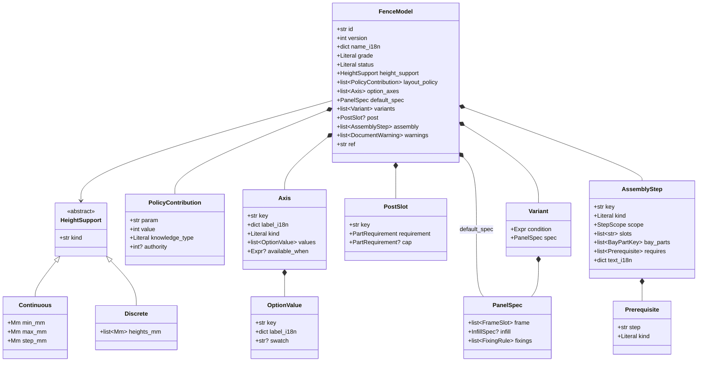

The panel a spec describes:

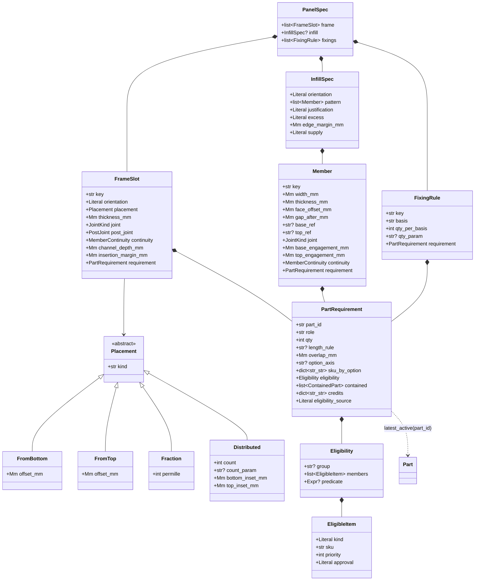

Resolution — the choice, the library, and what one bay is built to:

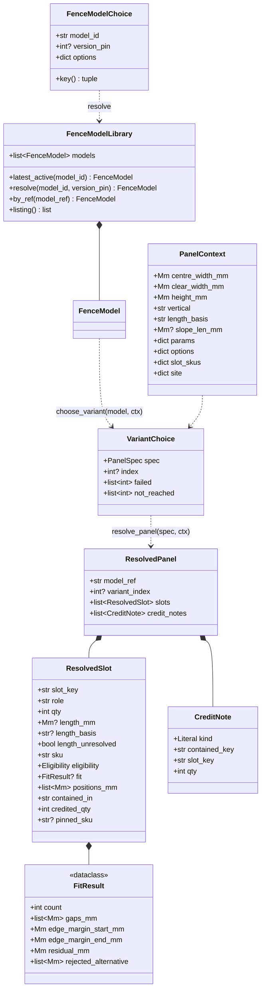

`ResolvedSlot` is **abridged**: it also carries the slot's geometry and joint facts
copied through for the read models (`slot_kind`, `orientation`, `member_width_mm`,
`thickness_mm`, `face_offset_mm`, `pattern_index`, `cycle_widths_mm`,
`cycle_gaps_mm`, `basis`, `qty_per_basis`, `joint`, `length_rule`, `continuity`,
`post_joint`, `channel_depth_mm`, `insertion_margin_mm`, `base_ref`, `top_ref`,
`base_engagement_mm`, `top_engagement_mm`, `option_axis`, `option_value`,
`span_start_mm`, `credits_slot_key`, `credited_by`). `FitResult.rejected_alternative`
may be `None`. A resolved panel is stored on
`Span.panel`, so it lives inside the run document. `ModelListing` (the library's
picker row) and the preview types in `fencemodel/preview.py` (`PreviewRequest`,
`PanelPreview`, `BayPreviewRequest`, …) are API read models, derived and never stored.

| Field | Values |
|---|---|
| `FenceModel.grade` | `residential` (default) · `commercial` · `industrial` |
| `FenceModel.status` | `draft` · `active` (default) · `retired` |
| `PolicyContribution.knowledge_type` | `hard_constraint` · `company_rule` · `fact` · `preference` |
| `Axis.kind` | `enum` · `numeric` |
| `FrameSlot.orientation`, `InfillSpec.orientation` | `horizontal` · `vertical` |
| `JointKind` | `butt` (default) · `channel` · `groove` · `bracket` · `overlap` |
| `PostJoint` | `unstated` (default) · `lands` · `through` |
| `MemberContinuity` | `derived` (default) · `continuous` · `per_bay` |
| `InfillSpec.justification` | `start` · `end` · `center` · `spread_to_fit` (default) |
| `InfillSpec.excess` | `truncate` · `space` (default) · `trim_last` · `extension_clip` |
| `InfillSpec.supply` | `components` (default) · `assembly` |
| `PartRequirement.length_rule` | a name registered in `fencemodel/lengths.py: LENGTH_RULES`, refused at parse if unknown |
| `FixingRule.basis` | a name registered in `fencemodel/bases.py: FIXING_BASES` |
| `EligibleItem.approval` | `auto` (default) · `suggest_only`; `kind` is the one-variant `catalog_item` |
| `AssemblyStep.kind` | `assembly` (default) · `installation` |
| `StepScope` | `panel` (default) · `bay` · `post` · `run` · `site` |
| `BayPartKey` | `post` · `cap` · `footing` |
| `Prerequisite.kind` | `after` (default) · `not_before` · `before` · `exclusive_with` |
| `CreditNote.kind` | `unmatched` · `surplus` |

**A step's order is a partial order, not its list position.** `AssemblyStep.requires`
holds EDGES with a kind — `after | not_before | before | exclusive_with` (contract
obligation 11) — and is empty where the document merely prints one step after another.
`after` and `before` are strict; `not_before` is a minimum, so two steps each
`not_before` the other are CONCURRENT rather than contradictory; `exclusive_with` is the
negative edge and constrains no order at all. `fencemodel/step_order.py` is the one
implementation: `validate_model` calls it to refuse a contradictory circle at authoring,
and `report/assembly.py` calls it for the sequence it returns — an authoring-time opinion
and a render-time opinion free to disagree is exactly what one function prevents.

Because a partial order has no single sequence, the read model publishes the SHAPE beside
the sequence — `AssemblyPlan.order` is a `StepOrder{basis, stages, unique, conflicts,
concurrent, exclusive}` — so a reader can tell "one valid order of several" from "the
only order" from "print order, which asserts nothing" (`basis = "authored"`).

**Two placeable vocabularies, two owners.** `slots` names this document's own panel
members. `bay_parts` (`post | cap | footing`) names what stands beside the panel — and
because which post stands at a station is the RUN's answer, the model names the KIND and
`report/assembly.py` is handed the instances. `AssemblyPlan.unplaced` stays the PANEL's
invariant exactly as contract obligation 9 defines it; `unplaced_bay` is the bay's, and is
asserted only once a model names a bay part at all.

**`scope`** is one of `panel | bay | post | run | site` (obligation 12). All five are
authorable; the panel sheet renders the first three and leaves `run` and `site`
present-and-unrendered until phase two.

**A choice is not a model.** `FenceModelChoice` is a reference plus option answers,
and lives in its own import-free module because `topology` and `project` both need to
say *"this stretch is built to that"* without depending on the resolver, the catalog
or the knowledge AST. `version_pin=None` follows the newest active version; an
integer freezes it **even after that version is retired**
(`FenceModelLibrary.resolve`), because a stored run must stay reproducible.

**A field the resolver does not honour is named, not ignored.**
`_unsupported_features(model)` is a set of per-feature checks — a non-`enum`
`Axis.kind`, `Axis.available_when`, a `layout_policy` param no model scope reaches,
`excess = trim_last | extension_clip`, `supply = assembly`, `bracket` and `overlap`
joints, `Eligibility.group`, among others — each returning an error ending
`not yet supported (phase 2)` (the `_UNSUPPORTED` suffix). It runs inside
`validate_model`, not at load: **a draft may be saved with errors**, which come back
beside the save, because a half-built panel is invalid by definition. Publishing
refuses it (422), and so does generating from it (`_validate_resolved_model` raises
a `GenerationFailure`), so an invalid draft never quietly becomes a fence. Removing
a check is how a wave turns a feature on, and the resolver change and the check's
removal are the same commit (the comment above `_UNSUPPORTED`).

**`PartRequirement.part_id` is unpinned, and `role`/`eligibility` are resolved, not
authored.** A slot stores `part_id`, never `part_id@version`; generation resolves
`latest_active` and the run stamps what it resolved (`GenerationRun.part_snapshot`,
below) — the same reason `FenceModelChoice.version_pin=None` follows the newest
version rather than freezing one. `role` and `eligibility` carry the same lifetime
`eligibility` already had before parts existed: `parts.resolve.resolve_model_parts`
fills `eligibility` from the part's spec (compiled to an `Expr` and matched against
the catalog, exactly as an authored `Eligibility.predicate` always was) and fills
`role` from the resolved part's `type` — a slot no longer states "rail" in its own
words, because a `part_id` naming a screw beside an authored `role` reading "rail"
would be two authorities over one word. `""` is what an unresolved document carries
for both. `contained` follows the same rule — what is in the box is the part's fact —
so naming a part *and* authoring any of `eligibility`, `role` or `contained` is
refused on the document (`PartRequirement._part_or_authored`). `credits` is the
exception, authored here and nowhere else: it says which slot a contained piece
supplies *in this panel*, and is a dict so one physical piece cannot be credited
against two slots. `eligibility_source` is derived, never stored. Two slots keep an
authored `Eligibility` and `part_id=""` (*names no part*) instead:
`routed_vinyl_model`'s post and cap agree with a fact about the **bay**, not the item
(`item.routed_at_mm == panel.rail_positions_mm`), and a part's `SpecField` only ever
compiles to `item.<key> <agree> <literal>` — there is no field-reference right-hand
side for it to express that with
(`docs/superpowers/specs/2026-08-18-part-library-design.md` §5, §7).

---

## Parts — what a piece is, named once and shared

`src/fenceai/parts/model.py`

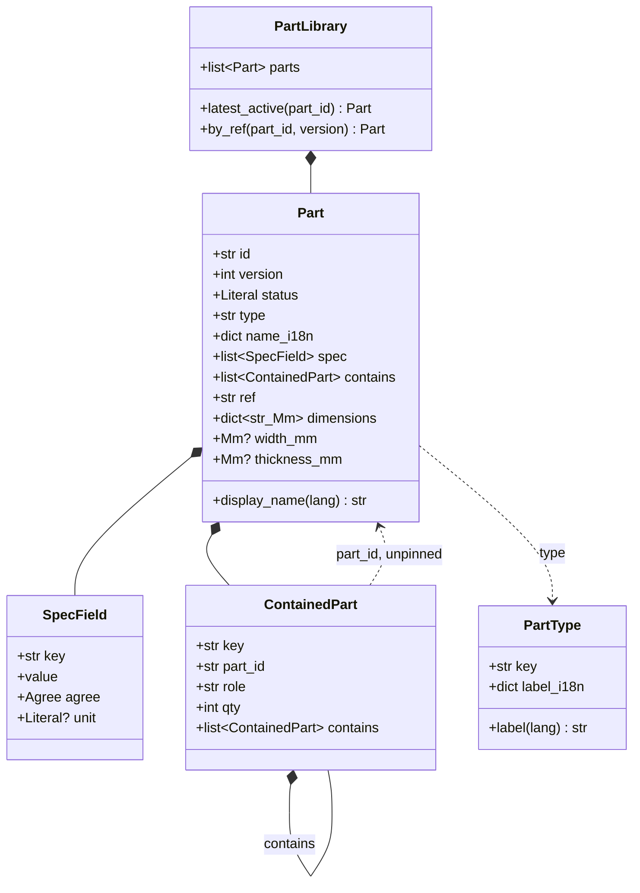

`SpecField.value` is `int | str | bool | list[int] | list[str] | None`; `unit` is
`"mm"` or `None`. `Part.status` is `draft` · `active` (default) · `retired`.

**A third citizen of the pattern knowledge objects and fence models already
follow**: immutable versions, a `status` transition guard (`draft` → `active` →
`retired`), a run stamps what it resolved (ADR-0006). A `Part` is what a piece
**is** — a rail's width, a screw's thread, a rail stock's stock length — stated as
`spec: list[SpecField]`, each field a sentence read left to right about the ITEM:
`item.<key> <agree> <value>`. `Agree` is `==`, `!=`, `>=`, `<=`; `among` (the item's
value is one the part lists) and `covers` (the item's own set includes everything
the part lists — `among`'s mirror, `fencemodel/match.py: _covers_fn`), both
list-valued where it matters; `between`, exactly two ints; or `supplies` for
consumption-aware length matching, carrying no value because a part cannot declare
its own length — the bay's `length_rule` does, per bay.

**`PartType` is the filing vocabulary, shared by parts AND products** (a Product's
`type` lives in `attrs`, not a typed field — see above). Entity rather than a
Python enum for the same reason `catalog/demo.py`'s materials are data: a company
that stocks a new kind of thing adds a row, not a release.

**A dimension is derived, never stored** (`Part.dimensions`, `width_mm`,
`thickness_mm`): `unit == "mm"`, `agree == "=="`, an int value, read off `spec` at
call time. A stored dimension beside the spec field that produces it would be two
authorities over one number — the exact defect a model drawing 38 while buying 45
used to be.

**Containment is declared on the part.** A gate kit arrives with its hinges in the
box; a hinge may ship its own pin. `ContainedPart` nests, and the path key composes
with `PATH_SEP = "/"` (`gate_kit/hinge/pin`), so a contained key may not itself
contain `/`. Contained pieces are members of the panel — a fitter places them,
obligation 9 counts them — and are not purchases, because the container is what was
bought. What a contained piece *supplies* in a particular panel is the model's fact,
`PartRequirement.credits`. Nothing infers containment from a product's
`AssemblyKit.components`: a kit's component list is what a BOM note prints.

**The unpinned-reference bargain, stated once.** A `FrameSlot` / `Member` /
`FixingRule` names a part by `id`, never by `id@version` — `PartRequirement.part_id`
above. Generation resolves `latest_active`, so fixing a rail's spec once reaches
every model that names it, without republishing any of them; that is the entire
reason the part is a shared entity rather than a template copied into each model.
The price is the one `FenceModel`'s own unpinned `FenceModelChoice` already pays:
an **ACTIVE model version no longer means one fixed thing forever**, because the
part beneath an unchanged model version can move between two generations of the
identical fence. `GenerationRun.part_snapshot` is what keeps an **old** run
honest regardless — a run is stamped with the exact part versions it actually
resolved, each with a content hash, so publishing a part cannot retroactively change
what an already-generated run meant. Only the NEXT run drawn from that model sees
the new part.

The published wire format has its own, different `Part`, `PartType` and
`SpecField` in `knowledge/parts.py` — see *Published knowledge* below and
*Names that collide* at the end.

---

## Knowledge — rules as data

`src/fenceai/knowledge/model.py`, `ast.py`, `evaluator.py`

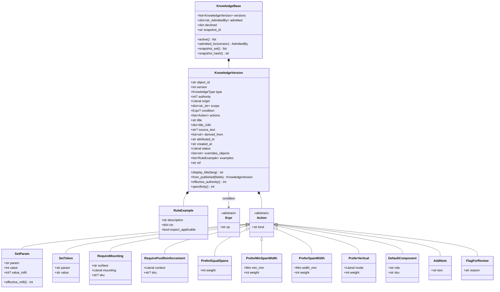

`origin` is `authored` (default) · `published`; `status` is `draft` · `active`
(default) · `retired` · `proposed` · `rejected`. `RequireMounting.mounting` is
`ground` · `masonry`; `RequirePostReinforcement.context` is `gate`;
`PreferVertical.mode` is `level` · `stepped` · `raked`. `SetParam` is frozen;
`value_milli` carries a published value's thousandths where it has them and must
round to `value`, and `effective_milli()` answers in thousandths either way — so an
arithmetic caller never multiplies an already-rounded millimetre.

**AST ops** (closed set, discriminated on `op`): `field`, `lit`, `cmp`, `and`, `or`,
`not`, `in`, `between`, `fn`. **Actions** (closed set, discriminated on `kind`):
`set_param`, `set_token`, `require_mounting`, `require_post_reinforcement`,
`prefer_equal_spans`, `prefer_min_span_width`, `prefer_span_width`,
`prefer_vertical`, `default_component`, `add_note`, `flag_for_review`. A field the
context does not supply raises `MissingField`, which means *not applicable* — never
*false*.

**Seven types, four distinct handlings.** `fact`, `hard_constraint`, `company_rule`,
`preference`, `heuristic`, `override`, `candidate`. A hard constraint is not a
preference is not an objective is not an override — they have different types and
different code paths. A hard tie between two **authored** rules is a **generation
failure**, not a coin flip; `origin: authored | published` decides, and a tie touching
a published row is a surfaced `Conflict` instead (contract §3.2.4).
`KnowledgeVersion.from_published()` is the seam a snapshot loader must build its rows
through: `origin` defaults to `authored`, the safe direction for a field nobody set,
so a loader that forgot it would silently turn two disagreeing published rows back
into a build error. `from_published` refuses an `origin` argument and sets it itself.

**Versions are immutable and runs stamp their snapshot set**, so editing a rule
cannot change what an old run meant. `source_text` holds the human's verbatim words
next to the structured form.

**`specificity()` is `len(scope)` plus the number of distinct field paths the
condition tests** — precedence is authority → specificity → recency. A rule that
applies sometimes is more specific than one that always applies: without counting the
condition, *"we say 1500; in Exposure C say 1200"* produced two hard rules that tied
and disagreed, and bricked every project (recorded as `planning-v4` in
`strategy/generator.py`). Which dimensions are bound during generation is documented
in [`knowledge-system.md`](knowledge-system.md); `bind_scope()` derives them
generically from generation facts rather than by hand at each call site.

**`KnowledgeBase` is what one generation receives**, built fresh by
`Store.knowledge_base()`: every authored row in `knowledge_versions`, plus the active
published snapshot re-ingested (next section). `active()` admits only
`status == "active"`. `admitted` records which source admitted each published
version (a run's answer, keyed `OBJ@vN`, so it rides on the base and not on the
version); `declined` records values the run refused to trust, by parameter, because a
refused source is not silence; `snapshot_id` is the publisher's id, distinct from
`snapshot_hash()`, our own digest of the `(object_id, version)` list.

The evaluator's working types are dataclasses, derived per run and never stored:
`Firing{version, actions, defeated_by, corroborated_by}`,
`Conflict{param_or_action, contenders, message, hard}` and
`Resolution{winner, firings, conflicts}`. Each distinct `Conflict` (keyed on its
slot and contenders) is drained into a `conflict` decision node and a
`knowledge_conflict` warning — severity `error` when the tie is hard
(`strategy/generator.py: _surface_conflicts`).

**A candidate is a state of `KnowledgeVersion`, not a class.** A proposed rule is a
version with `type="candidate"`, `status="proposed"` and authority 99; it fires
nothing, and review either rejects it or retires it beside a new active version.
Part III, *Learning*, draws that lifecycle.

---

## Published knowledge — the snapshot

`src/fenceai/knowledge/snapshot.py`, `parameters.py`, `source_docs.py`, `source_policy.py`, `src/fenceai/core/gaps.py`, `core/warnings.py`

What the other team's Knowledge Platform publishes arrives as one `Snapshot`
document under the boundary contract, frozen at v1.3 — this section draws only what
the code models of it.

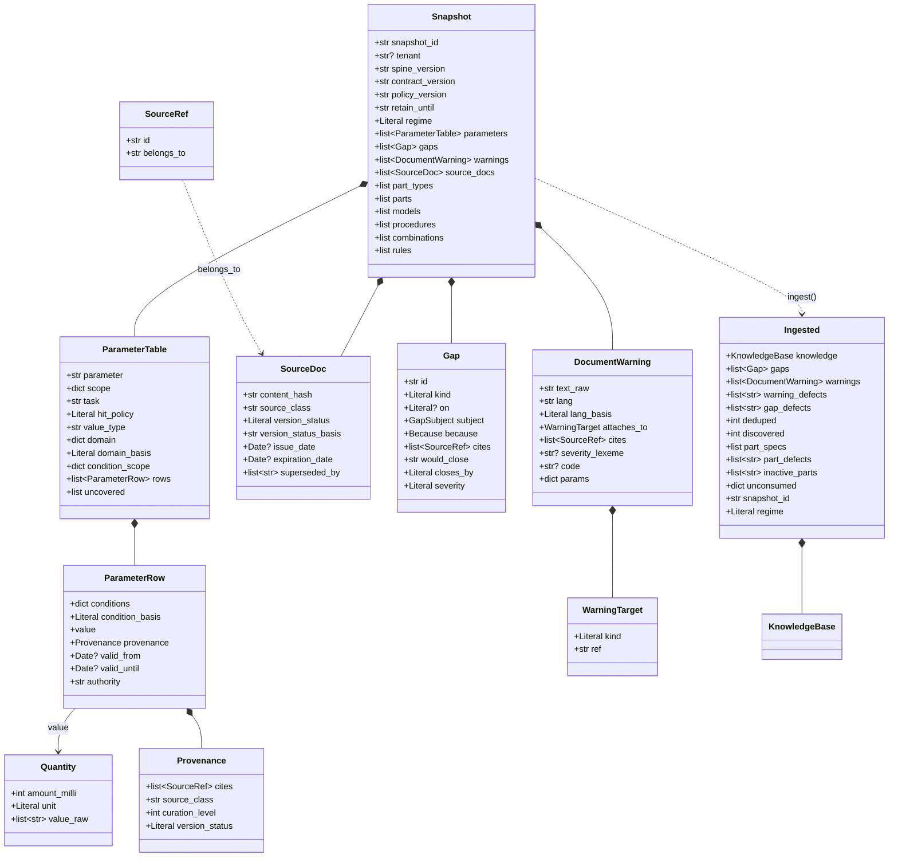

`ParameterRow.value` is a `Quantity`, a `Token{key, value_raw}` or a matrix
`list[list[Quantity]]`; a condition value may be an `Interval{min, max,
min_inclusive, max_inclusive, value_raw}`. `Gap` also carries
`GapSubject{kind, id, tenant, ref_kind, scope, point}` and `Because{code, params}`,
not drawn. `regime` is `us_astm` · `cn_gb`. `Gap.kind` is one of the `GapKind`
values in `core/gaps.py`; `closes_by` is `knowledge` · `planning`; `severity` is
`warns_line` · `informational`. `WarningTarget.kind` is `step` · `procedure` ·
`document` · `product` · `model` · `warranty` · `maintenance`.

**The document is stored, the reading is not.** `Store.save_snapshot` keeps the
snapshot exactly as published in `knowledge_snapshots`, keyed by its own
`snapshot_id`, and points the one-row `active_snapshot` at it. `knowledge_base()`
re-ingests the active snapshot **on every read** — a source verdict is a function of
`(snapshot, policy, task)` and the policy is an operator's editable table, so a
verdict frozen at load would record an answer the next policy edit makes false. A
snapshot that no longer parses leaves authored knowledge standing, the same state as
"none loaded". `Ingested` is that reading: the published rows as `KnowledgeVersion`s
built through `from_published`, the gaps it was told about and the ones expansion
discovered, the verbatim warnings, and defects counted rather than dropped.

**Only what the engine can act on is modelled.** `parameters`, `gaps`, `warnings`,
`source_docs`, `part_types` and `parts` are typed. `models`, `procedures`,
`combinations` and `rules` are `list[Any]` — accepted, counted in
`Snapshot.unconsumed()`, and not parsed, because a private shape for them would be a
shape nobody agreed to.

**Two engine types are the contract's own.** `Gap` (`core/gaps.py`) is also what a
generation reports on `Strategy.gaps`, and `DocumentWarning` (`core/warnings.py`) is
also what a fence model's `warnings` carry. A `DocumentWarning` is quoted, not
emitted: `text_raw` and `lang` verbatim, the publisher's `severity_lexeme`
unnormalised, any `code` of theirs carried and never rendered, no locale entry.
Where each one is shown is `report/annexe.py`'s single answer.

**Published parts are a different family of types.** `knowledge/parts.py` defines the
wire format's `Part{id, version: int | str, status, type: PartTypeRef, name_i18n,
spec, authorship, cites, contributing_sources}`, a namespaced
`PartType{key, namespace, parent, label_i18n}` and a `SpecField` whose `value` is a
`Quantity` or `Token` with its own provenance and whose agreements are `==`, `!=`,
`<=`, `>=`, `in`, `supplies`. Each admissible spec value becomes a
`PublishedSpec{part_id, part_type, key, agree, task, value, admitted_by, sources}`,
judged by the same source policy as a parameter row (`knowledge/source_policy.py`:
`SourcePolicyRow`, the source `Candidate`, `AdmittedBy`, `Resolution`). See
[`published-part-inspection.md`](published-part-inspection.md).

---

## Strategy and decisions — the proposal and its explanation

`src/fenceai/strategy/model.py`, `strategy/choices.py`, `strategy/continuity.py`, `decisions/graph.py`

The run and the document stored for it:

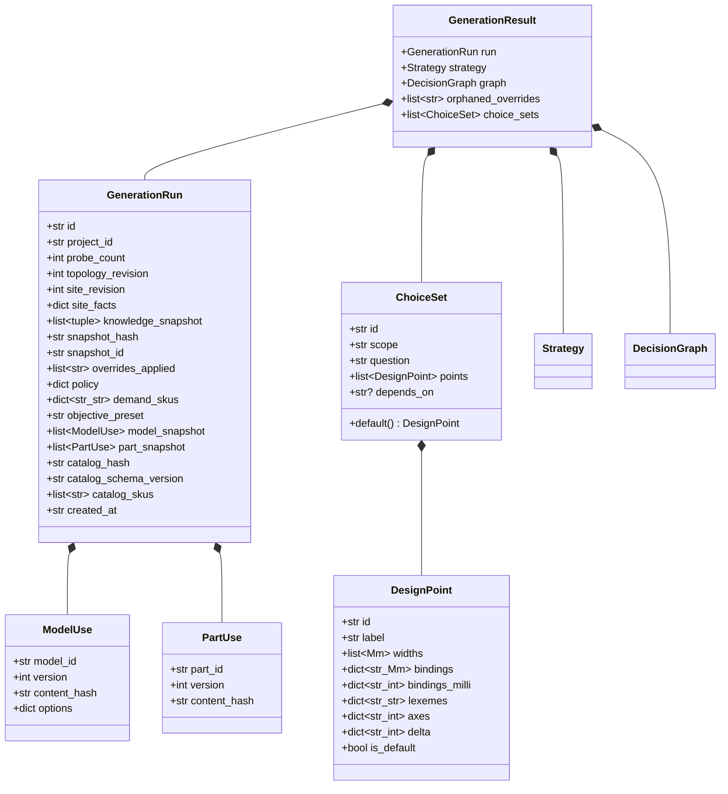

The strategy — what the fence is:

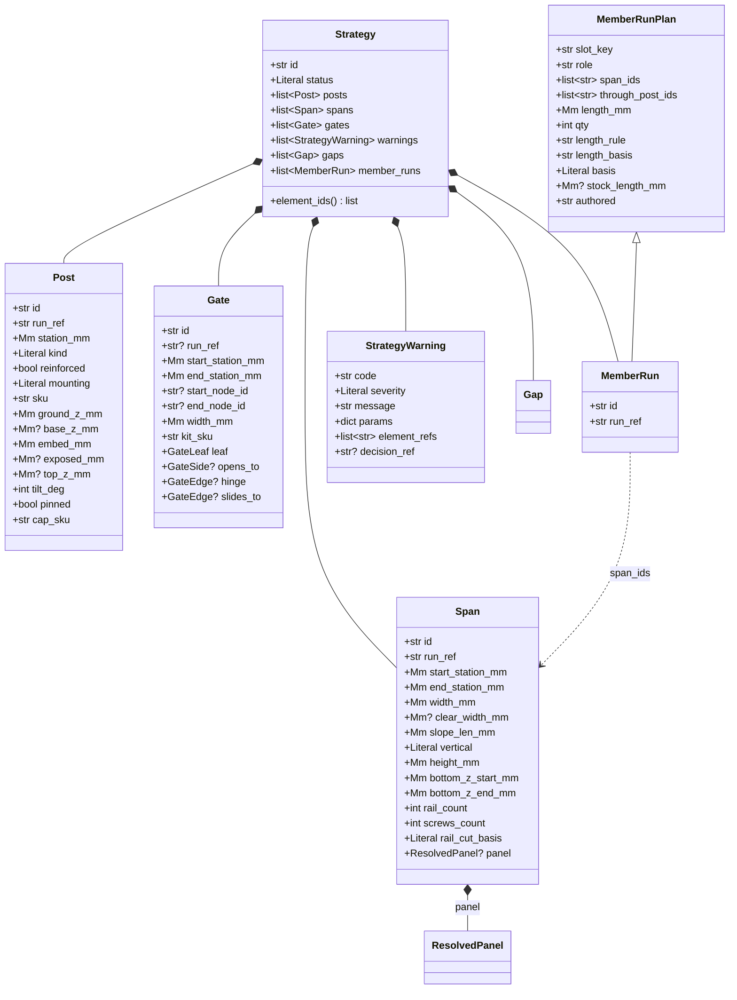

The explanation:

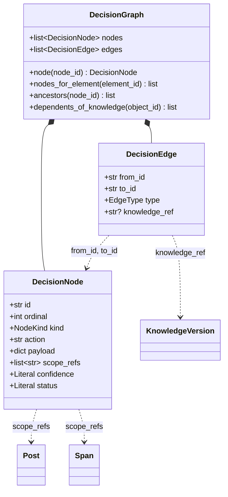

`DecisionGraph` also has `in_edges` and `out_edges`, not drawn.

| Field | Values |
|---|---|
| `Strategy.status` | `proposed` (default) · `accepted` · `superseded` |
| `Post.kind` | `end` · `corner` · `line` · `gate` · `junction` · `transition` |
| `Post.mounting` | `ground` (default) · `masonry` |
| `Span.vertical` | `level` (default) · `stepped` · `raked` |
| `Span.rail_cut_basis` | `width` (default) · `slope` |
| `MemberRunPlan.basis` | `stock_length` · `authored` |
| `StrategyWarning.severity` | `info` · `warning` (default) · `error` |
| `NodeKind` | `input_fact` · `rule_firing` · `structural` · `selection` · `vertical` · `mounting` · `quantity` · `conflict` · `assumption` · `override_applied` · `failure` · `gap` · `choice` |
| `EdgeType` | `derived_from` · `governed_by` · `defeated` · `input_from` · `assumption_of` · `corroborated` |
| `DecisionNode.confidence` | `deterministic` (default) · `inferred` · `uncertain` |
| `DecisionNode.status` | `proposed` (default) · `accepted` · `edited` · `rejected` · `pinned` · `superseded` |

**`GenerationResult` is the document stored.** `Store.save_run` writes the whole
result — run, strategy, graph, orphaned overrides and choice sets — into
`generation_runs` with `ON CONFLICT(id) DO NOTHING`. That includes `choice_sets`,
although the field's own comment calls them "DERIVED, never stored": they are rebuilt
on every generation, and a person's answer persists on the project as a `Selection`,
but the copy computed with the run is in the stored document. `orphaned_overrides`
lists the overrides that no longer matched the drawing; `generate()` reports them
and never mutates the caller's objects (ADR-0004).

**`GenerationRun.id` is a content hash over the identity of the inputs.** It is
`"run_" + sha256(...)[:12]` over, in order: `project_id`; the whole
`topology.model_dump()`, not just its revision; the knowledge snapshot set; the
overrides; the policy with `objective_preset` removed; `model_snapshot`;
`catalog_hash`; `part_snapshot`; `site_facts`; `PLANNING_BEHAVIOR_VERSION`;
`RUN_DIGEST_VERSION`; and, only when the project has answered a choice set, a
`choice_digest` of `(choice_set, scope, widths, bindings)` — appended only when
non-empty so every existing run id stayed stable (`strategy/generator.py: generate`).
Anything that changes what the run *means* has to be in that list, because the runs
table is append-only and a reused id would serve a stale stored document.
`project_id` is in because it is bound as a scope dimension, so a project-scoped rule
changes the fence without changing any other input. `catalog_hash` and
`catalog_schema_version` are also **checked**, not merely stamped, on every later
read (`api/app.py: _fresh_catalog`).

**Two versions ride in the digest, and they answer different questions.**
`RUN_DIGEST_VERSION = "digest-v4"` moves when the digest's *inputs* change: v2 added
`part_snapshot`, v3 removed `objective_preset` (a design is what it is regardless of
how it will be bought), v4 added `site_facts`. `PLANNING_BEHAVIOR_VERSION =
"planning-v4"` moves when generation's *output* changes for unchanged inputs: v2 a
resolved fixing slot carries its basis, v3 site conditions bind into every evaluation,
v4 `specificity()` counts condition paths. A genuinely new digest input cannot join
without changing the id it feeds, or the digest would be lying. **Newly generated runs
get new ids; stored runs keep theirs and stay readable** — nothing re-hashes a run
already in the table.

**What the run stamps but does not hash.** `objective_preset` is reported, not
identity, and because `save_run` keeps the first document it is frozen at the first
generation — read paths take the live preset from the project's policy and record it
on the `SupplyRun`. `site_revision` counts saves of the site form and is reported,
never hashed and never guarded on; `site_facts` is what the
`site_conditions_changed` guard compares, and it keeps the run explainable after
`Project.site` is edited. `snapshot_id` is the publisher's id, the one contract
obligation 1 asks every run to pin; `snapshot_hash` is our own digest of the
knowledge set. `probe_count` records how many extra generations the run spent
costing the alternatives in its choice sets.

**`part_snapshot` sits beside `model_snapshot`, and its hash guards something
else.** Both are deduped, sorted lists, and both belong in the digest: two runs of the
identical model document mean different fences the moment a part named by unpinned
`id` moves. `ModelUse` also carries `options`, because a different colour changes the
SKUs beneath it; `PartUse` has none. `ModelUse.content_hash` exists because a
**draft model** may be edited in place under a fixed ref. `PartUse.content_hash` is
**not** that argument: only `latest_active` parts are ever resolved, so a draft part
is never in a snapshot. It guards against a version *number* being reused across
libraries — a restored database, an import, a seed that diverged — where two runs
would otherwise share a digest and the second would be silently dropped.
`part_snapshot` defaults to `[]` for a run generated before parts existed, the same
readable-old-runs convention `catalog_skus = []` uses for "hashed over the whole
catalog"; `[]` needs no migration and no validator, because it is the default.

**The graph is append-only and acyclic by construction** — every edge runs from an
earlier ordinal to a later one, and `GraphBuilder._edge` refuses any other. A
`defeated` edge cites the **losing** version, which is what lets the UI say *"this rule
would have applied, and this one beat it."* A `corroborated` edge is distinct from
`defeated`: the cited version was never beaten, it independently said the same thing.
A `gap` node is a question nobody answered and the value the run proceeded on anyway;
a `choice` node is a point where two answers were admissible and a person chose, or
the stated default stood. The generator writes node `status` as `proposed`, or
`pinned` where an override pinned it; the other statuses, and the `inferred`
confidence, are declared and not yet written.

**`Strategy.id` is the constant `"strategy"` and its `status` is never moved off
`proposed`.** A run's identity is `GenerationRun.id`; which run is the real one is
`Project.committed_run_id`. `Strategy.gaps` travels with the strategy because every
gap is paired with a warning above and a `gap` node in the graph.

**Gates come from either kind of authoring.** `Gate.run_ref is None` *is* the
standalone gate (a `GateSpan`): it has no station, its `start_node_id` /
`end_node_id` are where its ends are, and `width_mm` is the one field every consumer
can rely on whichever kind it is — written once, during generation. The swing facts
are carried verbatim from the topology and change no quantity.

**A member that is one piece across several bays is a `MemberRun`**, not a field on
a `Span` — a rail threaded through an intermediate post belongs to no bay (contract
§3.1.12). It subclasses `strategy/continuity.py: MemberRunPlan`, the derivation's own
output, adding only an `id` and the `run_ref`, so demand can emit one line pegged to
every span it crosses.

**Post kinds:** `end`, `corner`, `line`, `gate`, `junction`, `transition`. A post
shared by two runs at a node has `run_ref = "node:<id>"` and station 0.

**Post fields carry the check that wrote them.** `embed_mm`, `exposed_mm` and
`top_z_mm` are written by `_check_post_lengths` from the same values it measured the
product against, so a run that warns *"this post is 200 mm short"* cannot also be
drawn with a post that looks fine. `None` means "never measured" — a different claim
from `0`.

`embed_mm` is the exception that proves the rule: it is recorded for every post
**before** the check's adjacency skip, so a post with no bay to measure against (the
node post of a run whose first bay is a gate) is still buried. `0` there is a *fact* —
masonry, bolted to what it stands on, embedding nothing — not a blank.

**A fence on a built base stands ON it.** Where a wall or concrete base carries the
fence, the panels rest on the base top and so does the post: `base_z_mm` is the
elevation the post **stands on**, while `ground_z_mm` stays the true ground, which is
what embedment is measured into. `base_z_mm = None` means "same as the ground" — soil,
and every strategy generated before the field existed. So the post-length check
measures the exposed length from `base_z_mm` rather than down through the wall, and
only a `ground`-mounted post spends length on embedment
(`tests/strategy/test_built_base_posts.py`).

**Posts are plumb by default** — vertical to earth, which is construction reality. A
section may opt into tilt with a `post_tilt` interval event: `perpendicular` (derived
from the local ground gradient, clamped ±45°) or `custom` degrees. Gate posts and node
posts always stay plumb: gates must hang plumb to swing, corners are braced plumb.
Tilt lengthens the post axis (exposed / cos θ in the length check), and tilt combined
with stepped panels is surfaced as a design-intent warning (`tilted_stepped`). Sloped
ground is absorbed by the **panels** — raked or stepped — never by tilting structure.
The consequences are all rule-driven rather than hard-coded: K-POST-EMBED with the
product's declared `length_mm`, K-MAX-GAP for stepped-panel gaps, K-GATE-SLOPE for
gate openings needing near-level ground, K-STEP-POST and K-MAX-STEP for vertical
ground steps (`tests/scenarios/test_vertical_ground.py`).

**A bay's opening is computed once.** `Span.clear_width_mm` is the distance between
the two post faces, computed during generation from the posts that bound the bay, so
the panel preview and the read models fit the panel to the number it was built to.
`None` is a run generated before the opening was computed, which reads its bays
centre-to-centre.

**Warnings carry structure, not a sentence.** `message` is an English *fallback*; the
contract is `code` + `params`, which each client renders in the reader's language. A
new code needs entries in **both** locale bundles or `tests/web/test_locale_bundles.py`
fails.

**A choice set is a question the data left open.** `ChoiceSet.scope` is a gap between
fixed stations (`gap:<run>:<start>`), not a section; `depends_on` names a set whose
answer must settle first. A `DesignPoint` is one admissible answer: `widths` where the
point is a layout, `bindings` (integer mm) where it binds parameters, with
`bindings_milli` the publisher's thousandths for arithmetic and `lexemes` the source's
own words for display. `axes` are physical counts a probe measured — never money,
which belongs to a `SupplyRun`. `is_default` marks what the engine builds, and a
default is never eliminated.

---

## Authored inputs — overrides, choices, site

`src/fenceai/strategy/overrides.py`, `src/fenceai/project/model.py` (`Selection`), `src/fenceai/project/site.py`

Three things a person authors that `generate()` reads beside the drawing. They are
engine inputs — all three enter the run digest — although two of them live in
`project/`.

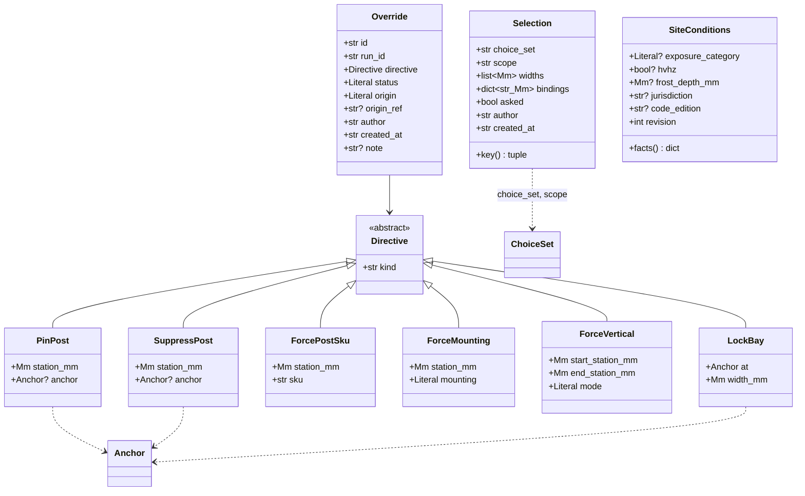

`Override.status` is `active` · `orphaned`; `origin` is `user` · `correction`.
`ForceMounting.mounting` is `ground` · `masonry`; `ForceVertical.mode` is `level` ·
`stepped` · `raked`. `SiteConditions.exposure_category` is `B` · `C` · `D`.

**An override is anchored to the drawing — `(run_id, directive)` — never to a
generated element id**, which does not survive regeneration (ADR-0004). The directive
is a closed discriminated union of six (`strategy/overrides.py: Directive`):

| Directive | Says | Anchored by |
|---|---|---|
| `PinPost{station_mm, anchor}` | there is a post here, whatever the layout wanted | an `Anchor`, or the legacy `station_mm` |
| `SuppressPost{station_mm, anchor}` | there is not | an `Anchor`, or `station_mm` |
| `ForcePostSku{station_mm, sku}` | this post is that product | `station_mm` |
| `ForceMounting{station_mm, mounting}` | ground or masonry | `station_mm` |
| `ForceVertical{start_station_mm, end_station_mm, mode}` | level, stepped or raked | two stations |
| `LockBay{at, width_mm}` | build the bay starting here exactly this wide | an `Anchor` |

Where a directive carries an `Anchor`, it resolves through
`override_station → anchor_station`, the one resolver, and **the anchor wins** over
`station_mm`, which is a reading from the geometry as it was. A bare `PinPost` with
neither resolves to nowhere and is reported orphaned, rather than quietly pinning a
post at station 0 — which is why `station_mm` defaults to 0. `LockBay` is one anchor and a
width, not two anchors, because two anchors can resolve to a half-orphaned interval,
grow to contain a corner, or silently relabel which bay a person signed off on; without
it, `layout_segment` would put back a post nobody asked for inside a hand-placed gap.

**Orphaning is reported per run, not written on the override.** An override the
generator could not apply is listed in `GenerationResult.orphaned_overrides` with an
`orphaned_override` warning; nothing writes `Override.status`, which stays `active`.
Likewise `origin = "correction"` and `origin_ref` are declared and never produced —
every override today has `origin = "user"`. `author`, `created_at` and `note` are
provenance: a confirmed `post_request` writes `note = "from interpretation <id>"`
(Part III). `author` is still client-supplied (see
[`people-and-work.md`](people-and-work.md)).

**A `Selection` is a person's answer to a choice set — the fifth kind**, beside hard
constraint, preference, objective and override. Nothing was wrong, so it is not an
override; neither point is nicer, so it is not a preference; and it is not a
correction. **It is anchored to a SCOPE, not a station**: an override dies when the
fence is redrawn, while a scope names the question rather than a place on today's
drawing, so the answer survives a redraw. `asked = False` is a PIN — "we always dig
610, stop asking" — one type with one flag rather than two stores that could
disagree. It carries the widths or bindings it chose, never the name of the generator
that proposed them. `key()` is `(choice_set, scope)`, the upsert identity.

**`SiteConditions` are whole-site facts**; anything that varies along a run belongs in
the topology as an interval payload instead. `None` means *nobody has said*, and
`facts()` omits unset dimensions from the `site.*` namespace, so a rule conditioned
on one is *not applicable* rather than false — and the run warns
`site_condition_missing` so the silence is visible. `extra = "forbid"`, because a
field-name typo used to validate clean and store all-`None`; `frost_depth_mm` must be
≥ 0 and has deliberately no upper bound. `revision` is bumped by the route on every
write and reported as `GenerationRun.site_revision`; it is not a fact about the site,
so it is excluded from `SITE_DIMENSIONS` and from the digest. The standards regime is
**not** a site condition — it rides on the snapshot.

---

## Demand and supply — from structure to purchase

`src/fenceai/demand/derive.py`, `fulfillment/lines.py`, `supply.py`, `fulfill.py`, `cutplan.py`, `phases.py`, `pipeline.py`, `supply_run.py`, `quote.py`

The lines, and how a product is chosen for them:

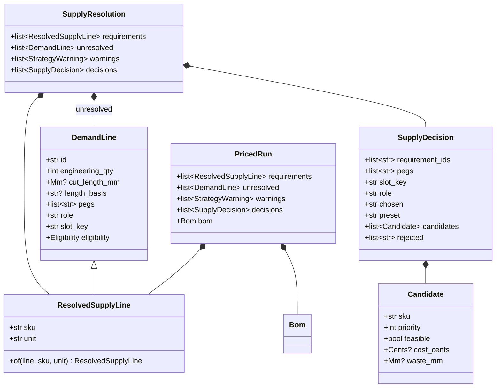

The purchase:

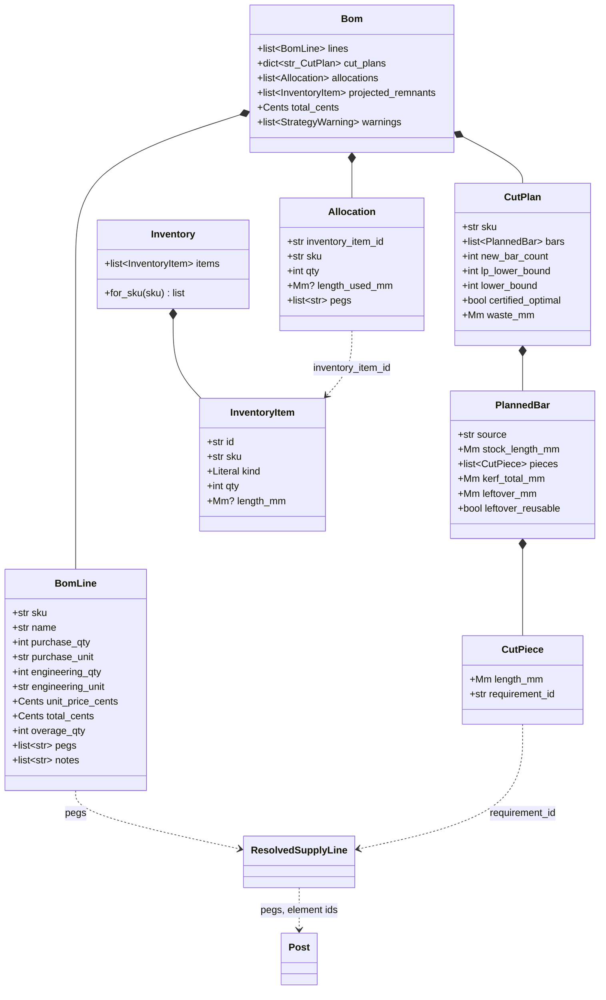

The two identities a price can have:

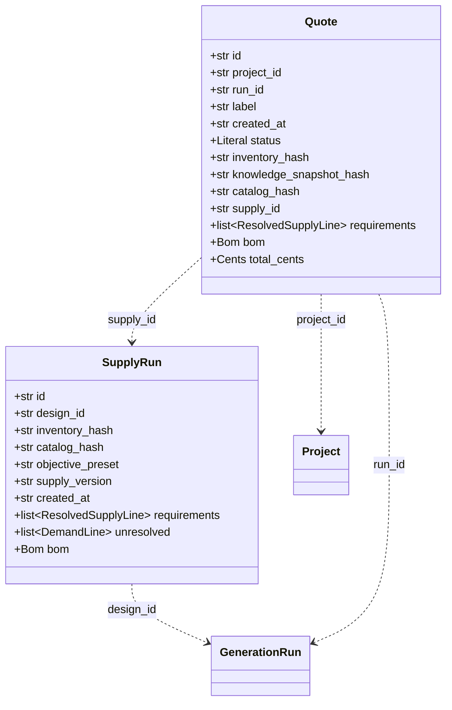

`InventoryItem.kind` is `full_stock` (default) · `remnant` · `opened_package`;
`PlannedBar.source` is `"new"` or the id of the inventory item it cuts from.
`Quote.status` is `draft` (default) · `accepted` · `superseded`.

**The pipeline is a declared list of phases.** `fulfillment/phases.py: PIPELINE` is
`derive_demand → resolve_supply → fulfil`, each a `Phase{name, fn, reads, writes}`
(dataclass) over one shared `PipelineState` (dataclass: `strategy, catalog,
inventory, demand_skus, preset, demand, requirements, unresolved, warnings,
decisions, bom`). `check_order` refuses at import a phase placed before the field it
reads exists, so inserting a step is a row. `price_strategy()` runs it and returns a
`PricedRun`.

| Phase | Function | Reads | Writes |
|---|---|---|---|
| `derive_demand` | `demand/derive.py: derive_requirements` | strategy, catalog, demand_skus | `demand: list[DemandLine]` |
| `resolve_supply` | `fulfillment/supply.py: resolve_supply` | demand, catalog, inventory, preset | requirements, unresolved, warnings, decisions |
| `fulfil` | `fulfillment/fulfill.py: fulfill` | requirements, catalog, inventory, warnings | `bom` |

**Demand and supply are two types, and the split is done.** A `DemandLine` says what
the fence NEEDS — pegs, role, slot key, a frozen eligibility — and deliberately
carries no `sku` and no `unit`: which product satisfies it is `resolve_supply`'s
answer, and the unit is a property of the product it chooses. `ResolvedSupplyLine`
subclasses it and adds both, **required and non-empty**, set together by
`ResolvedSupplyLine.of()`, which builds a new object rather than mutating the demand
line. `fulfill()` accepts only `list[ResolvedSupplyLine]`, so a blank SKU cannot reach
it — the runtime refusal it once needed is gone, because a type cannot be edited
around. A line no eligible product could supply stays a `DemandLine` and is kept,
never dropped: in `SupplyResolution.unresolved`, `PricedRun.unresolved`,
`SupplyRun.unresolved`, and on the read models below, each with a matching warning.
There is no third "unresolved supply line" type; the base type is the unresolved
state. `eligibility` is always populated, including for a product knowledge chose,
so `resolve_supply` never branches on whether a line already knows its answer.

**A supply decision is recorded per eligibility group**, not per line: `SupplyDecision`
names the candidates, the one chosen under which `preset`, and why the rest were
`rejected` (a property). An infeasible `Candidate` has `cost_cents` and `waste_mm` of
`None`, never 0, which would read as free. The decision-graph nodes for these are
derived at read time (`decisions/supply.py`), because selection runs here, where there
is no graph builder.

**`pegs` is the traceability invariant.** `ResolvedSupplyLine.pegs` holds strategy
element ids; `BomLine.pegs` and `CutPiece.requirement_id` hold `ResolvedSupplyLine`
ids. Every BOM line therefore points back to the supply lines that caused it, which
point back to the strategy elements that caused them, which point into the decision
graph. A BOM item that cannot be traced to structural demand is a defect, not a
rounding. `BomLine.notes` carries a kit's component list, or that a product is not in
the catalog; `Bom.warnings` carries the supply warnings, so a reader holding only the
BOM still sees why a line is missing.

**The cut plan certifies itself honestly.** `lower_bound = max(lp_lower_bound,
counting_bound)`, and `certified_optimal` is only true when the plan attains it — a
provably optimal plan is not called "heuristic", and no solver vocabulary reaches a
BOM line.

**Units and offcuts never merge.** A remnant allocation takes the **whole** offcut as
a bin, so half of one is never left over; whatever survives comes back as a
*projected remnant*, which is a different item.

**A `SupplyRun` is one design, priced against one yard, under one objective.** Its id
is `"sup_" + sha256(design_id, inventory_hash, catalog_hash, objective_preset,
SUPPLY_BEHAVIOR_VERSION)[:12]` with `SUPPLY_BEHAVIOR_VERSION = "supply-v1"`, the
fulfilment-side twin of `PLANNING_BEHAVIOR_VERSION`. `supply_runs` is append-only
(`ON CONFLICT(id) DO NOTHING`), and `save_supply_run` returns the stored row, so an
unchanged yard does not accumulate a row per read and two reads agree to the
timestamp. A run id answers *what fence is this*, for ever; a supply id answers *what
does it cost from this stock today*, which is legitimately different tomorrow
(ADR-0011). `Inventory` is engine reference data — the yard — stored per project.

**A `Quote` is a supply run somebody stood behind.** It freezes `requirements`, `bom`
and `total_cents` in full, names the `SupplyRun` it froze (`supply_id`; `""` on a quote
made before supply runs had names) and stamps the inventory, knowledge-snapshot and
catalog hashes as provenance, not as guards. Content is append-only; only `status`
moves: `draft → accepted | superseded`, `accepted → superseded`
(`QUOTE_STATUS_TRANSITIONS`). `Store.accept_quote` supersedes the project's previously
accepted quote in the same transaction. Its `status`, `label` and the act of accepting
are the job's commercial decision, but **accepting a quote does not move the job's
status** — nothing writes `Project.status = "quoted"` (see
[`people-and-work.md`](people-and-work.md)).

---

## Read models — derived, never stored

`src/fenceai/report/structure.py`, `elevation.py`, `assembly.py`, `annexe.py`, `bom_groups.py`, `sections.py`, `section_decisions.py`

The structure sheet:

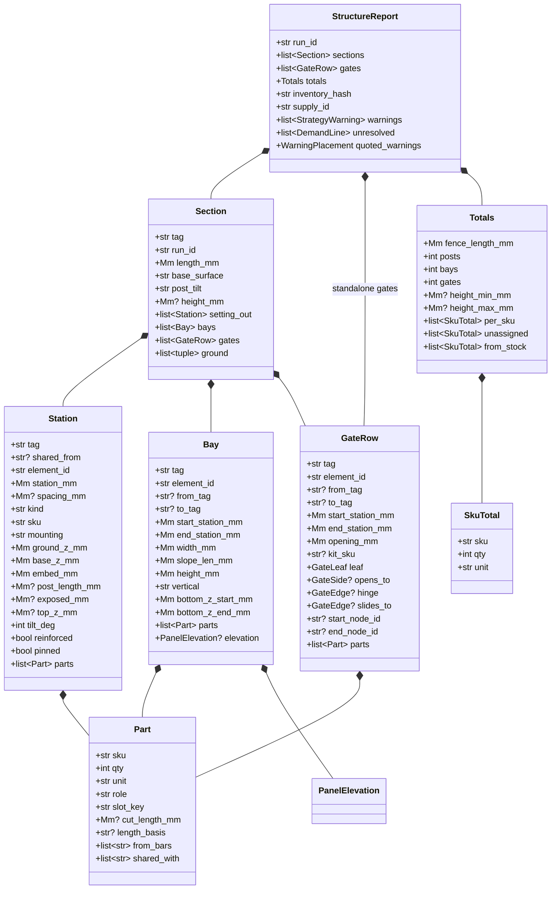

One bay drawn as built:

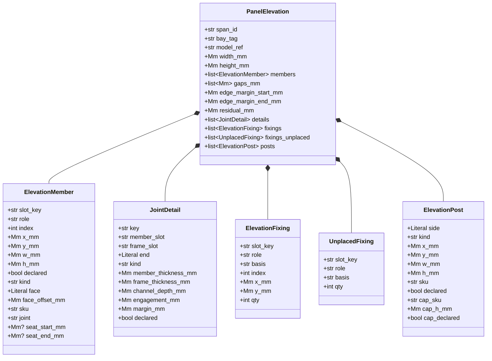

`ElevationMember.face` is `front` (default) · `back`; `JointDetail.end` is `base` ·
`top`; `ElevationPost.side` is `start` · `end`.

**Σ(parts) ≡ BOM is the governing property.** Parts are obtained by **inverting**
existing pegs — element → `ResolvedSupplyLine` id → `BomLine` — never by recomputing.
The identity has to hold in both directions, so `Totals` carries two extra buckets:
`unassigned`, what was purchased beyond anything an element asked for (rounding
overage, a package remainder), shown and never hidden; and `from_stock`, what was
asked for and met from inventory, which appears on no purchase line but still has to
be picked in the yard. Demand no product could supply is `unresolved`, as
`DemandLine`s. `GET /runs/{id}/structure` refuses to lay a run over a topology it was
not generated from (409 `topology_changed`, on the topology revision) or over site
facts that have moved since (409 `site_conditions_changed`).

**Tags are derived, never stored**, and are unique per element. Sections are `A`,
`B`, …; their elements are qualified by section — `A/P1`, `A/B1`, `A/G1`. A post
shared by two sections prints the tag of the section that reached it first, and the
later section's `Station.shared_from` names the owner — one tag, not two. A
standalone gate (a `GateSpan`) belongs to no section: it is `G1` in
`StructureReport.gates`, read between two posts. An end post a section already
tagged keeps that tag; one nothing else tagged is named in the gate's own namespace,
`G1/P1` for its start end and `G1/P2` for its end.

**`declared: false` is honesty in the schema.** A member whose face height is a
nominal the read model invented draws dashed and says so, rather than claiming a
precision the catalog does not have.

The other read models, all pure and persisted nowhere:

| Read model | Built by | Shape | Answers |
|---|---|---|---|
| `AssemblyPlan` | `report/assembly.py: assembly_plan` | `model_ref`, `steps: list[ResolvedStep{key, kind, scope, stage, text_i18n, parts}]`, `order: StepOrder`, `unplaced`, `unplaced_bay` (each `StepPart{slot_key, role, qty, length_mm, belongs_to}`) | the order a panel is built in, and which members no step places |
| `WarningPlacement` | `report/annexe.py: place_warnings`, `place_for_plan` | `placements: list[PlacedWarning{warning, where, ref, instances, owner}]`, `not_in_plan`, `documents_unreadable`; `where` is `step` · `procedure` · `product` · `model` · `annexe` · `unplaceable` | where each quoted `DocumentWarning` is shown |
| `GroupedBom` | `report/bom_groups.py: group_bom` | `groups: list[BomGroup{kind, element_id, lines: list[GroupedLine], chosen, rejected, preset}]`, `unassigned`, `from_stock`, `unresolved`; group `kind` is `section` · `node` · `bay` · `gate` · `decision` | the BOM by section, panel or supply decision |
| `SectionFacts` | `report/sections.py: section_facts(topology)` | `run_id, tag, length_mm, surfaces, base_surface, ground, base_top, max_slope_permille, corner_stations, height_intent_mm, height_covered_mm, models` | what each stretch of the drawing says, before anything is generated |
| `SectionDecisions` | `report/section_decisions.py: decisions_for_section` | `section_id`, `decisions: list[ScopedDecision{node_id, ordinal, kind, action, elements, sentence, governed_by, defeated}]`, `admitted`, `origins` | the decision trail for one section, rendered |

---

# Part II — People & work

## Accounts and the audit trail

`src/fenceai/identity/model.py`, `identity/ports.py`, `identity/binding.py`, `src/fenceai/store/db.py`

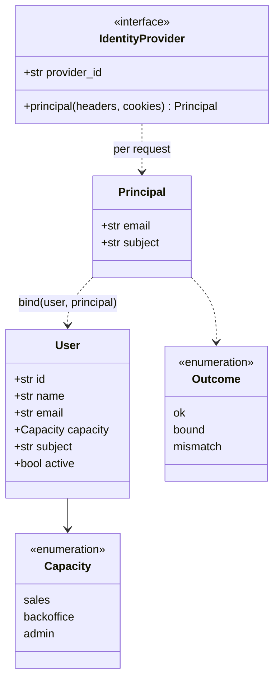

**Identity is Google's; a row holds the capacity** (ADR-0013). A `Principal` is a
verified identity derived per request by an `IdentityProvider` (`IapIdentity` or
`DevIdentity`) and is not an account — there may be no row for it. A `User` row says
what that identity may *do*. It has no credential. `email` is stripped and
lower-cased on both sides of the lookup so one address has one spelling; `id` is
restricted to `[A-Za-z0-9_.-]` so `user:<id>` can never spell another kind of actor.
`capacity` has no default, because both the narrowest and the widest would fail
quietly.

**Rows are created by email; `subject` binds on first arrival.**
`identity/binding.py: bind` answers `ok`, `bound` (the gate must save the row's new
`subject`) or `mismatch` (403). A principal with no subject — the dev provider —
binds nothing. **An account is deactivated, never deleted** (`active = False`),
because `audit_log.actor` must keep resolving to a name.

**There is no session.** No `sessions` table, no password: the gate resolves the
caller on every request from the IAP assertion or the dev cookie, and
`GET /api/session` reports the derived answer. The table was deleted with the
password store; an existing SQLite file keeps it, and nothing creates or reads it.

**The audit trail is a table with no model.** `audit_log` rows are
`(seq, at, actor, action, ref)`, written by `Store._audit` inside each store write and
by `Store.log` from routes, and read back as plain dicts by `Store.audit_entries`
(`GET /api/audit`). `Store.log` is defined twice in `store/db.py`; the second, marked
`@_serialized`, shadows the first and is the one in force.

| `actor` | Written by |
|---|---|
| `user:<id>` | every route write that names somebody — `identity/model.py: actor_ref`, through `api/app.py: _actor` |
| `agent:<…>` | reserved (`identity/model.py: is_agent`); nothing writes it |
| `system` | a store method called with no actor — today `save_run` from Generate, `save_supply_run` from the `/bom`, `/structure` and `/quote` routes, `PUT /api/catalog/products` and `PUT /api/projects/{id}/inventory` |
| `seed` | startup seeding of the catalog, knowledge, fence models, parts and the sample project, and the dev-only demo accounts |
| `bootstrap` | the first admin from `FENCEAI_BOOTSTRAP_ADMIN` |
| `proposer:<id>` | `propose-knowledge` storing a candidate |
| `user` | the literal, still written by the snapshot load route |

`action` is the store verb (`save_project`, `save_run`, `insert_knowledge_version`,
`save_quote`, …), a status move (`knowledge_status:<s>`, `fence_model_status:<s>`,
`part_status:<s>`, `quote_status:<s>`), an account event (`grant_capacity`,
`amend_capacity`, `identity_bound`, `subject_mismatch`, `bootstrap_admin`), or
`command:<kind>` for a desk command, whose `ref` is `<project_id>|<origin>`.

**A job's history is a second table beside it, with a model.** `project_changes`
rows are `(seq, project_id, at, actor, doc)`, where `doc` is a list of
`project/changes.py: Change(code, params)` — the difference between the stored job
and the one being saved, taken inside `Store.save_project` and nowhere else. An
audit row says *who saved*; a change entry says *what changed, from what, to what*.
Both are written by every job save that changes something; only the audit row is
written by one that changes nothing. Read by `Store.project_changes`
(`GET /api/projects/{id}/changes`). See [`people-and-work.md`](people-and-work.md#a-jobs-history).

## The job

`src/fenceai/project/model.py`, `project/lifecycle.py`, `src/fenceai/commands/model.py`, `commands/desk.py`

```mermaid
classDiagram
    class Job {
        +str customer
        +str address
        +str sold_by
        +str sold_on
        +label() str
    }
    class SiteContext {
        +list~Landmark~ landmarks
    }
    class Landmark {
        +str id
        +str kind
        +str label
        +list~tuple~ points
        +bool closed
    }
    class Stated {
        +bool no_gates
        +bool no_promises
    }
    class Acknowledgement {
        +str kind
        +str anchor
        +str by
        +str at
    }
    class JobState {
        <<enumeration>>
        drafting
        waiting
        planning
        planned
        quoted
        returned
        delivered
        cancelled
    }
    class CommandSpec {
        <<dataclass>>
        +str kind
        +type payload_model
        +Rung rung
        +str i18n_key
        +frozenset capacities
        +frozenset from_states
        +Disposition disposition
        +Callable? materialize
    }
    class NoPayload
    class CommitPlan {
        +str run_id
    }
    class AssignJob {
        +str user_id
    }
    class ReturnToSales {
        +str reason
    }
    class AcknowledgeWarnings {
        +str run_id
    }

    SiteContext *-- Landmark
    CommandSpec ..> NoPayload : payload_model
    CommandSpec ..> CommitPlan : payload_model
    CommandSpec ..> AssignJob : payload_model
    CommandSpec ..> ReturnToSales : payload_model
    CommandSpec ..> AcknowledgeWarnings : payload_model
    CommandSpec ..> JobState : from_states
```

The job is the `Project` document's job fields (drawn in the Project section above):
`job`, `context`, `stated`, `status`, `assignee`, `submitted_at`, `created_by`,
`closed_at`, `acknowledgements`, `committed_run_id`. **The state machine, the command
table and who may run each command are in [`people-and-work.md`](people-and-work.md)**
— this section draws only the types.

**`Job` is typed rather than four loose fields** because it reaches the handover, so a
typo fails at the boundary. Blank is allowed in every field — the salesperson enters
it from paper after the visit, and completeness is *reported* by the handover — but a
`Job` with nothing set is refused; leave `Project.job` as `None` instead. `sold_on` is
an ISO date or `""`. `label()` is customer, then address.

**`SiteContext` is everything on the property that is not the fence**, on the project
and never in `Topology`: a landmark changes no quantity, so it must not bump the
topology revision. `Landmark.kind` is validated against `LANDMARK_KINDS` — `house`,
`street`, `sidewalk`, `pool`, `tree`, `boundary`, `other` — a registry, so adding a
kind is a one-line change and not a contract amendment. `points` are integer mm in
the topology's plane; a closed landmark needs three points, an open one two. Landmark
ids are unique within the context.

**`Stated` is what the salesperson says the job does NOT have** — named facts, never
step keys, so `handover_gaps` can check `no_gates` against the drawing without knowing
a road exists, and "no gates on this job" is distinguishable from "nobody got to the
gates".

**An `Acknowledgement` is somebody saying they read something, anchored to what they
read.** `kind` is `sale_read` or `warnings_reviewed` (`SALE_READ`,
`WARNINGS_REVIEWED`, not validated by the type). `anchor` is opaque on purpose: for
`sale_read` it is `sale_anchor(project)`, a digest of the salesperson's note ids, so
a new note from her un-reads the sale; for `warnings_reviewed` it is a run id, so a
new run's warnings are unread. `report/readiness.py` owns both spellings.

**`JobState`** is defined in `project/lifecycle.py` with `TRANSITIONS`,
`FINISHED_STATES = {delivered, cancelled}` and the five sales words a salesperson's
list shows (`SalesStatus`: `draft`, `pending`, `needs_info`, `accepted`,
`rejected`).

**A command is a row, not a handler.** `CommandSpec` is a frozen, keyword-only
dataclass — `payload_model` is a type, and a registry row is code rather than data on
the wire. `rung` is `note` · `selection` · `directive` · `rule`; `disposition` is
`ask` (default) · `suggest` · `auto`. `capacities` is empty by default, so a row whose
author forgot the column refuses everybody; `from_states` empty means any state.
`materialize = None` is a real row: something an agent may propose that nothing
performs by hand yet. The payload models are `extra = "forbid"`; `NoPayload` serves
`submit_job`, `claim_job`, `cancel_job`, `revise_plan`, `reopen_job` and
`acknowledge_sale`. A refusal is `CommandRefused(code, **params)`, an exception
rather than a model.

## What each desk reads

`src/fenceai/report/handover.py`, `report/readiness.py`, `report/flags.py`, `src/fenceai/project/queue.py`

```mermaid
classDiagram
    class HandoverGap {
        +str code
        +dict params
        +bool blocking
    }
    class ReadinessItem {
        +str code
        +dict params
        +bool blocking
    }
    class JobFlag {
        +str code
        +dict params
        +Literal severity
        +list~Place~ places
        +Literal source
        +str message
    }
    class Place {
        +Literal kind
        +str run_id
        +Mm? station_mm
        +str node_id
        +str element_id
    }
    class QueueRow {
        +str id
        +str name
        +str label
        +str customer
        +str town
        +str sold_by
        +str sold_on
        +str status
        +str? assignee
        +str submitted_at
        +int waiting_seconds
        +int open_questions
        +str closed_at
        +Cents? quote_total_cents
    }
    class MyJobRow {
        +str id
        +str label
        +str customer
        +str town
        +str status
        +str sales_status
        +str submitted_at
        +int office_notes
        +str office_latest
    }

    JobFlag *-- Place
    HandoverGap ..> JobFlag : source handover
    ReadinessItem ..> JobFlag : source readiness
```

`JobFlag.severity` is `blocking` · `open` · `answered`; `source` is `handover` ·
`readiness` · `strategy`; `Place.kind` is `job` · `run` · `station` · `node` ·
`element`. `QueueFilter` (`bucket`, `status`, `assignee`, date ranges, `q`, `sort`,
`for_capacity`, `limit`, `cursor`) is the query a queue read takes, not a stored row.

**All of these are derived and never stored.** They live in `report/` and
`project/queue.py` because they are pure functions; the plane is about whom they
serve. Every finding is `code + params`, the sentence living in both locale bundles.
`HandoverGap` is a function of the project alone, so it answers before anything is
generated; `blocking` is narrow on purpose. `ReadinessItem` is computed from the run,
strategy, choice sets, supply, committed run, quotes and quoted warnings the caller
already holds, never a knowledge base, and its `blocking` is always `False` — kept so
both render through one row component. `job_flags` places handover gaps, readiness
items and strategy warnings
on the drawing (`Place`, where `station_mm = None` means *no station*, never 0); it
takes `choice_sets` and does not yet read them, a named seam. `QueueRow` and `MyJobRow`
are what `select_rows` and `my_jobs` return. Which route serves each, and what each
desk does with it, is in [`people-and-work.md`](people-and-work.md).

---

# Part III — AI & learning

Every type here is either a proposal that changes nothing until a person acts, or a
derived answer shown and never applied. [`ai-layer.md`](ai-layer.md) has the ports,
adapters and guards.

## Interpretation

`src/fenceai/project/model.py` (`Annotation`), `src/fenceai/ai/records.py`, `src/fenceai/project/intents.py`

```mermaid
classDiagram
    class Annotation {
        +str id
        +str target_ref
        +str text
        +str author
        +str created_at
        +list~InterpretationRecord~ interpretations
    }
    class InterpretationRecord {
        +str id
        +str annotation_id
        +str interpreter
        +str created_at
        +list~CandidateIntent~ candidates
        +list~str~ unparsed_spans
    }
    class CandidateIntent {
        +str id
        +IntentKind kind
        +dict params
        +str source_text
        +Literal confidence
        +str? ambiguity_note
        +Literal status
        +str? confirmed_by
    }

    Annotation *-- InterpretationRecord
    InterpretationRecord *-- CandidateIntent
    InterpretationRecord ..> Annotation : annotation_id
    CandidateIntent ..> IntervalEvent : confirm, height or top line
    CandidateIntent ..> Override : confirm, post request
```

`IntentKind` is `height_intent` · `top_line` · `post_request` ·
`material_preference` · `other`; `confidence` is `high` · `medium` · `low`; `status`
is `proposed` (default) · `confirmed` · `rejected`. `interpreter` is `"stub"` or
`"claude:<model>"`. `Annotation.target_ref` is a free string (`project`, `run:<id>`,
`node:<id>`, `event:<id>`, `landmark:<id>`), and its referent may stop existing while
the note stands. The route writes `author` as `user:<id>`.

**The verbatim text is immutable and never replaced by its interpretation.** An
interpretation is a *proposal* carrying candidates, each quoting the `source_text`
span it read; what it could not read stays in `unparsed_spans`. Records are stored on
the annotation, inside the project document. Confirming one candidate
(`project/intents.py: confirm_intent`) materialises it as first-class engine input,
with the chain back to the human's words kept:

| Intent kind | Confirming it writes | Provenance |
|---|---|---|
| `height_intent` | an `IntervalEvent(HeightIntentPayload)` over the whole run, and `topology.revision += 1` | `payload.source` = the interpretation record id |
| `top_line` | an `IntervalEvent(TopLinePayload)` over the whole run (`mode` defaults to `level`), and `topology.revision += 1` | `payload.source` = the record id |
| `post_request` with a `station_mm` param | an `Override(PinPost(station_mm))` with `origin = "user"`, `author = confirmed_by` | `note = "from interpretation <record id>"` — overrides have no `source` field |
| `material_preference`, `other`, or a `post_request` with no station | nothing — refused, "cannot be materialized automatically" | — |

The candidate is then marked `confirmed` with `confirmed_by`, which still comes from
the request body (see [`ai-layer.md`](ai-layer.md)). Nothing writes
`status = "rejected"`.

## Learning

`src/fenceai/learning/model.py`, `learning/review.py`, `learning/impact.py`, `src/fenceai/ai/stub.py` (`StubProposer`)

```mermaid
classDiagram
    class Correction {
        +str id
        +str project_id
        +str generation_run_id
        +str? decision_ref
        +str? element_ref
        +dict before
        +dict after
        +str? comment
        +str author
        +str created_at
    }
    class ReviewAction {
        +Literal action
        +str reviewer
        +str? reason
        +dict? edited_scope
        +str at
    }
    class KnowledgeVersion {
        <<engine>>
        +KnowledgeType type
        +Literal status
        +list~str~ derived_from
        +str attributed_to
    }
    class ImpactCase {
        +str project_id
        +str project_name
        +Topology topology
        +list~Override~ overrides
        +Inventory inventory
        +Cents? accepted_quote_cents
        +FenceModelChoice? fence_model
        +SiteConditions site
        +dict policy
    }
    class ImpactReport {
        +str hypothetical_ref
        +int projects_checked
        +int projects_affected
        +list~ProjectImpact~ impacts
    }
    class ProjectImpact {
        +str project_id
        +str project_name
        +bool changed
        +ImpactFailure? generation_failure
        +bool baseline_failed
        +int posts_added
        +int posts_removed
        +int posts_modified
        +int spans_before
        +int spans_after
        +Cents bom_before_cents
        +Cents bom_after_cents
        +Cents bom_delta_cents
        +int warnings_before
        +int warnings_after
        +Cents? accepted_quote_cents
        +Cents? vs_accepted_delta_cents
    }
    class ImpactFailure {
        +str code
        +dict params
        +str message
    }

    Correction ..> GenerationRun : generation_run_id
    Correction ..> KnowledgeVersion : proposes a candidate
    ReviewAction ..> KnowledgeVersion : apply_review
    ImpactReport *-- ProjectImpact
    ProjectImpact *-- ImpactFailure
    ImpactCase ..> ImpactReport : regenerate and diff
```

`ReviewAction.action` is `approve` · `reject` · `edit_approve` · `scope_restrict`.
`KnowledgeVersion` is **abridged** here to the fields the learning loop writes; it is
drawn whole in Part I.

**A `Correction` is an immutable capture of an expert changing a generated result.**
It pegs `generation_run_id` and a `decision_ref` or `element_ref` — both *generated*
ids, meaningful only inside that run. `comment` is verbatim. `author` defaults to
`"expert"`; the route writes the session's `user:<id>`. Corrections are append-only in
`corrections`.

**A correction never becomes an active rule.** It proposes a **candidate** — a
`KnowledgeVersion` with `type = "candidate"` (default authority 99) and
`status = "proposed"`. As `StubProposer` builds one, it is scoped to the project,
`derived_from` names the correction ids and each `<run_id>#<decision_ref>`, and
`attributed_to` is `proposer:<id>`. It is inert until a reviewer acts:

```mermaid
stateDiagram-v2
    direction LR
    state "vN+1 · type heuristic · status active · derived_from vN · attributed_to the reviewer" as minted
    [*] --> proposed : propose-knowledge
    proposed --> rejected : reject
    proposed --> retired : approve / edit_approve / scope_restrict
    retired --> minted : same transaction
    rejected --> [*]
```

`learning/review.py: apply_review` reviews only a `proposed` version. **Approval mints
a new version and retires the candidate**: `v+1` keeps the condition, actions,
verbatim `source_text` and examples, becomes a `heuristic` (a candidate's type is
promoted; any other type is kept), drops the "(candidate)" marker from its titles in
every language, and is `active`. `scope_restrict` approves with a narrower scope — it
must keep every existing dimension and add at least one. **`edit_approve` applies no
edit**: it behaves exactly like `approve`. **Rejection is kept for ever**: a
`rejected` candidate's `object_id` is still in the knowledge base, so `propose-knowledge`
never proposes it again. `Store.apply_review_outcome` writes the status change and the
new version in one transaction.

**`ReviewAction` is never stored.** It is the request; the outcome is the two version
rows and their audit entries. Its `reason` is discarded.

**The impact preview is derived.** `learning/impact.py` regenerates and re-prices each
`ImpactCase` — one per project, skipping any with no runs drawn — before and after a
hypothetical version, and diffs posts, spans, warnings and BOM cents into an `ImpactReport`. A
project already failing before the change is `baseline_failed`, not "affected".
`ImpactCase` has no `choices`, so a project whose choice sets were answered previews at
their defaults. The same module serves the fence-model editor
(`preview_model_impact`) and hand-authored rules, so it is shared with the engine.

## The agent

`src/fenceai/agent/tasks.py`, `agent/view.py`, `agent/proposal.py`, `agent/registry.py`

```mermaid
classDiagram
    class TaskSpec {
        <<dataclass>>
        +str id
        +str goal
        +list~str~ reads
        +list~str~ may_emit
        +int max_proposals
        +list~str~ triggers
    }
    class AgentView {
        +open_choice_sets() list
        +point_ids(choice_set, scope) set
        +refs_handed_over() set
        +has(slice_name) bool
        +digest(slices) ViewDigest
    }
    class TaskResult {
        +str task_id
        +bool evaluated
        +list~Proposal~ proposals
        +list~Declined~ declined
        +list~Claim~ measured
        +list~str~ needs
        +list~NoStanding~ no_standing
        +int produced
        +int dropped
        +int claims_refused
    }
    class Proposal {
        +str id
        +str task_id
        +str project_id
        +str kind
        +dict payload
        +str scope
        +list~Claim~ claims
        +ViewDigest saw
        +Literal source_class
        +str agent_id
        +Literal status
        +str created_at
    }
    class Claim {
        +Marker marker
        +str text
        +str? evidence
    }
    class ViewDigest {
        +list~str~ slices
        +str? run_id
        +int? topology_revision
        +str knowledge_hash
    }
    class Declined {
        +str kind
        +list~Claim~ claims
    }
    class NoStanding {
        +str about
        +str whose
        +list~Claim~ claims
    }
    class ActionSpec {
        <<dataclass>>
        +Callable referential
        +Literal disposition
    }
    class SelectChoicePoint {
        +str choice_set
        +str scope
        +str point_id
    }

    TaskSpec ..> AgentView : run(task, view, project_id)
    AgentView ..> GenerationResult : choice_sets
    AgentView ..> Project : choices
    AgentView ..> ViewDigest : digest
    TaskResult *-- Proposal
    TaskResult *-- Declined
    TaskResult *-- NoStanding
    Proposal *-- Claim
    Proposal *-- ViewDigest : saw
    CommandSpec <|-- ActionSpec
    ActionSpec ..> SelectChoicePoint : payload_model
    SelectChoicePoint ..> DesignPoint : point_id
```

`Marker` is `measured` · `read` · `inferred`; `Proposal.source_class` is the fixed
`ai_proposal`; `Proposal.status` is `proposed` (default) · `kept` · `reversed`;
`ActionSpec.disposition` is `show` (default) · `hold_pending` · `auto`.

**Tasks are data, not code.** A `TaskSpec` is one goal, one output shape, one
permission list; the one row is `RANK_CHOICE_SET` (reads `choice_sets`, may emit
`select_choice_point`, at most one proposal). `goal` says what the task is for and
must never say what is true. `AgentView` is a plain class over `(Project,
GenerationResult)` with no mutators, constructed per run and never cached: it hands
over only the choice sets a person has not answered and records every reference it
hands over, so the dispatcher can check each claim cites something actually shown.

**A rationale is never prose.** Every `Claim` carries how it is known: evidence is
required for `measured` and `read` and forbidden for `inferred`, so an opinion cannot
pass as an observation. A `Proposal` stamps what it `saw` by identity — the run id,
topology revision and knowledge hash — and its id is `prop_` + a content hash of task,
kind, payload and scope, so repeated reads are byte-identical. `Declined` is an action
considered and ruled out, with its claims; `NoStanding` is something the task could
assert and may not, which is different from lacking information (`needs`).

**Everything here is derived and never stored.** `GET /runs/{id}/advice` returns a
`TaskResult` and writes nothing. `Proposal.status` declares `kept` and `reversed`, and
nothing writes either.

**The agent's action is a row in the desk's command table.** `ActionSpec` subclasses
`CommandSpec`, adding `referential` — the check that the named point is still
`offered()` by a set this run considers open — and its own `disposition` vocabulary.
`select_choice_point` is registered with an empty capacity set and no `materialize`,
so `POST /actions` refuses it to everyone.

## Critique

`src/fenceai/ai/records.py`

```mermaid
classDiagram
    class CritiqueNote {
        +list~str~ element_refs
        +Literal severity
        +str text
        +str code
        +dict params
    }
```

`severity` is `info` (default) · `warning`. A `CritiqueNote` is a platform finding,
`code + params` like a warning (`code` defaults to `generic`), returned beside the
result in the `/generate` response and **never stored**. The stub critic's one rule
is `narrow_span`.

`ProposedRule` in `ai/records.py` is dead: defined, and referenced by nothing.

---

## Names that collide

Several class names exist more than once. Check the module before trusting a field
list.

| Name | Modules | Which is which |
|---|---|---|
| `Candidate` | `knowledge/source_policy.py`; `fulfillment/supply.py`; and a *state*, not a class, in learning | a **source** in the running for admission; a **product** in the running for a supply decision; a `KnowledgeVersion` with `type = "candidate"` |
| `Part` | `parts/model.py`; `knowledge/parts.py`; `report/structure.py` | the authored, versioned part; the published wire-format part; one row of an element's parts on the structure sheet |
| `PartType` | `parts/model.py`; `knowledge/parts.py` | the flat filing vocabulary; the published, namespaced type with a `parent` |
| `SpecField` | `parts/model.py`; `knowledge/parts.py` | an authored `item.<key> <agree> <value>` sentence; a published value with provenance |
| `Resolution` | `knowledge/evaluator.py`; `knowledge/source_policy.py` | the evaluator's winner, firings and conflicts (dataclass); which sources a value admitted |
| `SkuTotal` | `report/structure.py`; `report/bom_groups.py` | identical shapes `{sku, qty, unit}`, defined twice |
| `BaseTopPoint` | `topology/model.py`; `report/sections.py` | an authored point `{pos_permille, z_mm, lock}`; a derived point `{station_mm, z_mm}` |
| `Expr` | `knowledge/ast.py`; re-exported by `knowledge/model.py`, `fencemodel/model.py`, `knowledge/parameters.py` | one type, many import paths |
