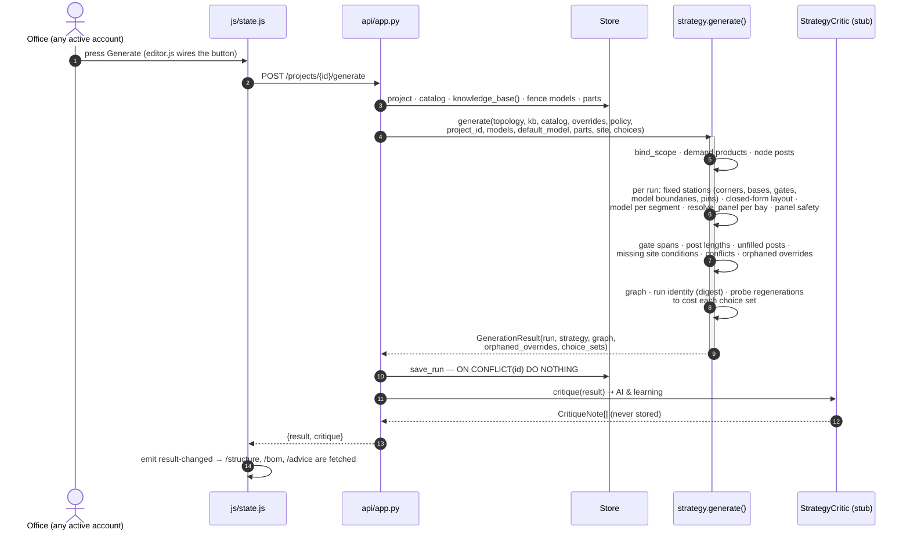
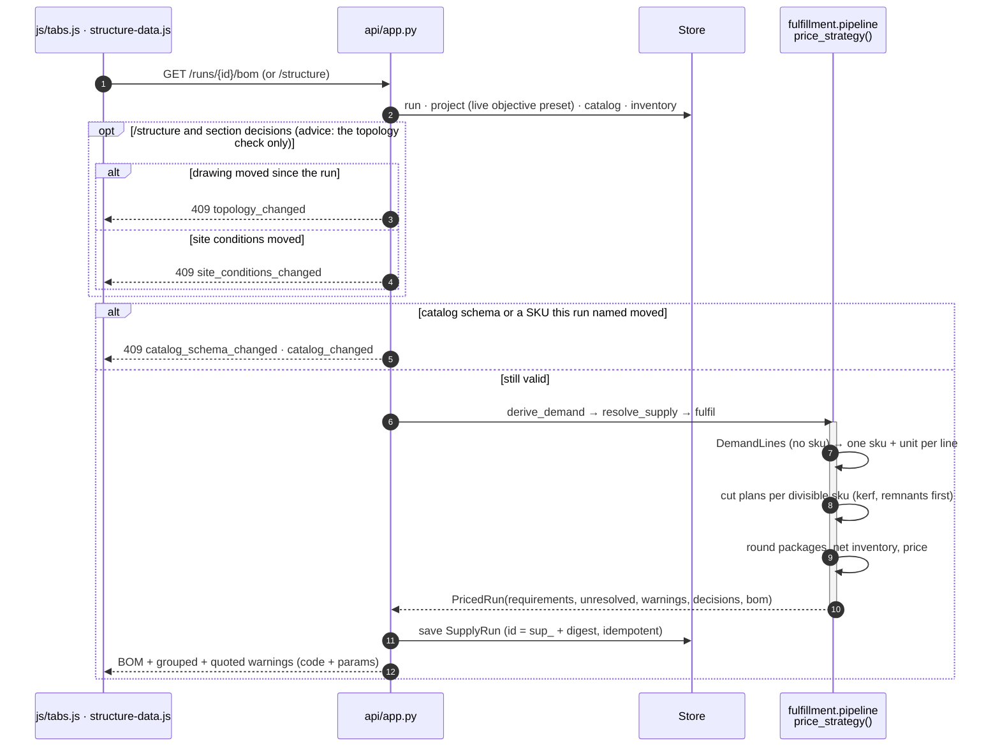
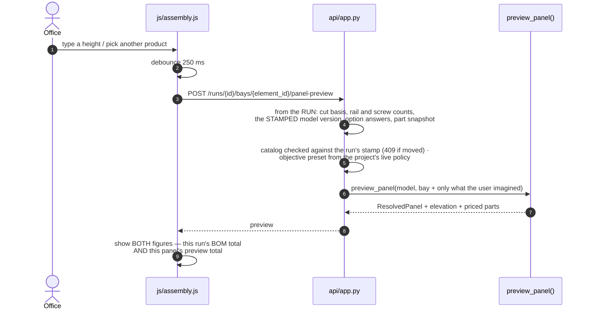
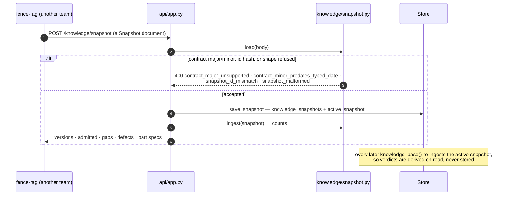
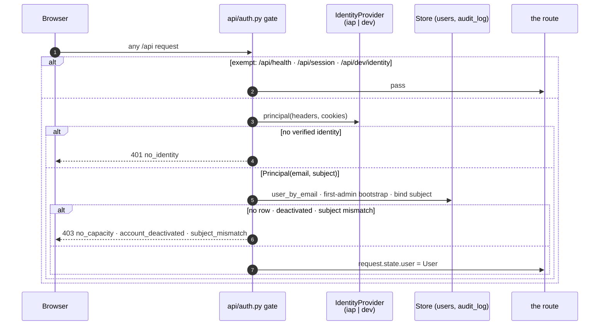
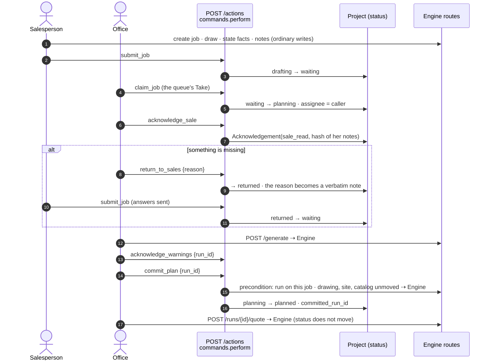
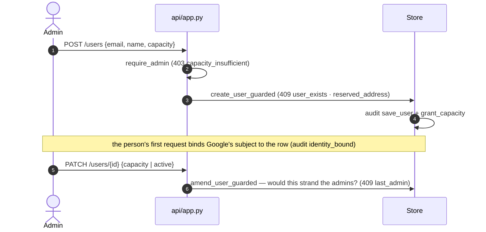
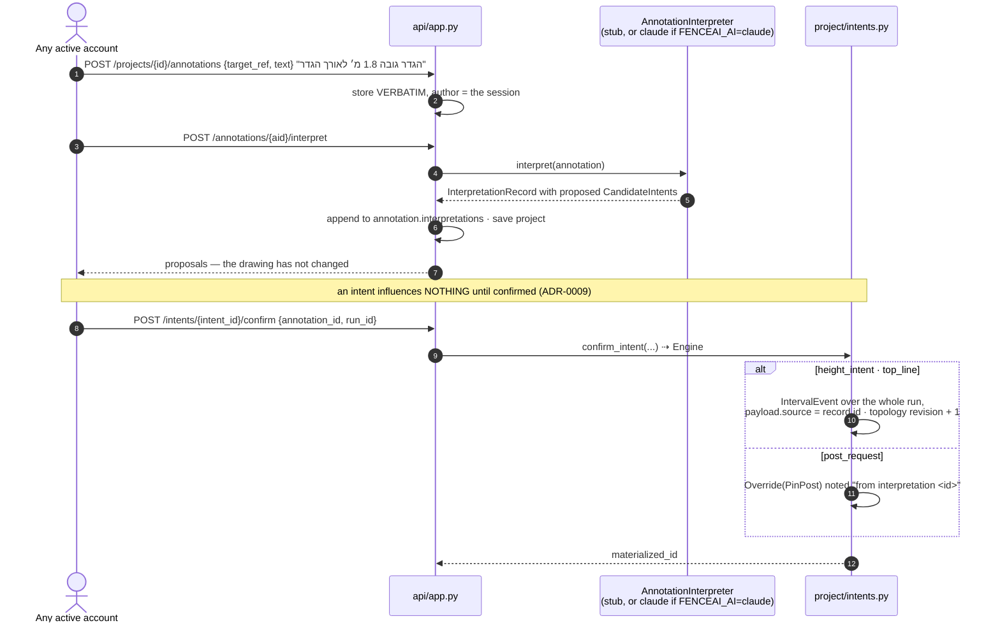
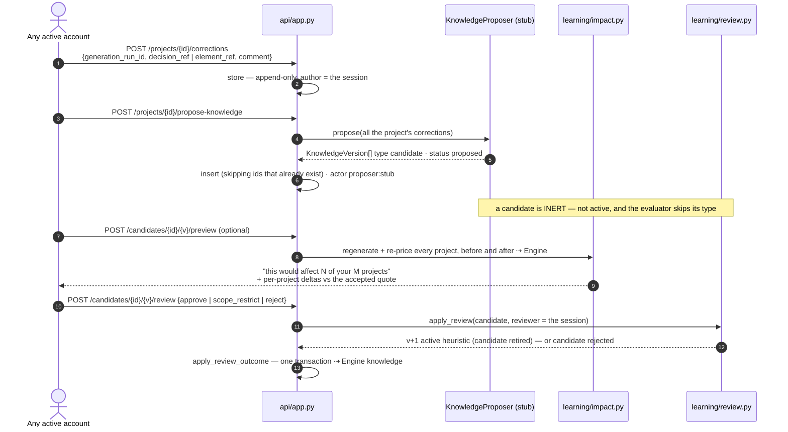
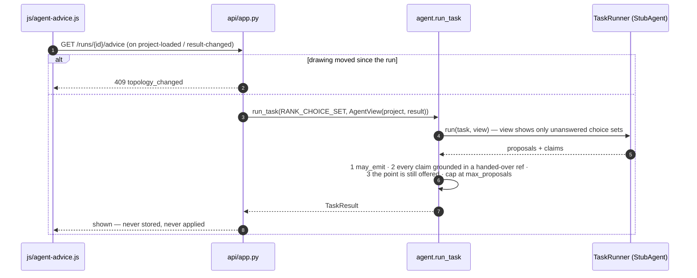

# 03 — Flows

The sequences worth knowing, grouped by the plane that owns them (see
[`00-overview.md`](00-overview.md#three-planes)). Where a flow crosses into another
plane the crossing is marked **⇢ plane** at the step where it happens.

| Plane | Flows |
|---|---|
| **Engine** | [E1 Generate](#e1-generate-a-strategy) · [E2 Read a priced run](#e2-read-a-priced-run--and-refuse-a-stale-one) · [E3 A what-if that never generates](#e3-a-what-if-that-never-generates) · [E4 Published knowledge arrives](#e4-published-knowledge-arrives) |
| **People & work** | [P1 A request is identified](#p1-a-request-is-identified) · [P2 A job goes from the sale to a plan](#p2-a-job-goes-from-the-sale-to-a-plan) · [P3 An admin grants a capacity](#p3-an-admin-grants-a-capacity) |
| **AI & learning** | [A1 Free text becomes structure](#a1-free-text-becomes-structure) · [A2 A correction becomes knowledge](#a2-a-correction-becomes-knowledge) · [A3 Advice on an open question](#a3-advice-on-an-open-question) |

Every `/api` request first passes the identity gate (P1); the diagrams below start
after it.

---

## Engine

### E1. Generate a strategy

The only place a fence is decided. Explicit, never automatic.

**`generate()` is pure and deterministic** (ADR-0004). Same inputs, same fence,
same run id — which is what makes the run-id digest, immutable quotes, the portfolio
impact preview and the golden scenarios possible. Generation checks no capacity and
no job state: the office road's Generate is a plain engine call.

**A model boundary is a structural boundary.** A `fence_model` interval event adds
its stations to the fixed set, so no bay ever straddles the place where the fence
visibly changes — spans sample their properties at the mid-point, which would
otherwise hand one model's panel to a bay that is half another's.

**Choice sets are costed, not chosen.** Where the data leaves two admissible
layouts, the generator records a `ChoiceSet` and prices each point by regenerating
with `offer_alternatives=False`. A person answers it (`PUT /projects/{id}/choices`)
and the answer becomes an input to the next run; the agent may only rank it (A3).

**A failure is refused, not stored.** `GenerationFailure` is a 422: a coded one
(`fence_model_invalid`, `post_spec_conflict`, a hard panel limit, …) carries
`code + params` and renders in the reader's language; a hard tie between authored
rules currently carries only the constraint refs and answers an English string.
Nothing is written to `generation_runs`.

---

### E2. Read a priced run — and refuse a stale one

Pricing is re-run on every read, against today's catalog and stock, by one pipeline.

**One pipeline, three call sites.** `api._priced` serves `/bom`, `/structure`,
`/quote`, `/explain`, section decisions, `/readiness` and `/flags`;
`learning/impact.py` uses it for the three impact previews; and
`fencemodel/preview.py` for the three panel previews. The phases are declared
(`fulfillment/phases.py: PIPELINE`) and their order is checked at import. They were
four hand-written copies once, and the copies had already diverged: `create_quote`
loaded the catalog directly, so the one endpoint freezing an immutable commercial
document was the only one exempt from the staleness check.

**The BOM refuses a moved catalog and nothing else.** It describes the run, not the
drawing, so it stays readable after the drawing is edited. The views that lay the run
over the drawing refuse instead, because "the decisions for section A" stops being a
true sentence once A may have moved.

**`catalog_hash` is narrowed to what a run named** — chosen SKUs, every eligibility
rival, kit components transitively. Adding an unrelated product no longer 409s every
prior run; repricing one it bought still does. Safe only because **eligibility is
frozen into the run**.

**A quote is a supply run somebody stood behind.** `POST /runs/{id}/quote` refuses a
moved site or catalog and any unresolved supply (400 `unresolved_supply`), then
freezes requirements, BOM and the three hashes. Accepting it supersedes the
project's previously accepted quote. Neither act moves the job's status — see
[`people-and-work.md`](people-and-work.md).

---

### E3. A what-if that never generates

The Assembly tab prices an imagined panel without touching the stored run.

**The route reads what the run decided off the run.** An earlier version priced a
stored bay through the model-scoped preview route, which hardcodes `least_cost`,
hardcodes `length_basis="width"` and reads the live catalog — it marked the wrong
product as chosen and priced a bay at 51% of what it cost, under a tag that said *"as
generated"*. The preset is the one deliberate live read: it is a supply choice, not
part of the design's identity, and it is the same preset `/bom` prices under. The
route's docstring still says "the run's preset"; the code is the authority.

**Two numbers with the same shape and different meanings are named, always.** The
cost strip never silently switches one figure's meaning underneath the reader, and
generation stays behind its own button.

---

### E4. Published knowledge arrives

The boundary door with fence-rag (contract v1.3). Loading is explicit and never
automatic.

Published rows become `fact` versions beside the authored ones and resolve in
`generate()` like any other knowledge. Nothing flows back: the contract's "report
gaps" obligation has no implementation, and `POST /source-refs:batch` answers from a
vendored fixture rather than a live Discovery API. Details:
[`knowledge-system.md`](knowledge-system.md).

---

## People & work

### P1. A request is identified

The browser asks `GET /api/session` once, last, after every module is listening; the
answer sets the view and emits `signed-in` or `signed-out`. A sales account lands on
its jobs, an office or admin account on the queue. The rules — capacity versus view,
bootstrap, last admin, the actor is the caller — are in
[`people-and-work.md`](people-and-work.md).

---

### P2. A job goes from the sale to a plan

Every move is a command through one door, `POST /projects/{id}/actions`; field edits
(customer, address, the drawing) are ordinary writes.

`perform` asks capacity → performable → state → payload → precondition, in that
order, and logs `command:<kind>` only on success. `quoted` and `delivered` are
declared states that no command reaches. The state machine and the full command
table are in [`people-and-work.md`](people-and-work.md).

---

### P3. An admin grants a capacity

---

## AI & learning

### A1. Free text becomes structure

Foundation §9's central loop, and the one place AI touches authored reality — always
through a person.

`run_id` here is a TOPOLOGY run id, not a generation run. `material_preference` and
`other` cannot be confirmed (400), and nothing writes an intent's `rejected` status.
The stub understands the demo vocabulary in **English and Hebrew** and is
deliberately capped — it must not become a second rule engine.

---

### A2. A correction becomes knowledge

**Impact can be shown before the change** (foundation §11), but the review does not
require it — preview and review are separate requests. A project that was *already*
failing is reported as `baseline_failed` and not counted as affected. The preview
regenerates without the project's answered choice sets.

---

### A3. Advice on an open question

The one action kind the agent may propose, `select_choice_point`, is registered in
the desk's command table with no capacities, so `POST /actions` refuses it to
everyone ⇢ People & work. Answering the question is still a person's
`PUT /projects/{id}/choices`.
