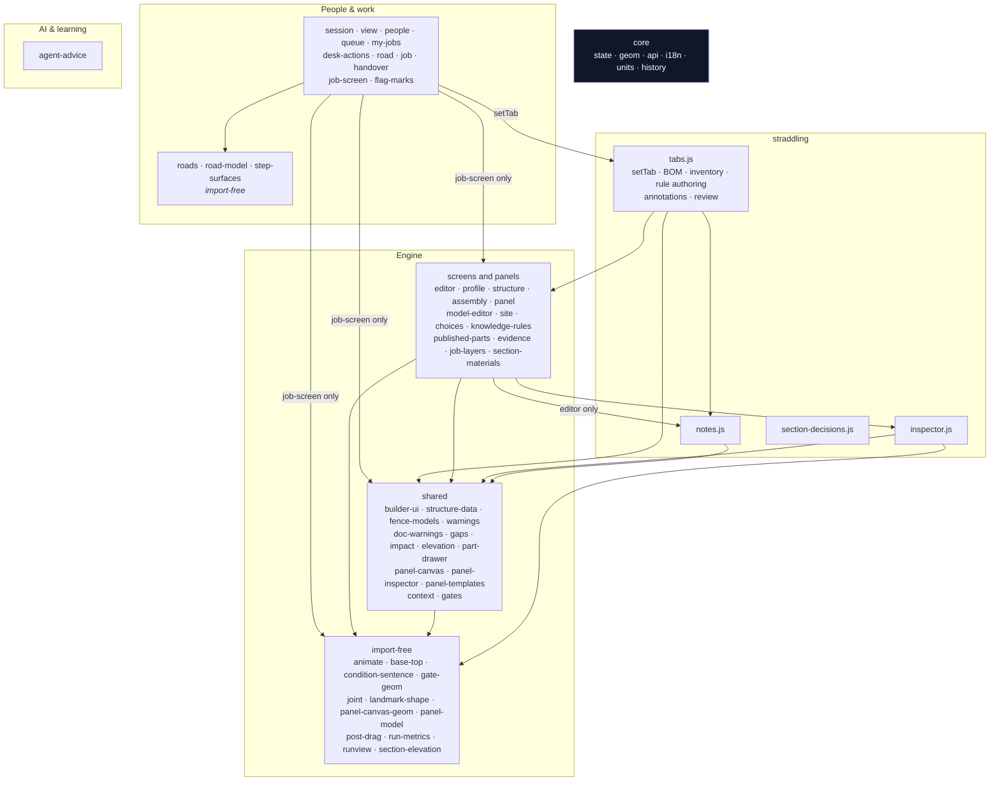
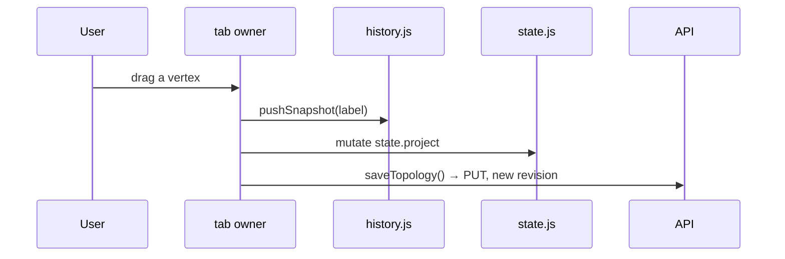

# 05 — Frontend

64 ES modules under `src/fenceai/web/static/js/`, plus `app.js` — the composition
root — and SVG and CSS. **No framework, no build step, no CDN** — fonts are bundled,
modules are loaded natively by the browser (ADR-0010). Hebrew-first RTL with an
English toggle.

The browser carries all three planes of [`00-overview.md`](00-overview.md): the
**engine** (the drawing, generation results, the BOM, the structure sheet, fence
models, parts, knowledge rules), **people & work** (who is signed in, people
admin, the two homes, the roads, the desk's acts, the handover, the office's job
screen) and **AI & learning** (annotation interpretation and confirmation, agent
advice, corrections → candidates → review), plus a small **core** that belongs to
none of them. The planes are a way of reading the module map below; nothing in the
browser enforces them, and a handful of modules straddle two.

---

## The rule

> Modules communicate **only** through `state.js` (events and exports). No module
> touches another module's DOM subtree.

`state.js` is the hub. It holds the open project and its last run (`result`,
`critique`), the selection, the display preferences (`locale`, `units`, `view`),
who is signed in (`me`, `mayChooseView`, `authStatus` / `authCode` /
`authEmail`, written by `session.js`), the road step (`step`, written by
`road.js`), whether the office is reading (`officeReading`, written by
`job-screen.js`), the armed tool, the draft and the id sequences. It owns the bus
(`on` / `emit`), the project's lifecycle and shared writes — open, create, reload,
save topology, context and `stated`, generate — and `runCommand`, the one client of
the command door. Narrower writes (the site, the job fields, choices, overrides,
the fence model) are made by the module that owns the panel, which then calls
`reloadProject()` rather than writing the project back itself.

**A module owns DOM ids, not a tab.** Its header comment names the hosts it owns,
either looked up in `index.html` or created by itself when the page has none
(`#job-panel`, `#context-panel`, `#choices`, `#handover-panel`, `#step-done`). Most
tabs have one owner; the canvas tab is shared by most of the modules on the page,
each owning one panel or SVG group in it; `tabs.js` owns four tabs, the Knowledge
author pane and the Knowledge sub-navigation.

**Where the rule bends today:**

* `editor.js`'s "see the BOM" link clicks `#tabs button[data-tab="bom"]` rather
  than calling `tabs.js: setTab`, which exists precisely so nobody pokes that strip.
* `choices.js` positions its self-created `#choices` after `site.js`'s
  `#site-conditions`.
* `html[data-locked]` has two writers (`my-jobs.js`, `job-screen.js`) and
  `view-changed` two emitters (`view.js`, `job-screen.js`). Both writers compute the
  same `state.js: drawingLocked()` answer, so they agree, but neither is
  single-owner.

---

## Modules by plane

Routes are abbreviated: `P/` is `/api/projects/{id}/`, `R/` is `/api/runs/{run}/`.
"via state" means the module mutates `state.project` and calls the `state.js` save.
A module marked † straddles planes; it is listed under its main plane, and its
other half appears in the other plane's table.

### Engine

What the fence is and what it costs. Nothing here imports a People & work or AI
module except `notes.js`: `editor.js` hands it the thing a click landed on, because
a note is attached by clicking the drawing, and `tabs.js` borrows its
`targetLabel` to name a note's target on the Annotations tab.

| Module | What it does | Routes |
|---|---|---|
| `editor.js` | The plan canvas: topology and strategy overlay, every drawing tool and drag (nodes, posts, gates, landmark grips), overrides, Generate, status bar, summary, `#warnings`, `#gaps`, note-target routing. Enforces the drawing lock. | POST/DELETE `P/overrides[/{id}]`; via state: PUT `P/topology`, `P/context`, POST `P/generate` |
| `profile.js` | The side view `#profile`: ground, base, height, post tops; 5×/1× exaggeration; the base bar; drags. Enforces the lock. | POST/DELETE `P/overrides`; via state: PUT `P/topology` |
| `context.js` | The property layer: landmarks in `#g-context`, the draft, `#g-landmark-grips`, a self-created `#context-panel`. Saves through `saveContext`, never through topology. | via state: PUT `P/context` |
| `gates.js` | `#gates-panel` (which kit, the placed gates) and `#g-gates` (gate spans and in-run gates drawn from the topology, swing options, grips). | via state: PUT `P/topology` |
| `site.js` | `#site-conditions`: five tri-state site dimensions and the `#site-more` fold. | PUT `P/site` |
| `choices.js` | Open questions (choice sets): answer or clear one without generating; self-created `#choices`. | PUT `P/choices`; DELETE `P/choices/{set}?scope=` |
| `structure.js` | Structure tab: setting-out table, bay schedule, parts, installer/customer detail, print, annexe. | — (through `structure-data.js`) |
| `assembly.js` | Assembly tab: macro run elevation and micro panel on one bay selection, joint sections, part drawer, assembly film, the macro `MEMBER_BUDGET`. | GET `P/inventory`; POST `R/bays/{el}/panel-preview`; GET `R/bom` |
| `panel.js` | Panel tab (model picker, priced preview) and `#model-row` in the canvas aside. | POST `/api/fence-models/{id}/{v}/preview`; PUT `P/fence-model` |
| `model-editor.js` | Models tab: library, editor session (canvas, inspector, axes, JSON), draft, preview, impact, publish, retire, template gallery. | POST `/api/fence-models`; GET `…/{id}/{v}`; PUT `…/{id}/draft`; POST `…/{id}/preview-impact`, `…/{id}/{v}/publish`, `…/{id}/{v}/status`; POST `/api/fence-models/preview` |
| `knowledge-rules.js` | Knowledge → Rules pane: the rules in force (proposed versions counted, retired folded away), retire. | GET `/api/knowledge`; POST `/api/knowledge/{o}/{v}/retire` |
| `published-parts.js` | Knowledge → Published pane, read-only. | GET `/api/knowledge/parts` |
| `evidence.js` | `#evidence-viewer`, outside every tab: resolves every `.evidence-link` on screen in one batch into crop, quote and provenance. | POST `/api/source-refs:batch` |
| `tabs.js` † | BOM tab with quotes, Inventory tab, Knowledge → Author pane; also `setTab`. | GET `R/bom`, `P/quotes`, `/api/quotes/{q}`; POST `R/quote`, `/api/quotes/{q}/accept`; GET/PUT `P/inventory`; POST `/api/knowledge`, `/api/knowledge/preview-impact` |
| `inspector.js` † | `#inspector` (an element's decision trail, post override directives) and `#run-editing-panel` (run select, typed run metrics, events, override list). | GET `R/explain/{el}`; POST/DELETE `P/overrides` |
| `section-decisions.js` † | The selected section's decisions: what governed it, what admitted it. | GET `R/sections/{s}/decisions` |
| `structure-data.js` | The one structure-report cache: in-flight guard, tags, stale keys (topology / site). | GET `R/structure` |
| `builder-ui.js` | Row-editor DOM builders, `skuSelect`, the Advanced-JSON toggle, `actionSentence` / `scopeChips`; the single promise caches for catalog, parts, part types and vocabularies. | GET `/api/catalog`, `/api/parts`, `/api/part-types`, `/api/vocabularies` |
| `fence-models.js` | Cached model listing and localized model names. | GET `/api/fence-models` |
| `warnings.js` | `code + params` → localized warning rows and supply-problem rows. | — |
| `doc-warnings.js` | Warnings quoted from documents, verbatim; product and model warnings; the annexe. Returns HTML strings. | — |
| `gaps.js` | A run's Gaps grouped by `closes_by`, with `would_close` on the row. | — |
| `impact.js` | Renders an ImpactReport into the caller's container — for rule authoring, the model publish gate and candidate review. | — |
| `elevation.js` | Draws the server's `PanelElevation`; its one transform is the y-flip; layout shared with `panel-canvas.js`. | — |
| `panel-canvas.js` | Interaction layer over the panel elevation in the model editor. | — |
| `panel-inspector.js` | Detached-DOM inspector for a selected panel element; the part / eligibility picker. | — |
| `panel-templates.js` | Five starter panel structures for "New model". | — |
| `part-drawer.js` | Joins panel × catalog × inventory into the drawer's rows. | — |
| `job-layers.js` | Emphasis layers in `#g-layers` (surface bands, height ribbon), with a `PROTECTED` list no layer may affect. Drawn only for `job-screen.js`. | — |
| `section-materials.js` | Cut pieces per stretch for an office job card — never money or bars, which are pooled across the job. Drawn only for `job-screen.js`. | — |
| `animate.js` | Import-free: the assembly film's build order and clock. | — |
| `base-top.js` | Import-free: base-top profile transforms (height, level, match, step). | — |
| `intervals.js` | Import-free: `carveInterval` — a new interval takes its stretch from older ones of its kind (trimmed, split, or dropped). The height tool's replace; the generator reads the FIRST covering height. | — |
| `condition-sentence.js` | Import-free: a variant condition `Expr` ⇄ a sentence. | — |
| `gate-geom.js` | Import-free: gate opening, leaf, arc, slide, `swingOptions`. | — |
| `joint.js` | Import-free: joint-section geometry from a `JointDetail`. | — |
| `landmark-shape.js` | Import-free: the landmark registry's drawing half, gestures, bearing snap, band grips, rect and circle metrics. | — |
| `panel-canvas-geom.js` | Import-free: panel-canvas handles and drag transforms. | — |
| `panel-model.js` | Import-free: fence-model vocabularies, default factories, `eligibilitySource`, part helpers. | — |
| `post-drag.js` | Import-free: post-drag arithmetic (pin layout, violations, snaps). | — |
| `run-metrics.js` | Import-free: a stretch's length and bearing, read and write. | — |
| `runview.js` | Import-free: macro elevation placement from the StructureReport. | — |
| `section-elevation.js` | Import-free: one stretch from the side, for an office job card. | — |

### People & work

Who is asking, what they may do, and where the job is — the screen half of
[`people-and-work.md`](people-and-work.md). Its imports reach the engine in two
places only: `job-screen.js` renders engine read models, and the four modules that
navigate (`desk-actions`, `my-jobs`, `queue`, `road`) import `tabs.js` for `setTab`.

| Module | What it does | Routes |
|---|---|---|
| `session.js` | The one `/api/session` client: `sessionState`, `isRefused`, `refusalTextKey`, `showsAskAnAdmin`; dev `become`; `pickProject` / `lastProjectKey`; `signOut`. Emits `signed-in` / `signed-out`. | GET `/api/session`; POST/DELETE `/api/dev/identity` |
| `view.js` | Which view is shown (`sales` · `backoffice` · `all`): `html[data-view]`, the hide lists, `SALES_TABS`; re-applies static strings on a change. | — |
| `people.js` | The People tab: list, grant, change capacity, deactivate / reactivate; nothing is fetched until the tab is opened. | GET `/api/users`; POST `/api/users`; PATCH `/api/users/{id}` |
| `queue.js` | The office's home, the Jobs tab: open and finished lists, filters, *Take* (`claim_job`), *Reopen* (`reopen_job`), open a job. | GET `/api/queue`; POST `P/actions` |
| `my-jobs.js` | The salesperson's home `#tab-myjobs`; `#finish-job` (`submit_job`, back home); a `data-locked` writer; the sales status words. | GET `/api/my-jobs`; POST `P/actions` |
| `desk-actions.js` | The office's acts per step (`deskActs`), in `#desk-actions` or `#desk-actions-plan`. | POST `P/actions` |
| `roads.js` | Import-free: the road definitions, `SALES_ROAD` and `OFFICE_ROAD`. | — |
| `road-model.js` | Import-free: groups handover and readiness gaps into step states. | — |
| `step-surfaces.js` | Import-free: what each step of each road keeps on screen, and the tool it arms. | — |
| `road.js` | The `#road` band and a self-created `#step-done`; `html[data-step]`; switches tab and tool per step; the skip chips; loads readiness for the office. | GET `P/readiness`; via state: PUT `P/stated` |
| `job.js` | Step 1's job form (customer, address, sold by, sold on) in a self-created `#job-panel`. | PUT `P/job` |
| `handover.js` | "What the office still needs" and the estimate, in a self-created `#handover-panel`; publishes `state.handover` for the road. | GET `P/handover`; GET `R/bom` |
| `job-screen.js` † | The office's reading surface `#job-screen`: the read/edit switch, layer rail, flags list, a card per stretch. | GET `P/sections`, `P/flags`, `R/bom`, `R/structure` |
| `flag-marks.js` | Draws `report/flags.py`'s placements as `!` / `?` glyphs in `#g-flags`; never invents a place. Used only by `job-screen.js`. | — |
| `notes.js` † | Notes on the drawing: `#notes-panel`, `#g-notes`, the write popover, `isFromOffice`, `targetLabel`. | POST `P/annotations` |
| `change-log.js` | The job's history `#change-log`: a closed `<details>`, fetched only while open; refreshed on `project-loaded`, `context-changed`, `job-changed`. Kept by the office's reading mode and step `sale`, and the sales step `review`. | GET `P/changes` |
| `change-text.js` | One change as a sentence: `change.<code>`, words looked up (states, surfaces, landmarks, areas), people named from the route's map, lengths in the reader's unit. Node-tested. | — |

### AI & learning

What a model suggests and how an expert's correction becomes a rule — the screen
half of [`ai-layer.md`](ai-layer.md). Only one module is wholly this plane, and it
imports nothing but core. Every other AI surface is half of a straddler, and every
one of them ends at a person's button: confirm an intent, approve a candidate.
Nothing on screen applies advice.

| Module | What it does | Routes |
|---|---|---|
| `agent-advice.js` | `#agent-advice`, beside the choices: the advisory agent's suggestions for the current run. Advise-only — no keep/reverse — and keeps "not evaluated", "none" and "all refused" distinct. | GET `R/advice` |
| `tabs.js` † — Annotations tab | Add a note, ask for its interpretation, confirm an intent. | POST `P/annotations`, `P/annotations/{a}/interpret`, `P/intents/{c}/confirm` |
| `tabs.js` † — Review tab | The candidate queue: preview impact, approve / narrow scope / reject; *Propose knowledge from corrections*. | GET `/api/candidates`; POST `/api/candidates/{o}/{v}/preview`, `…/review`; POST `P/propose-knowledge` |
| `inspector.js` † — *record a correction* | A correction against an element of the current run. | POST `P/corrections` |
| `section-decisions.js` † — comment threads | A comment on a decision becomes a correction, and corrections a proposal. | GET/POST `P/corrections`; POST `P/propose-knowledge` |
| `notes.js` † | Writes the annotations interpretation reads; interprets nothing itself. | (POST `P/annotations`, above) |

### Core

Belongs to no plane. The six core modules import nothing outside core; `app.js`
imports every plane, because composing them is its job.

| Module | What it does | Routes |
|---|---|---|
| `state.js` | State and bus; open, create and save a project; save context and `stated`; generate; `runCommand`; `drawingLocked`; `maxSpanFor`. | GET `/api/projects`, `/api/projects/{id}`, `P/runs`, `R`; POST `/api/projects`; PUT `P/topology`, `P/context`, `P/stated`; POST `P/generate`, `P/actions` |
| `geom.js` | Geometry and SVG helpers: `toPx`, stations, `anchorFor` / `stationOfAnchor`, hit tests, ground samples. Reads `state.project`. | — |
| `api.js` | `apiGet` / `apiSend` (a localized `error.<code>` alert, a `quiet` option) and `esc()`. | any |
| `i18n.js` | `t()` with the `sales.<key>` layer, the locale tables, `applyStatic`; sets `lang` and `dir`. Hebrew by default. | GET `i18n/{locale}.json` (static) |
| `units.js` | mm/cm conversion, `tu` / `sentence`, `money`, `enumWord` / `roleWord`, `#btn-units`. | — |
| `history.js` | The undo stack — see [Mutation discipline](#mutation-discipline). | POST/DELETE `P/overrides`; PUT/DELETE `P/choices`; via state: PUT `P/context`, `P/stated`, `P/topology` |
| `app.js` | Composition: init order, the header (new job, locale, units, view select), the login, no-access and signed-in chip, opening the workspace on sign-in, the undo buttons. | GET `/api/health` |

### Modules that straddle planes

* **`tabs.js`** — BOM, quotes, inventory and rule authoring are engine; the
  Annotations tab (interpret, confirm) and the Review queue are AI & learning; and
  `setTab` is the shell every road and home navigates by. Because `setTab` lives
  here, the four People & work modules that navigate carry the BOM, knowledge and
  review screens in their import closure. It wants splitting.
* **`inspector.js`** — the decision trail, overrides and run editing are engine;
  the *record a correction* box is the first step of the learning loop.
* **`section-decisions.js`** — the decision graph's read model is engine; its
  comment threads turn into corrections and a knowledge proposal.
* **`notes.js`** — notes are the salesperson's promises and the office's questions
  (people & work), and annotations are what interpretation reads (AI). It never
  interprets anything; it is also the one module from outside the engine that an
  engine module imports.
* **`job-screen.js` and its helpers** — a People & work screen drawn mostly from
  engine read models: `job-layers.js`, `section-elevation.js` and
  `section-materials.js` are engine drawings used nowhere else, and
  `flag-marks.js` draws the people plane's `/flags` placements.
* **`handover.js`** — the handover is people & work, and its estimate reads the
  engine's BOM.
* **`context.js`** — listed under the engine because it draws on the plan canvas
  beside the fence, but the landmarks it edits are the job's `SiteContext`, which
  is people & work data ([`02-entities.md`](02-entities.md) Part II): unrevisioned,
  saved through `PUT /context`, and never a `generate()` input.
* **`editor.js`, `profile.js`, `gates.js`** — engine modules that enforce the
  people plane's lock (`state.js: drawingLocked`), which reads the view, the job's
  status and the office's mode.
* **`app.js`** — the shell, and the place identity is wired to the screen (the
  login, the no-access screen, opening the workspace on `signed-in`).

---

## How the modules depend on each other



*Every import between these boxes is drawn except the edges into core, which nearly
every box has; edges inside a box and `app.js`'s imports of every plane are left
out. `agent-advice.js` and `section-decisions.js` import core and nothing else.*

**Two cycles, both inside core.** `state.js` and `geom.js` import each other
(`state` builds anchors with `geom.anchorFor`; `geom` reads `state.project`), and
`api.js` → `i18n.js` → `state.js` → `api.js` closes a second loop (`api` localizes
its error alert with `t()`, `i18n` reads `state.locale` and emits through the bus,
`state` fetches through `api`). ES modules tolerate both because none of the four
uses another at module-evaluation time. It is the one place the layering is not
strict, and the reason `i18n.js` reads `state.view` rather than importing `view.js`.

**Dynamic `import()` appears in four modules, and none of them breaks a real
cycle.** `session.js` loads `view.js` lazily, by its own comment to stay out of the
cycle above — though nothing imports `session.js` but `app.js`, so a static import
would only hang it off the loop. `job-screen.js` defers `editor.js` until a card is
clicked, for load cost, although `app.js` imports `editor.js` statically anyway.
`context.js` and `queue.js` re-import `state.js`, which both already import
statically, and `queue.js` loads `my-jobs.js` (for `refusalText`) the same way.

**These modules import nothing**, which is what makes them node-testable with no
DOM: `animate`, `base-top`, `condition-sentence`, `gate-geom`, `joint`,
`landmark-shape`, `panel-canvas-geom`, `panel-model`, `post-drag`, `road-model`,
`roads`, `run-metrics`, `runview`, `section-elevation`, `step-surfaces`. `api.js`
is not one of them: it imports `i18n.js`, fetches, and raises an `alert`.

**Most requests go through `api.js`, and seven modules call `fetch` themselves** —
mostly so that a refusal renders on the screen in the reader's language instead of
raising `apiSend`'s alert: `session.js`, `state.js: runCommand`, `people.js`
(its list), `my-jobs.js`, `queue.js`, `road.js` (`/readiness`) and `job-screen.js`.
Two of them bypass something they should not: the queue's *Take* sends `claim_job`
without `runCommand` and without reading the answer, and `job-screen.js` fetches
`/structure` itself rather than through the `structure-data.js` cache.

---

## The bus

`state.js: on` / `emit` over one `EventTarget`. `state.js` emits six events; the
other seventeen are emitted by the module that owns the change.

| Event | Emitted by | Listened to by |
|---|---|---|
| `project-opened` | `state` — a true project switch | `history` (resets the stack), `app` (remembers the job per account) |
| `project-loaded` | `state` — every open, reload, topology or `stated` save | 20 modules |
| `result-changed` | `state` — after Generate | 14 modules |
| `selection-changed` | `state` | `assembly`, `editor`, `inspector`, `job-screen`, `profile`, `section-decisions`, `structure` |
| `context-changed` | `state` — after `saveContext` | `context`, `handover`, `notes`, `app` |
| `tool-changed` | `state` | `context`, `editor` |
| `topology-changed` | `history` only, after an undo/redo restore | `gates`, `inspector`, `notes`, `profile`, `app` |
| `locale-changed` | `i18n` | 25 modules |
| `units-changed` | `units` | 17 modules |
| `view-changed` | `view`; `job-screen` when the office toggles reading/editing | `context`, `desk-actions`, `gates`, `handover`, `job`, `job-screen`, `my-jobs`, `notes`, `road` |
| `tab-changed` | `tabs` (`setTab`) | `assembly`, `model-editor`, `my-jobs`, `panel`, `people`, `published-parts`, `queue`, `road`, `structure` |
| `signed-in` | `session` | `desk-actions`, `my-jobs`, `queue`, `app` |
| `signed-out` | `session` | `queue`, `app` |
| `step-changed` | `road`, after `data-step` is set | `context`, `desk-actions` |
| `road-go` | `app`, `my-jobs` — "go to this step" | `road` |
| `road-advance` | `desk-actions` — a step's own act finished it | `road` |
| `job-changed` | `job` — step 1 saved | `handover`, `road` |
| `handover-changed` | `handover` | `road` |
| `structure-loaded` | `structure-data` | `assembly`, `editor`, `profile`, `structure` |
| `fit-view` | `structure` — frame the plan before printing | `context`, `editor`, `notes` |
| `inventory-saved` | `tabs` | `assembly`, `structure-data` |
| `fence-models-changed` | `fence-models` | `panel` |
| `knowledge-counts` | `knowledge-rules` | `tabs` (the Rules sub-pane's count) |

* **`topology-changed` does not mean what it says.** A topology save emits
  `project-loaded`; only `history.js` emits `topology-changed`, after a restore. A
  module that must see every drawing change listens to `project-loaded`.
* **The comment in `state.js` that lists the events is incomplete.** It omits
  `project-opened`, `signed-in`, `signed-out`, `handover-changed`,
  `inventory-saved`, `knowledge-counts` and `road-advance`. This table is the list.
* **Two fields are written onto `state` at runtime and never declared** —
  `state.handover` (`handover.js`, the handover answer the road groups) and
  `state.readiness` (`road.js`, the office's readiness answer). That is the trap
  `state.js`'s own comments describe, and the reason it declares `view`,
  `officeReading` and `authStatus` up front.

---

## Screens, views and roads

### The page

`index.html` is one page: `#login-screen` (an email box and *Continue*, no
password), `#no-access`, a header (`#btn-new-project`, `#btn-my-jobs`,
`#btn-locale`, `#btn-units`, `#view-select`, `#ai-badge`, `#signed-in-as`), the tab
strip `nav#tabs`, the road band `nav#road`, thirteen `section.tab`s, and
`#evidence-viewer` outside every tab so a citation can open over any of them.

### The tabs

`tabs.js: setTab` is the only path that moves the `active` class, and it emits
`tab-changed`; the Knowledge, Review and BOM tabs render when they are shown. The
roads, both homes, the desk and `app.js` all navigate with it.

| Tab (`data-tab`) | Owner | What is on it |
|---|---|---|
| `myjobs` | `my-jobs.js` | the salesperson's jobs, each with the office's latest note |
| `queue` — "Jobs" | `queue.js` | the office queue: open and finished lists, filters, *Take*, *Reopen* |
| `canvas` — "Topology & Strategy" | shared | the plan, the side view and the side panels (below); active by default |
| `annotations` | `tabs.js` | add a note, interpret it, confirm an intent |
| `knowledge` | three modules | sub-panes `rules` (`knowledge-rules.js`), `author` (`tabs.js`), `published` (`published-parts.js`), switched by `tabs.js: setKnowledgePane` |
| `review` | `tabs.js` | the candidate queue |
| `structure` | `structure.js` | the structure sheet; also hosts `#desk-actions-plan` |
| `assembly` | `assembly.js` | macro and micro views, joint sections, part drawer, assembly film |
| `panel` | `panel.js` | model picker and priced preview |
| `models` | `model-editor.js` | the fence-model editor |
| `people` | `people.js` | accounts and capacities |
| `bom` | `tabs.js` | the BOM and quotes |
| `inventory` | `tabs.js` | the inventory editor |

The canvas tab is the toolbar rail plus two columns. The **canvas column** runs
`#job-panel` (put at the top by `job.js`), `#finish-job`, `#desk-actions`,
`#generate-toolbar`, `svg#canvas`, `#statusbar`, `#strategy-summary`, `#warnings`,
`#gaps`, `#profile`, and `#step-done` (appended by `road.js`). The SVG's groups,
bottom to top, are `g-grid`, `g-context`, `g-context-draft`, `g-layers`,
`g-topology`, `g-overlay`, `g-handles`, `g-draft`, `g-gates`, `g-notes`, `g-flags`,
`g-landmark-grips`, `g-snap`. The **side column** runs `#context-panel` (put at the
top by `context.js`), `#job-screen`, `#model-row`, `#site-conditions`, `#choices`
(inserted after it by `choices.js`), `#agent-advice`, `#gates-panel`,
`#notes-panel`, `#run-editing-panel`, `#inspector`, `#section-decisions`, and
`#handover-panel` (appended by `handover.js`).

### Views are presentation, never permission

A view (`view.js`) decides what is drawn; the server decides what is allowed, on
the capacity (see [`people-and-work.md`](people-and-work.md)). It lives on
`html[data-view]` and in `localStorage`, defaults to `all`, and after sign-in
`session.js` applies the server's `default_view(capacity)`. Only an admin is
offered `#view-select`. Hiding is CSS: `view.js` owns the hide lists, `style.css`
repeats them, `tests/web/test_view_sync.py` checks the two copies are equal, and
`test_view_module.py` checks every selector against the real page — a hide-list
that matches nothing hides nothing and looks fine.

| View | Hides | Navigates by |
|---|---|---|
| `sales` | the whole tab strip, every tab not in `SALES_TABS` (`myjobs`, `canvas`, `annotations`), and `#tool-pin`, `#override-list`, `#choices`, `#agent-advice`, `#section-decisions`, `#inspector`, `#gaps`, `#chk-overlay-label`, `#profile-exag`, `#model-row-hint` | the header's *My jobs* and the sales road. The annotations tab is kept but unreachable: the strip is hidden and no step points at it. |
| `backoffice` | the `knowledge`, `review`, `myjobs` and `people` tabs, and `#btn-my-jobs` | the tab strip and the office road — but every job opens in reading mode (below) |
| `all` | nothing | the tab strip; no road, no `data-step` |

**Where each capacity lands on sign-in.** A `sales` account gets the `sales` view
and lands on My jobs (`my-jobs.js`, on `signed-in`), where the road band hides
because no job is being walked. A `backoffice` account gets the `backoffice` view
and lands on the Jobs queue (`queue.js`, on `signed-in`). An `admin` gets the `all`
view, the view selector, and the Jobs queue. Behind every home, `app.js:
openWorkspace` opens the job this account last had open, or the first job, or
creates a demo job, so every panel has a project from the first moment. *New job*
(header or My jobs) creates an untitled project, shows the canvas and asks the
road for step 1 (`road-go "job"`). Opening a queue row opens that job on the
canvas; opening a My jobs row goes to the review step if the office has written on
it or needs information, otherwise to step 1 (`my-jobs.js: stepToOpen`).

### The office reads before it edits

**The office lands on every job reading, not editing.** `job-screen.js` owns
`#job-screen` in the side column — a mode switch, a layer rail, the flags list and
one card per stretch, each with its side elevation (`section-elevation.js`) and cut
pieces (`section-materials.js`) — and marks problems on the map itself
(`flag-marks.js` into `#g-flags`, `job-layers.js` into `#g-layers`). It is a layout
around the canvas, not a second plan renderer. While reading it sets
`html[data-jobmode="read"]`, which hides the road, the toolbar, the profile's base
bar, `#job-panel` and every side-column child but `#job-screen`; `#desk-actions`
stays, because acknowledging, sending back and rejecting are the office's own acts,
not edits to her drawing. It writes `state.officeReading`, and
`state.js: drawingLockedFor(view, status, reading)` locks the drawing for the
office by MODE exactly as it locks it for the salesperson by STATUS. *Start
editing* removes `data-jobmode`, brings the office road back whole, and emits
`view-changed` so the lock is re-read. The mode resets to reading whenever a
different job opens and is never remembered. It applies only in the `backoffice`
view; an admin, whose view is `all`, never sees it.

### Roads, mechanically

What each road's steps are, which findings each owns and which desk act each
offers is in [`people-and-work.md`](people-and-work.md) and is not repeated here.
The browser half is four modules — three import-free ones that decide, and one that
draws, the split `base-top.js` / `profile.js` make:

* **`roads.js` is data.** `SALES_ROAD` and `OFFICE_ROAD` each carry their `view`,
  an `anchor` code, and per step a `key`, the tab it lives on (`panel`), the codes
  it `requires` and `wants`, an optional `satisfiedBy` fact (which makes it
  skippable) and `commits` when the step has its own finishing control.
  `roadFor("all")` is `null`: that view has no road.
* **`road-model.js` groups and never recounts.** It folds the gaps `road.js` hands
  it — the handover's (`state.handover`) and, for the office only, readiness's
  (`state.readiness`) — into step states: `unknown`, `empty`, `skipped`,
  `blocked`, `missing`, `done`. Until an answer has arrived a step is `unknown` and
  claims nothing.
* **`road.js` draws it.** It builds the band once per road, sets
  `html[data-step]` (and removes it in a view with no road), then publishes
  `state.step` and emits `step-changed`. On a step it calls `setTab` with the step's
  panel and arms the step's tool (`step-surfaces.js: defaultToolForStep`). The Done
  button in `#step-done` is hidden on the last step and on every `commits` step;
  those steps advance on their own control — `job-changed` on the sales road's step
  1, `road-advance` from the desk. The skip chips write `stated` through
  `saveStated`, with an undo snapshot first. `road-go` jumps to a named step; a
  step this road does not have is ignored. The band hides on the My jobs tab.
* **`step-surfaces.js` decides what a step shows.** Each step of each road KEEPS
  tools, panels and parts of the drawing; everything the road scopes that a step
  does not keep is hidden (`STEP_HIDDEN`, derived per road), and
  `ROAD_HIDES_ENTIRELY` names what a road hides on every step — the generate button
  and both desk hosts on the sales road, the handover panel and `#finish-job` on
  the office road. `style.css` repeats the lists under `html[data-step]`, keyed on
  the step alone, and `tests/web/test_step_surfaces.py` checks the two copies are
  equal and that no two roads share a step key.

### The presentation contract

Six attributes on `<html>` carry the screen's state to the stylesheet. Every one of
them is presentation; none is a permission.

| Attribute | Written by | Values | Keys |
|---|---|---|---|
| `data-auth` | `app.js` | `pending` (shipped) · `out` · `in` · `denied` | the login screen, the no-access screen |
| `data-view` | `view.js` | `sales` · `backoffice` · `all` | the view hide lists |
| `data-selector` | `session.js` | `yes` · `no` | `#view-select` |
| `data-step` | `road.js` | the step key; absent with no road | the step keep-lists |
| `data-locked` | `my-jobs.js`, `job-screen.js` | `yes` · `no` | hides the tools, undo, redo, clear and the draft actions |
| `data-jobmode` | `job-screen.js` | `read`; absent while editing or off the office view | the office's reading layout |

`i18n.js` also sets `lang` and `dir`. What the browser keeps in `localStorage` is
convenience, never anything the server relies on: `fenceai.view`,
`fenceai.locale`, `fenceai.units`, `fenceai.lastProject.<userId>`,
`fenceai.structure.detail`, `fenceai.profile.open`, `fenceai.profile.scope`,
`fenceai.assembly.dims`, `fenceai.assembly.mode`.

---

## The property, and the promises about it

Two surfaces the salesperson's road leans on, and both are deliberately *outside*
`Topology`. A landmark and a note change no quantity, so neither may bump the
topology revision — a nudged driveway must not 409 the structure sheet.

**`landmark-shape.js` is the property registry's frontend half**, pure and
node-tested beside `base-top.js`. `project/model.py: LANDMARK_KINDS` says what is
*recordable*; this module says how each kind is *drawn*:

| gesture | kinds | what it makes |
|---|---|---|
| `polygon` | house | a closed shape built click by click — a building is not a box |
| `band` | street, sidewalk | a rectangle around the dragged centreline, so it has a **width** |
| `rect` | pool, boundary, other | the bbox of the drag |
| `circle` | tree | a 16-gon; there is one shape in the storage model, so a tree is a polygon that reads as a circle |

Only the house and the street are toolbar buttons. Everything else lives behind
one `#tool-other` picker: seven equal buttons on the rail is the opposite of the
screen a non-technical salesperson should open.

Because a band is a rectangle, it is **editable** — and so is anything else whose
four corners make one. `rectMetrics` reads `{center, angle_deg, length_mm,
width_mm}` off the corners and `rectFromMetrics` writes them back, which is what the
property panel's angle/length/width fields are; a street, a sidewalk, a pool, a
boundary and an "other" all get them. A tree's 16-gon reads back as `{center,
radius_mm}` (`circleMetrics`), so its row is a radius. `metricsKind` decides from
the points, not the kind. A free polygon — a click-built house — reads as neither
and is offered none: inventing an angle for it would silently square off a shape
somebody traced.

**Notes are attached by clicking the thing they are about.** `editor.js`
resolves what is under the pointer in a fixed order — point event, corner node,
run, landmark, else the job itself — and hands `notes.js` a
`{ref, label}`. Interval events (`base`, `height`, `model`) are deliberately not
matched: `base` spans a whole run, so matching it would mean no click on a fence
could ever be about the fence. `target_ref` gained `landmark:<id>` for this; the
field is a free string on purpose, and a note **outlives its referent** — the
drawing is mutable and verbatim human text is not, so every ref is resolved
defensively and an unresolvable one reads as "something no longer on the
drawing".

---

## The front door, and what the header no longer carries

**Signed out, the page is the login screen and nothing else.** `index.html` ships
`<html data-auth="pending">`; `app.js` calls `session.js: loadSession` last, after
every module is listening; that asks `GET /api/session`, and `app.js` sets
`data-auth` to `out`, `in`, or `denied` from the answer. `style.css` hides every
child of `body` except `#login-screen` until it reads `in`, and `pending` hides the
form too, so a signed-in reload never flashes it. No project is fetched before
sign-in: the workspace opens on the `signed-in` event. The account decides the view
(`identity/model.py: default_view`) — nobody picks a role on the way in, and only an
admin is offered `#view-select` afterwards.

Under the `dev` provider the login form is an impersonation picker:
`session.js: become(email)` posts to `/api/dev/identity`, which sets a cookie with
no credential, and re-reads the session. Under `iap` that route does not exist, so
`become` answers "refused"; a signed IAP assertion has identified the person before
the request arrives. **Signing out leaves the app.** `session.js: signOut` sends
`DELETE /api/dev/identity` — which clears the impersonation cookie under `dev` and
fails harmlessly under `iap` — and then sends the browser to IAP's logout
(`/?gcp-iap-mode=CLEAR_LOGIN_COOKIE`). Revoking access is central and for every
device at once, which this app could never promise by deleting a row of its own.
The page it lands on is a fresh load either way, which is what the open job, its
undo stack and every panel's cached answers need.

**`denied` is the third state, and it is new.** Google admits somebody the app has
no capacity row for; `#no-access` names them to the admin they are about to ask,
says WHICH refusal this is (`session.js: refusalTextKey`), and offers the generic
"ask an administrator" advice only for `no_capacity` — the one refusal it answers.
It carries its own language toggle because the header is hidden on that screen.

**This is no longer only the UI's front door.** Every route the app serves is gated
server-side by one app-level dependency (`api/auth.py: make_gate`, ADR-0013); the
screen state above is presentation over a door that is now actually locked. What
the server does NOT yet check per route is CAPACITY — that is asked at
`POST /projects/{id}/actions` and the two user-admin routes, and nowhere else.

**No job picker and no name box in the header.** The office and the admin open a
job from the Jobs queue, the salesperson from My jobs; "New job" creates an
untitled project and step 1 of the road names it. A header control that switched
jobs mid-step was a second way to be in the wrong job. Behind either home, sign-in
still opens the job THIS account last had open (`session.js: pickProject`),
falling back to the first job in the list. It is remembered per account in
`localStorage`, so the next person to sign in on a shared machine does not land in
somebody else's job.

**`#btn-generate` belongs to one step.** It lived in the drawing's toolbar and so
followed the drawing onto every map step. `step-surfaces.js` now scopes it on its
own: the office road's `generate` step keeps it, the sales road hides it entirely
(`ROAD_HIDES_ENTIRELY`), and the `all` view — no road — shows it as before. The
toolbar itself (fit, finish run) still travels with the drawing.

**Settled, 2026-09-16:** *"No need for the agent to be able to generate a fence."*
Working out the fence is the office's job, on the office road's step 4, and the
salesperson has no way to reach it. The consequence is deliberate and worth stating
where the next reader will meet it: her Review step shows **no estimate** until the
office has generated one, which supersedes the estimate the sales-road design
(`specs/2026-09-06-salesperson-road-design.md`) put on that step. The sentences that
told a reader to "press ⚙" were reworded to "generate the strategy again", because
the button is not on every screen that shows them.

**A street is dragged along its centre line, at any angle.** The bearing
soft-snaps to 15° within 4°. A placed band shows three grips in `#g-landmark-grips`
(`context.js: renderGrips`) by `landmark-shape.js: gripKindsFor(tool, step)`: the
street/sidewalk tool shows that kind's grips; the select tool shows them only on the
`property` step or in a view with no road. It reads STATE (`state.step`, published by
`road.js` with a `step-changed` event after `data-step` is set), never layout — the
road arms a step's tool before it scopes the screen, so a rule read from the panel's
visibility at `tool-changed` showed the grips one step late, including live grips
on the side-view step. The two square ends swing and stretch the street about the
other end — pulled roughly along itself it keeps its own angle exactly, turned it
snaps to 15° — and the round one sets the width symmetrically about the centre
line. The geometry is `landmark-shape.js: snapBearing / bandAxis / dragBandGrip`,
pure and node-tested; `editor.js` only turns a press on a grip into a
`landmark-grip` drag with one undo snapshot and a `saveContext` on release. The
earlier "drag a box and the box is the street" gesture was removed: a box is
axis-aligned, so a diagonal drag drew a square instead of an angled street.

---

## A salesperson's home, and the office's question back

**Her home is her jobs** (`js/my-jobs.js`, `#tab-myjobs`). A `sales` account signs in
onto it; the header's "My jobs" returns to it; the road band hides while it is on
screen, because no job is being walked. Each row is a job HER account created
(`GET /api/my-jobs`) with a sales word for where it is — `needs_info · draft ·
pending · accepted · rejected`, folded from the eight job states by
`lifecycle.sales_status`, in that order of attention — and the office's latest note
verbatim. Opening a job the office has written on lands on the **review step**
(`road-go` event), because that is where a note is read beside the map it was
pinned on; anything else opens at step 1.

**The review step shows the map again.** "He should look at it and figure out if he
made mistakes." It keeps the drawing (`#canvas`, `#statusbar`, and
`#generate-toolbar` for fit-view), the notes panel, `#handover-panel`, `#warnings`,
`#site-conditions` and `#finish-job`: *Send to the office* (`submit_job`) for a
draft, *Send my answers* for a job handed back, and *Back to my jobs* always.
Sending returns her home. The generate button stays hidden on this road. **A job
she has sent is view-only for her** (`state.js: drawingLockedFor`, editable exactly
where `submit_job` accepts the job): the tools hide (`html[data-locked]`), every
press on the canvas pans, and clicks and keys that would change the drawing are
ignored by `editor.js`, `profile.js` and `gates.js` — a drag there would bump the
topology under a run the office generated. The same function locks the office by
mode rather than status ([above](#the-office-reads-before-it-edits)). Presentation
only: the server does not gate topology writes by status yet.

**The office's step controls** (`js/desk-actions.js`) are one panel keyed on the
step, not four panels. What it offers is `deskActs(step, status, hasRun)`, pure and
node-tested; [`people-and-work.md`](people-and-work.md) tables it by step:

* *I have read what she sold* (`acknowledge_sale`) on `sale`, while the job is open;
* *Send back with this question* (`return_to_sales`) on `sale` and `blanks` only,
  and only while the job is `waiting` or `planning` — the states the command
  accepts;
* *I have read these warnings* (`acknowledge_warnings`) on `generate`, once there is
  a run;
* *Commit this plan* (`commit_plan`) on `plan`, with a run and the job in
  `planning`, and *Take the plan back* (`revise_plan`) once it is `planned` or
  `quoted`;
* *Reject this job* (`cancel_job`) rides along on any step that already offers one
  of the above, while the job is open — never on a step of its own.

After an act the panel reloads the project, then does one of three things.
`acknowledge_sale`, `acknowledge_warnings` and `commit_plan` advance the road
(`road-advance`), because those steps suppress the road's own Done button on the
grounds that they have a control of their own — suppressing it without advancing
leaves three steps with no way forward. `cancel_job` and `return_to_sales` switch to
the queue instead: the job has left this desk. `revise_plan` does neither — it
undoes step 6 rather than finishing it. Each act was a command with no screen —
which is why steps 1, 4 and 6 read amber on every job — and each step's
`commits: true` was flipped in the commit that shipped its button, never before. The
panel has TWO hosts, because step 6 is read on the structure sheet and every other
step on the canvas (`#desk-actions-plan` there, kept by `plan`; `#desk-actions`
here, kept by `sale`, `blanks` and `generate`); the one not in use is emptied, so an
act cannot be drawn twice. Rejecting is undone from the finished queue's *Reopen*,
the one place that lists the jobs it applies to. A question about one THING is a
note pinned on it — the office's `blanks` step now
keeps the note tool — and a note written by an account other than the job's
creator is "from the office": marked in the notes panel and drawn larger in blue
on the map (`notes.js: isFromOffice`, mirroring `project/model.py: is_office_note`).
That one rule also decides what counts as **the sale**: with a recorded creator, the
sale anchor and her "no promises" claim read her notes only, whenever she wrote
them — a promise added after sending un-reads the office's acknowledgement, and an
office question never contradicts her. Jobs with no recorded creator keep the older
time-based reading.

**Which way a gate opens is chosen on the drawing.** On the gates step (and the
office's blanks step, or with the gate tool armed) every possible swing is drawn
faintly — four for a single leaf, two for a double, two for a sliding gate
(`gate-geom.js: swingOptions`) — each with a round target where the open leaf
would stand, and one click states side, post and slide together. The old flow
(click the `?`, then the arc to flip it, then the hinge dot to swap it) was two
hidden controls on a 45 px mark; the arc and the hinge dot still work on the
stated swing.

**Site conditions beyond exposure are optional and folded** (`#site-more`): HVHZ,
frost depth, jurisdiction and code edition start blank, the group opens by itself
only when one has a value, and the panel no longer counts what is unstated.

---

## Typed measurements

A street landmark could be typed — angle, length, width — and the fence could
not, so a salesperson who had *measured* a run could only drag until the label
read about right. `run-metrics.js` is the fence's half of that pair, pure and
node-tested beside `landmark-shape.js`: it reads a stretch's `{length_mm,
angle_deg}` off its geometry and writes them back, with the **start anchored**
— typing a length means "this stretch is 12.4 m", not "slide it off the corner
it was drawn from".

A stretch WITH CORNERS gets one row per leg and no single answer, for exactly
the reason a click-built house is offered no angle: there is no one bearing for
an L, and offering one would silently straighten a shape somebody drew. Editing
a leg carries every later point along by the same translation, so lengthening
the first leg of an L moves the corner and the far end rather than stretching
past a corner that stayed put.

---

## A gate, and which way it opens

A gate was a station, a `width_mm` and a `kit_sku` inside a run — a hole punched
in a fence — drawn as a dashed segment labelled "gate" only *after* Generate.
Two verdicts from the user rebuilt it: *"the placement is not sufficient for an
opening fence"*, and then *"a run and a gate are different things — the gate is
placed next to a run, not on it"*.

**There are two kinds now**, and the second is the one this UI authors.
`GateSpan` (`topology.gates`) is a gate that stands BESIDE the runs, between two
nodes of its own:

```
o------------o  [====gate====]  o------------o
    run rA       topology.gates      run rB
                 sharing n2 and n3
```

It has no stored width — the opening is the distance between its nodes, as a
run's length is between its own — it joins two stretches drawn unconnected by
sharing their end nodes, and it changes the layout of neither: the generator
runs it *after* the whole run loop, so nothing a run produces can observe a
gate. That invariance is asserted, not asserted-in-a-comment. `GatePayload`, the
in-run opening, stays valid: stored projects have them and the golden scenarios
build them. Nothing in the UI makes a new one.

Both carry `leaf` (single | double | sliding), `opens_to`, `hinge` and
`slides_to`, validated by one shared `check_swing_coherence`, and `js/gates.js`
draws both from the **topology** rather than from a generated strategy: the
opening at its true width, the leaf where it stands open, the quarter arc
showing it get there, and a dot on the post it hangs from. A swing nobody has
stated is a question mark, never a default — and it is a gap on the handover
sheet (`gate_swing_unstated`), reported on the road's gates step because that
is the screen where one click closes it.

A placed span is **grabbable**: two endpoint grips resize the opening, a
transparent body stroke slides the whole gate, and an end released near another
node re-points at it — which is how a gate joins a stretch drawn after it.
Three details there are load-bearing and each was a bug avoided:

* the body handle is painted UNDER the gate's marks, because a 1000 mm gate is
  about 45 px wide and a handle on top would swallow the two clicks the gate
  exists to answer;
* the grips step 12 px off the line, because on the post is where the hinge dot
  already is (the same offset, for the same reason, that keeps a ghost off a
  generated post);
* the grips work with **any** tool armed, so a person does not have to know
  which tool "owns" a gate they can see.

Moving an end moves a NODE, so anything else attached to it follows — a gate
hung on a stretch's end node drags that end with it. That is what sharing a
node means, and it is the same thing dragging a run's dot has always done.

Three properties hold this together and each is load-bearing:

* **The stored fact is run-relative (`left`/`right`), the sentence is
  rendered.** *"Opens toward the house"* is computed by probing the side for a
  landmark — the frontend is the only place that knows what is on the property.
  Storing the sentence would mean a gate goes on claiming to open toward a
  house that has since been moved.
* **`None` means nobody has said, and is drawn as a question mark**, not as a
  default side. A swing drawn from a default is a confident wrong drawing, and
  which way it opens is the one question a gate on a plan exists to answer.
  `GatePayload`'s validator refuses the contradictions outright (a sliding gate
  that states a swing side, a double that states a hinge) rather than clearing
  them quietly.
* **None of it reaches generation.** The swing is carried through the generator
  as one opaque value and influences no post, span, kit, warning, graph node or
  BOM line — `tests/report/test_structure.py` compares all of those between a
  plain gate and a swung one. Handedness will pick hardware only once the
  catalog declares it, as its own slice.

`contract.md` obligation 18 is why this lives on our side: `PanelSpec` models no
gate — *"no handedness, no swing direction"* — so nothing across the boundary
can tell us and nothing across it needs to be told. It is internal design and
needed no amendment.

---

## Mutation discipline

Always in this order. Getting it wrong wipes the user's undo stack or writes a
revision the server rejects.



* **One undo stack covers every committed gesture, not only the drawing.**
  `history.js` snapshots the topology, the overrides, the answered choices, the
  property context and the `stated` facts together, so Ctrl+Z pops the last thing
  the person did — a choice, a house, a "no gates" claim — rather than reaching
  past it into the fence edit underneath.
* **Undo/redo restore locally and write forward, never back.** A restore diffs the
  overrides and the choices against their own routes, replaces the context and
  `stated` only when they changed, and PUTs the topology as a *new forward*
  revision only when the topology itself changed — otherwise it calls
  `reloadProject()`, because every topology PUT bumps the revision and would stale
  the structure sheet for a context-only undo. Restores are serialized, and a queued
  one never writes into a different project. Server revisions never go backwards.
* **Non-user changes never push history.** After a non-topology mutation, call
  `reloadProject()` — not `openProject()`, which wipes undo.
* **Anchors are segment-local.** Author with `geom.anchorFor`, resolve with
  `geom.stationOfAnchor`. These mirror backend `make_anchor` / `anchor_station`
  exactly. Never read `anchor.offset_mm` as a station.

---

## Three states, not two: the site-conditions panel

`site.js` owns `#site-conditions` in the canvas aside — the only surface that can
say what KIND of site this is, and therefore the prerequisite for every rule the
Knowledge Platform publishes with a condition on it.

Every control has an **unset** state that is not a value. `null` means *nobody has
stated it*, and the evaluator turns a missing context field into *not applicable*
rather than false — so a checkbox for `hvhz` would have destroyed the distinction
the whole feature rests on, and the control is a three-option select instead. The
same rule runs through the mapping: `?? null` and never `|| null`, so a stated
`false` and a stated `0` survive a reload as themselves.

The pure half (`draftFromSite` / `sitePayload` / `unsetDimensions` / `siteChanged`)
is node-tested against the Pydantic model it feeds, because a form is where "" ,
`false` and "not stated" all look like the same emptiness. It sends the five
declared fields and never a `revision`: the route owns that counter, and every
derived view checks itself against it.

Saving is the canonical **non-topology** mutation — no history snapshot, and
`reloadProject()` rather than `openProject()`. Afterwards the derived views refuse
the run that was laid out for the old site (`409 site_conditions_changed`), which
`structure-data.js` and `section-decisions.js` render as `structure.site_changed`
and `decisions.stale_site`.

---

## The drawings of one fence

They must never disagree, so **each one places numbers it was given** rather than
deriving its own.

| Drawing | Module | Where | Looks | Sources its numbers from |
|---|---|---|---|---|
| Plan canvas | `editor.js` | canvas tab | down | topology + strategy overlay |
| Profile side view | `profile.js`, `base-top.js` | canvas tab | along, 5× (or 1×) vertical exaggeration | ground + post tops; base geometry is pure transforms |
| Macro run elevation | `runview.js` places, `assembly.js` draws | Assembly | standing up, true scale | the structure report — itself forbidden from recomputing |
| Panel elevation | `elevation.js` | Panel, Structure, Assembly, Models | one bay | `report/elevation.py`'s rectangles, computed on the server |
| Joint section | `joint.js`, drawn only by `assembly.js` | Assembly | one joint, at its own scale | the `JointDetail`s riding on the server's panel elevation |
| Section elevation | `section-elevation.js` | the office job card | one stretch from the side | the stored bays' bases, heights and widths from the structure report |
| Panel canvas | `panel-canvas.js` over `elevation.js` | Models, plus the template thumbnails | one bay, editable | the same server rectangles; handles from `panel-canvas-geom.js` |

The plan canvas also carries layers other modules draw into their own groups — the
property (`context.js`), gates (`gates.js`), notes (`notes.js`), the office's
emphasis layers (`job-layers.js`) and flags (`flag-marks.js`) — each from the
topology or a read model, never from a number of its own.

**Why the panel fit is not in JS.** The fit is an algorithm with a justification ×
excess matrix, and a client copy would eventually disagree with the cut list the same
numbers produced. `elevation.js` owns exactly **one** transform — the axis flip,
because the panel frame puts y = 0 at the bottom and SVG grows downward.

**Where a drawing lacks a number it says so.** An undeclared post face or member
thickness draws as a flagged nominal (dashed, and stated in both bundles); a gate
opening with no neighbouring height gets no leaf; and above `MEMBER_BUDGET` (900)
drawn members the Assembly macro view draws panels as blocks and says it simplified
(`assembly.js`).

**No drawing is ever mirrored in RTL.** `style.css` pins every one left-to-right:
`#canvas`, `#profile-svg`, `.elevation-svg`, `.macro-svg`, `.joint-svg`,
`.section-elev`, `#model-canvas`, `.template-draw` and `.basis-diagram`. The browser
smoke asserts it for the plan canvas and the profile by computed direction, and for
the panel elevation by where its slats land on screen in Hebrew *and* English — a
drawing that happened to be left-to-right because the page was would pass an RTL
check by accident.

---

## The slot inspector names a part

A `FrameSlot`, `Member` and `FixingRule` each hold a `PartRequirement`, and the
Models tab's slot pane (`model-editor.js` → `panel-inspector.js`, the DOM half; the
pure logic lives in `panel-model.js` so node can test it without a browser) exists to
author that requirement honestly. It used to author a bare sku; it authors a **part**
now, because eligibility moved onto the part the requirement names.

The pane branches on `eligibilitySource(req)` — a JS function that mirrors
`PartRequirement.eligibility_source` exactly, `part_id` checked first, and the two are
kept from drifting apart by a test on each side of the mirror rather than a shared
module (they run in different runtimes). There are four shapes, and only one of them
puts a picker on screen:

* **`part`** — a `<select>` grouped by type (`partsByType`), the chosen part's
  declared facts as chips (`specChips`), and how many catalog products can fill the
  slot (`partSummary`, joined from the preview the tab already fetched — no request
  of its own).
* **`authored_predicate`** — the slot's rule agrees with a fact about the bay, which
  no part can declare (e.g. a post's routed position matching the bay's rail
  positions). Said plainly, no picker offered.
* **`authored_members`** — a sku list, rebuilt per run from company knowledge; naming
  a part here would let a fixed sku silently outrank the rule that sources it.
* **`unspecified`** — a slot the "+ Add" button just made. The pane asks for a part.

**The preference list survives only for `authored_members`.** `eligibilityList`
renders the ordered sku/priority rows, and it is offered exactly there — not on a
`part` slot (the pair a part-named requirement is refused for carrying), and not on
`authored_predicate` (a list with nothing to order).

**`role` left authoring entirely — it did not move behind Advanced, it is gone.**
`PartRequirement` refuses a slot that names a part and also states what the piece is;
`resolve_model_parts` fills `role` from the part's own type at generation, so the
field is still required on `ResolvedSlot` and the BOM still reads it — it just has no
control in the editor. `width_mm` and `thickness_mm` are the same exclusion one level
up (`_refuse_authored_dimensions`, on the frame slot's and the member's own fields,
not the requirement): naming a part **hides** the width and thickness inputs the
INFILL member offers — the frame slot's `thickness_mm` never had a control to hide —
and shows the part's own declared dimension read-only in their place, clearing
whatever number the holder carried in the same act that writes `part_id` — a stale
100 mm left by `defaultMember` is the identical 422 one field over.

---

## Units, i18n, safety

**Display units (mm | cm) are a presentation preference.** `units.js` is the only
converter: `toDisplayValue` / `toMm` at every field boundary, `tu()` to render length
strings from locale keys that carry `{…_mm}` + `{u}` and never a literal unit.
Storage, API payloads and the raw-JSON editors stay integer millimetres. A new length
surface must round-trip losslessly.

`units.js: money()` takes its symbol from the locale key `units.currency`
(`currencySymbol()` is `t("units.currency")`) — which is what lets the bundle test
forbid a bare currency symbol anywhere else. Multi-currency is deliberately **not**
done: that is a `Money(amount, currency)` type through the whole cost tier plus a
rate source with an as-of date, and a symbol swap wearing its clothes is worse than
one honest currency.

**i18n.** Every user-visible string goes through `t("key")` in JS or `data-i18n` in
HTML. `i18n/he.json` and `en.json` must keep identical key sets. Enum *values* are
words too — `enumWord()` and `roleWord()` have separate namespaces, because
`concrete` is both a base surface and a part role.

**The sales view has its own words, not its own bundle.** While the view is
`sales`, `t()` resolves `sales.<key>` ahead of `<key>` when one exists
(`i18n.js: lookup`), so a salesperson reads "Work out the fence" where the office
reads "Generate strategy", and the sales vocabulary is a short override list rather
than a second bundle that would drift. Every label is stale the moment the view
changes, so `view.js` re-runs `applyStatic()` on every change and on start-up;
that is enough only while every override is a `data-i18n` key in `index.html`, which
`tests/web/test_locale_bundles.py` holds.

**CSS uses logical properties only** — no `left`/`right`. SKUs, ids and dimensions
get `.sku` / `.num` / `<bdi>` isolation so an RTL paragraph cannot reorder a part
number.

**XSS.** Any user or expert text interpolated into `innerHTML` goes through `esc()`.
Colour is the exception that proves it: `attrs.colour` reaches the client as a CSS
`fill`, where escaping does nothing, so it is validated as `#rrggbb` at **load** in
`catalog/model.py`. Nothing server-authored reaches a colour otherwise — fills come
from a stylesheet keyed by a role from a closed set, never a SKU or a swatch.

---

## How the frontend is tested

Two tiers, because neither alone is enough.

**Node tests** (`tests/web/`) run the modules directly: every import-free module,
and the pure halves the DOM modules export for exactly this — `session.js`'s reading
of `/api/session`, `view.js` and `step-surfaces.js` against their stylesheet copies,
the road's model and render invariants, `desk-actions.js: deskActs`, the queue,
My jobs and People modules, the handover panel, the job screen's helpers, and the
panel and model-editor halves. They also pin the JS vocabularies against the Python
ones in **both** directions, so a role or length rule added on one side fails the
suite on the other. The biggest DOM owners — `editor.js`, `profile.js`,
`assembly.js`, `inspector.js`, `job-screen.js` — and `history.js` have no test file
of their own; only the browser tier reaches them.

**Browser smoke** (`tools/ui_smoke.py`, driven over CDP) is the only tier that sees
rendering, event wiring and concurrency. Things it has caught that pytest
structurally could not: a rail painting black because a macro member carried its role
class but not `elev-member`; a bay selection keeping the previous bay's preview so
the cost strip quoted one panel's price under another's tag (both numbers correct in
isolation); a joint section rendering inside the panel's own render, so it ran once
while nothing was selected and never again — the box was present and simply empty;
and the Models tab's slot pane showing "no product" on every slot and refusing the
save that would fix it, passing every check the whole time because the suite had
always opened that tab and left again rather than using the pane it opened.

**A smoke check that reads the whole page body proves nothing.** Assertions are
scoped to the panel that owns the feature, and verified by deleting the feature and
watching them fail. A step that changes project state puts it back, or every later
check silently depends on that step having run.
