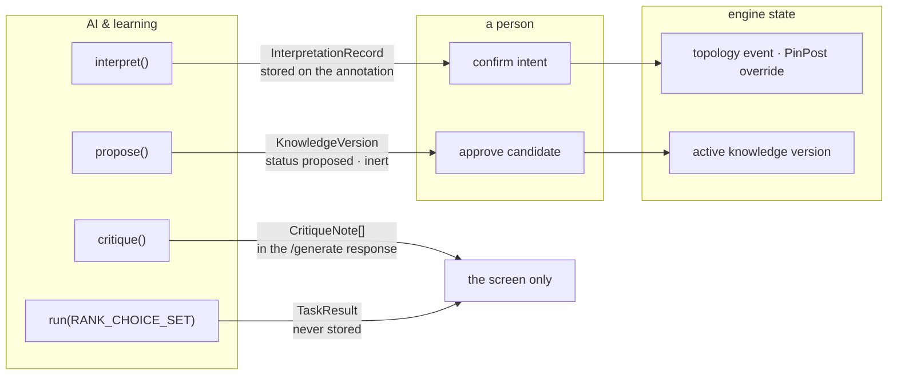
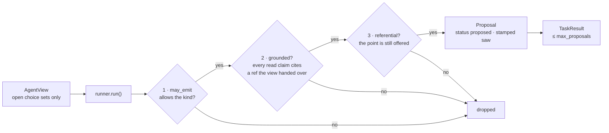

# AI and learning

The plane that answers **what a model suggests, and how an expert's correction
becomes a rule** — kept apart from the engine, which decides, and from people and
work, which owns who may act. See [`00-overview.md`](00-overview.md) for the three
planes. Its entities are drawn in [`02-entities.md`](02-entities.md) Part III and
its flows in [`03-flows.md`](03-flows.md) §AI.

Bounded roles (foundation §12): interpreter, knowledge-acquisition assistant,
critic, and — since the agent framework — a ranker of alternatives the engine
already produced. Deterministic code owns geometry, rules, arithmetic, cutting and
inventory. Decision: ADR-0009. Specs: `docs/superpowers/specs/2026-09-08-agent-framework-design.md`,
`2026-09-08-advisory-agent-design.md`. Research: `docs/research/ai-layer-landscape.md`.

| Package | Is | Imported by |
|---|---|---|
| `ai/` | the four ports, the AI record types, the stub and Claude adapters | `api` (composition); `project` imports `ai.records` only |
| `agent/` | the task table, the dispatcher and its three checks, the read-only `AgentView`, proposal types | `api`, and `ai` (the stub; the ports for types only) |
| `learning/` | `Correction`, the review rules, the portfolio impact preview | `api`, `store`, `ai` (types) |

`learning/impact.py` is shared with the engine: the same regenerate-and-diff serves
the fence-model editor (`POST /fence-models/{id}/preview-impact`) and hand-authored
rules (`POST /knowledge/preview-impact`). Only `learning/model.py` and
`learning/review.py` are specific to the learning loop.

---

## The one rule

**AI output changes no engine computation until a person confirms it.**



| Guard | Enforced by |
|---|---|
| No engine package imports an AI port, adapter or the agent; `ai.records` (the vocabulary a project stores) is the one AI module the engine may name, and it may not import the agent | `tests/architecture/test_fitness.py`: `test_no_ai_inside_deterministic_computation`, `test_only_the_api_layer_imports_the_agent` |
| The agent never reaches the store or the generator | `test_the_agent_never_reaches_the_store_or_the_generator` |
| `generate()` takes no annotation and no AI input | its signature (`strategy/generator.py:350`) |
| An interpretation changes nothing until confirmed | only `project/intents.py: confirm_intent` materialises; generation never reads annotations |
| A candidate fires nothing | `KnowledgeBase.active()` takes only `status == "active"`, and the evaluator skips `type == "candidate"` (`knowledge/evaluator.py:63`) |
| Advice cannot be performed | `select_choice_point` is registered with no capacities and no `materialize`, so `POST /actions` refuses it to everyone (`tests/commands/test_registry.py`) |
| Every port works offline | `test_every_ai_port_has_a_stub` matches each Protocol to a conforming stub |

**"A person" means any active account today.** None of the AI or learning routes
asks for a capacity — interpret, confirm, correct, propose, review and approve are
open to sales, backoffice and admin alike. Hiding the review tab from a view is CSS.
ADR-0013 records per-capacity authorization as the next slice; see
[`people-and-work.md`](people-and-work.md).

---

## Ports

Four, and these are the real signatures — `src/fenceai/ai/ports.py`. Only
`ai.records` is imported at runtime; every other type sits under `TYPE_CHECKING`.

```python
class AnnotationInterpreter(Protocol):
    interpreter_id: str
    def interpret(self, annotation: Annotation) -> InterpretationRecord: ...

class KnowledgeProposer(Protocol):
    interpreter_id: str
    def propose(self, corrections: list[Correction]) -> list[KnowledgeVersion]:
        """Returns versions with status='proposed' only — never active."""

class StrategyCritic(Protocol):
    interpreter_id: str
    def critique(self, result: GenerationResult) -> list[CritiqueNote]: ...

class TaskRunner(Protocol):
    interpreter_id: str
    def run(self, task: TaskSpec, view: AgentView, project_id: str) -> TaskResult: ...
```

The first three take exactly what they need. `TaskRunner` is the deliberate
exception: an `AgentView` is a broad, read-only window over `(Project,
GenerationResult)` that records every reference it hands over, so the dispatcher
can later check that each claim cites something the runner was actually shown.

## Adapters, and what the composition root wires

| Port | Stub (`ai/stub.py`) | Claude (`ai/claude.py`) | Wired in `lifespan` |
|---|---|---|---|
| `AnnotationInterpreter` | `StubInterpreter` | `ClaudeInterpreter` | `build_interpreter()` — Claude only when `FENCEAI_AI=claude` AND the client constructs; anything else falls back to the stub |
| `KnowledgeProposer` | `StubProposer` | — | always the stub |
| `StrategyCritic` | `StubCritic` | — | always the stub |
| `TaskRunner` | `StubAgent` | — | always the stub |

* **`StubInterpreter`** — about twenty keyword tokens, English and Hebrew, in four
  branches: a level top line, a height, privacy (a low-confidence 1800 mm), and a
  post request. It emits three of the five `IntentKind`s; everything else lands in
  `unparsed_spans`. Capped by design: it must not become a second rule engine. The
  cap is a docstring and review discipline, not a test.
* **`StubProposer`** — looks for one word, *foundation* / *יסוד*, in correction
  comments and proposes at most one candidate per project (`K-CAND-<first
  correction id>`): `type="candidate"`, `status="proposed"`, scoped to the project,
  a single `AddNote` action and no condition.
* **`StubCritic`** — one rule: `narrow_span` for a span under 500 mm, as
  `code + params`.
* **`StubAgent`** — runs only `rank_choice_set`; for each open choice set it picks
  the first non-default point and cites it with one `read` claim.
* **`ClaudeInterpreter`** — `messages.parse()` into a flat wire model
  (`_WireIntent`, `kind: str`), default model `claude-opus-5` or `FENCEAI_AI_MODEL`.
  Two attempts at building valid records, then it degrades to no candidates and the
  whole text unparsed. A candidate whose `source_text` is not in the annotation is
  dropped. Every record stamps `interpreter = "claude:<model>"`.

`GET /api/health` reports the interpreter id, and the browser smoke suite refuses
to run against a server that is not on the stub.

---

## The agent

One task today, and a dispatcher that trusts nothing the runner returns.



* **`RANK_CHOICE_SET`** (`agent/tasks.py`) reads `choice_sets`, may emit
  `select_choice_point`, at most one proposal. A choice set is alternative bay
  layouts the generator already produced and costed; the agent only orders them.
* **`run_task`** (`agent/run.py`) answers `evaluated=False` when no slice has data,
  when the runner raises, or when the runner says so. A `measured` claim is always
  refused — the agent measured nothing — and an empty claim list is ungrounded.
* **The action row lives in the desk's command table.** `agent/registry.py`
  registers `select_choice_point` as an `ActionSpec` (a `CommandSpec` plus a
  `referential` check) into `commands.registry` at import. The empty capacity set is
  what makes advice unperformable; the shared table is what will make a future
  "accept this advice" go through the same door, checks and audit as a person's
  button.
* `GET /runs/{id}/advice` refuses a moved drawing (409 `topology_changed`), stores
  nothing and audits nothing; proposal ids are content hashes, so repeated reads are
  byte-identical. The panel has no apply control and is hidden in the sales view.

---

## The learning loop

| Step | Rule | Where |
|---|---|---|
| Correct | a `Correction` pegs `generation_run_id` and a `decision_ref` or `element_ref` — both GENERATED ids, meaningful only inside that run; the author is the session | `POST /projects/{id}/corrections` |
| Propose | the proposer reads all the project's corrections; an `object_id` already present in any status is skipped; audited as `proposer:stub` | `POST /projects/{id}/propose-knowledge` |
| Preview | regenerate and re-price every project with a drawing, before and after, and diff posts, spans, warnings and BOM cents; a project already failing is `baseline_failed`, not "affected" | `POST /candidates/{id}/{v}/preview` → `learning/impact.py` |
| Review | `approve` / `scope_restrict` retire the candidate and write `v+1` as an `active` `heuristic`, `attributed_to` the reviewer; `reject` marks it `rejected`; one transaction | `POST /candidates/{id}/{v}/review` → `learning/review.py` |

`scope_restrict` must keep every existing scope dimension and add at least one.
`edit_approve` is accepted and behaves exactly like `approve`; nothing sends it.

---

## Designed, not built

* **`ExplanationWriter`** — the Tier-2 LLM polish over Tier-1 template prose. It is
  in foundation §12 and ADR-0009 and in no code; Tier-1 templates
  (`decisions/explain.py`) are the only tier that exists.
* **Claude for the other three ports.** Only the interpreter has an adapter.
* **Accepting advice.** `Proposal.status` declares `kept` and `reversed`, and nothing
  writes either; no route turns a proposal into a `Selection`. `TaskSpec.goal` and
  `TaskSpec.triggers` are declared and read by nothing.
* **Recording who proposed versus who did.** `CommandBody.origin` and the `agent:`
  actor prefix (`identity/model.py: is_agent`) exist; nothing writes them.

## Where the code is weaker than the rules above

Recorded so nobody reads the rule as the implementation:

* `confirmed_by` on `POST /intents/{id}/confirm` comes from the request body and
  becomes the materialised override's `author`; the UI never sends it, so every
  confirmation records `"user"`. The audit row beside it still names the session.
* `propose-knowledge` stores whatever the proposer returns; "proposed only" is the
  port's docstring, and no test swaps in a proposer that breaks it.
* A rejection's `reason` is discarded — `ReviewAction` is never persisted.
* The impact preview regenerates without `project.choices`, so a project whose
  choice sets were answered previews at their defaults.
* Claude transport and parse errors propagate out of `interpret` as a 500; the
  `live` pytest marker is declared and used by no test.
* **The impact preview compares two different knowledge bases** when a snapshot is
  loaded: `hypothetical_kb` rebuilds `KnowledgeBase(versions=…)` and drops
  `declined`, `admitted` and `snapshot_id`, and `declined` caps `max_span_mm` in
  generation — so "before" is capped and "after" is not, and projects can read as
  affected by a rule that did not cause the change.
* **Undo can erase a confirmed intent.** The Annotations tab confirms through the
  server and then `reloadProject()`s without `pushSnapshot`, so a later undo restores
  a snapshot from before the confirmation and deletes the materialised event or
  `PinPost` — while the intent stays `confirmed` and cannot be confirmed again. Only
  redo recovers it. This is the mutation-discipline rule broken at exactly the AI →
  engine seam.

ADR-0009 predates the agent and differs from the code in places — it lists
`ExplanationWriter` as a port, omits `TaskRunner`, and describes auto-detection and
discriminated-union wire schemas. The ADR records the decision; this page records
what was built.
