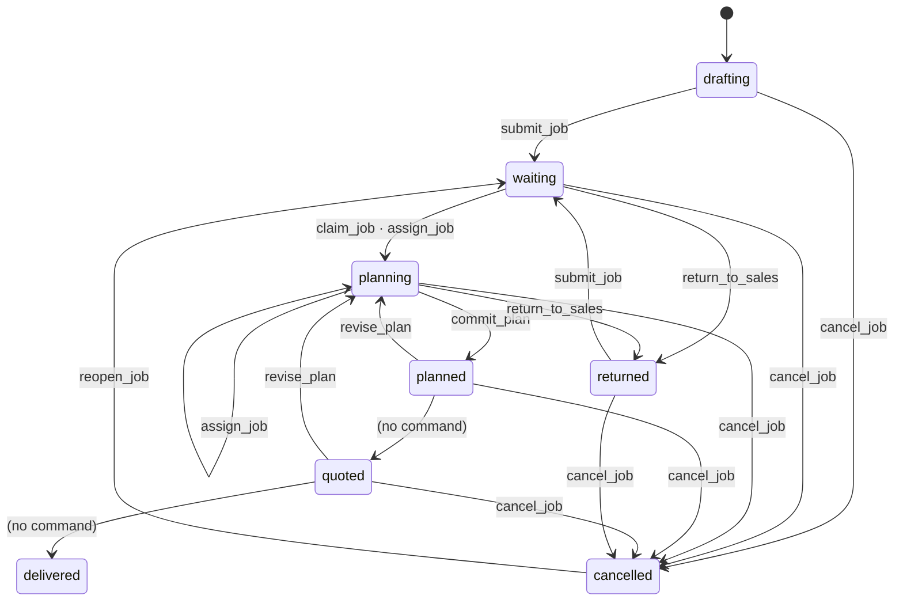
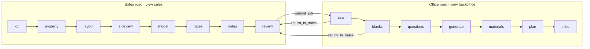

# People and work

The plane that answers **who is asking, what they may do, and where the job is**.
It never decides what a fence is — that is the engine — and it never acts on what a
model suggests — that is the AI plane. See [`00-overview.md`](00-overview.md) for
the three planes and the seams between them.

| Owns | Lives in |
|---|---|
| Who a caller is | `identity/` (ports, providers, binding) · `api/auth.py` (the gate) |
| What an account may do | `identity/model.py` (`Capacity`) · `commands/` (the per-kind table) |
| Where a job is | `project/lifecycle.py` (states, transitions) · `project/model.py` (the job fields) |
| What each desk is shown | `project/queue.py` · `report/handover.py` · `report/readiness.py` · `report/flags.py` |
| What happened, and who did it | `audit_log` via `Store.log` |
| The two roads | `web/static/js/roads.js` (data) · `road.js` · `desk-actions.js` · `my-jobs.js` · `queue.js` |

Decision: ADR-0013 (identity is delegated). Specs under
`docs/superpowers/specs/`: `2026-09-17-identity-is-googles-design.md`,
`2026-09-15-backoffice-design.md`, `2026-09-06-salesperson-road-design.md`,
`2026-09-07-eight-step-road-design.md`, `2026-09-16-office-job-screen-design.md`.

---

## Three words that are easy to confuse

| Word | Is | Checked by | Stored |
|---|---|---|---|
| **identity** | which person this request is — an email, and Google's `sub` | the gate, on every `/api` request | never; derived per request |
| **capacity** | what that person's account may do — `sales` · `backoffice` · `admin` | the gate (that one exists and is active), the command door, the two user-admin writes | `users.doc.capacity` |
| **view** | what the screen shows — `sales` · `backoffice` · `all` | nothing — it is presentation | `localStorage` (`fenceai.view`) |

**A view is derived from a capacity, one way only.** `default_view`
(`identity/model.py:141`) maps sales → sales, backoffice → backoffice,
admin → all, and only an admin may pick another (`may_choose_view`). Choosing the
`sales` view as an admin changes what is drawn and nothing the server will accept.

---

## Identity is Google's; a row holds the capacity

The request-by-request sequence is drawn in [`03-flows.md` P1](03-flows.md#p1-a-request-is-identified). The rules behind it:

* **One app-level dependency, not middleware and not per route.**
  `FastAPI(dependencies=[Depends(_gate)])` (`api/app.py:261`) copies the gate onto
  every `APIRoute` at registration. `tests/architecture/test_fitness.py` asserts it
  per route (`test_every_api_route_actually_carries_the_gate`), that nothing else
  answers under `/api`, and that the exempt list is exactly three paths.
* **Two providers, chosen by `FENCEAI_IDENTITY`, with no default.**
  `iap` verifies the signed `x-goog-iap-jwt-assertion` (ES256, `aud` checked,
  fail-closed past the key cache's grace); the plain email header is never trusted.
  `dev` reads a cookie set by `POST /api/dev/identity`, a route that exists only
  under `dev`. `DevIdentity` is to identity what the stub is to AI: what keeps the
  app working on a laptop.
* **No session table, no password.** "Session" is the derived answer of
  `GET /api/session` — the one route that answers somebody with no row, because the
  screen telling them to ask an admin has to name them.
* **Rows are created by email before the person arrives**; `subject` binds on first
  arrival and is never used to find a row. An account is deactivated, never deleted,
  because `audit_log.actor` must keep resolving to a name.
* **The first admin** comes from `FENCEAI_BOOTSTRAP_ADMIN`, which fires only while
  no ACTIVE admin exists. **The last admin** cannot be demoted or deactivated:
  `would_strand_the_admins` is evaluated inside the store's lock
  (`Store.amend_user_guarded`), answering 409 `last_admin`.

### Where capacity is actually asked — the whole list

| Where | Rule | Refusal |
|---|---|---|
| The gate | an active account with a row exists | 401 / 403 |
| `POST /api/projects/{id}/actions` | the command's `capacities` set | 403 `command_not_permitted` |
| `POST /api/users`, `PATCH /api/users/{id}` | `require_admin` | 403 `capacity_insufficient` |
| `GET /api/queue` | backoffice does not see drafts (`DRAFTS_HIDDEN_FROM`) | a filter, not a refusal |

**Everything else admits any active account** — generation, knowledge, candidates,
fence models, catalog, topology writes, the user roster, the audit log. ADR-0013
records this as the next slice rather than implying it is closed. The sales road's
drawing lock (`state.js: drawingLockedFor`) is presentation only.

### The actor is the caller

`_actor(request)` (`api/app.py:2262`) builds `user:<id>` from the gated user at every
write that names somebody, and `created_by`, `Annotation.author` and a command's
actor all come from it. Three stored fields still take a client-supplied name — an
intent's `confirmed_by`, a choice's `author`, an override's `author` — while the
audit row beside each still names the session.

---

## A job moves through eight states

The job is the `Project` document; these fields never touch `Topology`, so moving a
job never bumps the drawing's revision or stales a run.

**`quoted` and `delivered` are declared and unreachable.** `TRANSITIONS`
(`project/lifecycle.py:25`) lists `planned → quoted` and `quoted → delivered`, and
nothing performs either: creating or accepting a quote changes `Quote.status` and
never `Project.status`. Every edge out of `quoted` is therefore dead in practice.

### The command door

Every change that moves a job is a row in one table (`commands/registry.py`) reached
through one route, `POST /api/projects/{id}/actions`. Field edits — the address, the
customer — are deliberately not commands.

| Command | Capacity | From → to | Writes |
|---|---|---|---|
| `submit_job` | sales, admin | drafting, returned → waiting | `submitted_at` (restamped each time) |
| `claim_job` | backoffice, admin | waiting → planning | `assignee` = the caller |
| `assign_job` | backoffice, admin | waiting, planning → planning | `assignee` = payload (must be an active user) |
| `return_to_sales` | backoffice, admin | waiting, planning → returned | clears `assignee` and `committed_run_id`; the reason becomes a verbatim job note |
| `commit_plan` | backoffice, admin | planning → planned | `committed_run_id` |
| `revise_plan` | backoffice, admin | planned, quoted → planning | clears `committed_run_id` |
| `cancel_job` | backoffice, admin | any open state → cancelled | `closed_at` |
| `reopen_job` | backoffice, admin | cancelled → waiting | clears `assignee`, `committed_run_id`, `closed_at` |
| `acknowledge_sale` | backoffice, admin | any → unchanged | `Acknowledgement(sale_read, anchor = hash of her notes)` |
| `acknowledge_warnings` | backoffice, admin | any → unchanged | `Acknowledgement(warnings_reviewed, run_id)` |

`commands.perform` (`commands/run.py:19`) asks **capacity → performable → state →
payload → precondition**, in that order, so a refusal never tells a caller what
state a job it may not touch is in. Of the door's own refusals,
`command_wrong_state` is the one 409; the rest are 403/400/404. Only `commit_plan`
has a precondition, and it is the engine's strictest guard: the run must belong to
this job (422 `run_not_on_this_job`) and neither the drawing, the site nor the
catalog may have moved since it was generated (409 `topology_changed` ·
`site_conditions_changed` · `catalog_schema_changed` · `catalog_changed`). A success
saves the project and writes `command:<kind>` to `audit_log`; refusals are not logged.

One exception to the order: `assign_job`'s "is the assignee a real, active user"
check runs in the route before `perform`, so a salesperson asking it gets 422
`assignee_unknown` rather than 403.

**The table is shared with the agent.** `agent/registry.py` registers
`select_choice_point` into the same table with an empty capacity set and no
`materialize`, so the door refuses it to everyone. That is the seam the AI plane is
meant to reach the job through — see [`ai-layer.md`](ai-layer.md).

---

## Two roads, one job

A road is a list of steps, each naming the handover/readiness codes it owns
(`roads.js`). The road GROUPS findings and never recounts them.

| Office step | Panel | Desk acts on it |
|---|---|---|
| `sale` | canvas | `acknowledge_sale`, `return_to_sales`, `cancel_job` |
| `blanks` | canvas | `return_to_sales`, `cancel_job` |
| `questions` | canvas | — |
| `generate` | canvas | `acknowledge_warnings`, `cancel_job` (plus the Generate button, an engine call) |
| `materials` | BOM | — |
| `plan` | structure sheet | `commit_plan`, `revise_plan`, `cancel_job` |
| `price` | BOM | — (a quote is an engine write and moves no state) |

Off the road: the queue's *Take* sends `claim_job`, its finished list sends
`reopen_job`, and the review step's finish panel sends `submit_job`. `assign_job`
has no caller in the UI.

### What each desk reads

| Read model | Route | A function of | Answers |
|---|---|---|---|
| `handover_gaps` | `GET /projects/{id}/handover` | the project only — no run | what the salesperson left unsaid, before a strategy makes a default look decided |
| `readiness` | `GET /projects/{id}/readiness` | the stored run, its supply, quotes — no knowledge base | what the office still has to do; nothing is `blocking` |
| `job_flags` | `GET /projects/{id}/flags` | the two above and the stored run's warnings, placed on the drawing | where each finding is; never 409s |
| `section_facts` | `GET /projects/{id}/sections` | the topology only — an **engine** read model the office's job screen reads | what each stretch is; never stale |
| `select_rows` | `GET /queue` | stored job fields + `handover_gaps` per row | what to work on next; paged |
| `my_jobs` | `GET /my-jobs` | jobs where `created_by` is the caller | her jobs, in sales words, with the office's latest note |

All six are derived and never stored, and live in `report/` and `project/queue.py`
because they are pure functions — the plane is about whom they serve, not where the
code sits.

---

## The seams

**With the engine.** The people plane reaches the engine at four places, and only
`commit_plan` changes anything the engine reads:

* `commit_plan` names a `GenerationRun` and re-checks the run against the drawing,
  site and catalog before recording it.
* `/readiness` and `/flags` run the engine's pricing pipeline
  (`fulfillment.pipeline.price_strategy`) and report `supply_unknown` instead of
  refusing when the run cannot be priced.
* `handover_gaps` reads topology stationing and the generator's `DEFAULT_POLICY` —
  pure functions and a constant, no generation.
* The office's Generate is a plain engine call: `POST /generate` checks no capacity
  and no job state.

**With the AI plane.** The agent registers into the command table (above) and reads
`Project.choices` through its `AgentView`. `CommandBody.origin` and the
`agent:` actor prefix (`identity/model.py: is_agent`) are the reserved place to
record "an agent proposed this, a person did it" — both exist and neither is written
by anything today.

**Package edges.** `project/queue.py` imports `report.handover`, and
`report/handover.py` / `report/readiness.py` import `project.model` — the two
packages depend on each other, which is one of the reasons the package graph is a
single cycle (see [`01-domains.md`](01-domains.md)).
